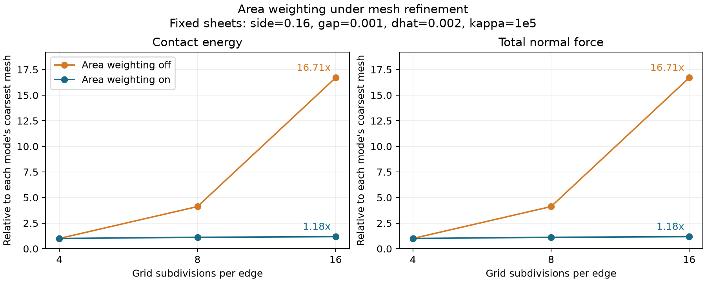

# Area weighting under mesh refinement

[Back to Contact](./index.md)

Two parallel square sheets occupy the same fixed geometry at every resolution.
Each sheet has side length `0.16`, their gap is `0.001`, and native IPC uses
`dhat=0.002` and the same numerical `kappa=1e5`. The grids have 4, 8 and 16
subdivisions per edge: 64, 256 and 1024 triangles across both sheets.

For each grid, the example evaluates the raw contact energy and gradient with
`use_area_weighting=False`, then with `True`. The reported normal force is
the magnitude of the summed z-gradient on the lower sheet. Both programs check
that energy and force are finite and positive and the sheets' normal forces
balance. No equilibrium solve, parameter fitting or barrier normalization is
performed, so this isolates the contact discretization from elastic mesh errors.



The unweighted energy and force grow by about **16.71 times** from the coarse to
the fine grid; with reference-area weighting they grow by about **1.18 times**.
Area weighting reduces mesh sensitivity in this example, but finite patch
boundaries and the discrete candidate sum still matter. This is not a proof of
mesh convergence or a calibration of contact stiffness.

The plot divides each mode's energy and force by its own coarsest-grid value
for display only. The CSV retains the actual `kappa`-scaled values. The same
numerical `kappa` in the two modes has different units because area weights
carry units of length squared; absolute force magnitudes should not be read as
an equivalently calibrated physical comparison.

All commands below run from the litepgo repository root after building:

```sh
cmake --build build/release --target contact_area_weighting litepgo_python
build/release/examples/contact/contact_area_weighting
PYTHONPATH=build/release/python uv run --no-sync python examples/contact/contact_area_weighting.py
```

The default CSV paths are `output/contact_area_weighting.csv` in C++ and
`output/python/contact_area_weighting.csv` in Python. Both accept an optional
output CSV path as their first argument. Columns contain grid subdivisions,
grid edge length, total triangles, the area-weighting flag, contact energy and
total normal force.

Use the separate plot script with either CSV. Matplotlib is supplied by the
optional `plot` dependency group, as for the other plotting examples:

```sh
uv sync --locked --group plot
uv run --no-sync python examples/contact/plot_contact_area_weighting.py \
  output/python/contact_area_weighting.csv
```

The PNG defaults to the CSV's stem. Use `--output path/to/comparison.png` to
choose another destination.

::: details Complete Python source — `contact_area_weighting.py`

<<< ../../../examples/contact/contact_area_weighting.py

:::

::: details Complete C++ source — `contact_area_weighting.cpp`

<<< ../../../examples/contact/contact_area_weighting.cpp

:::
