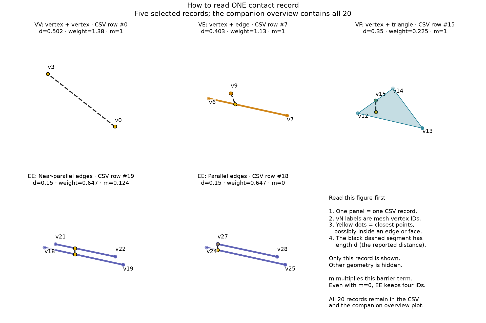
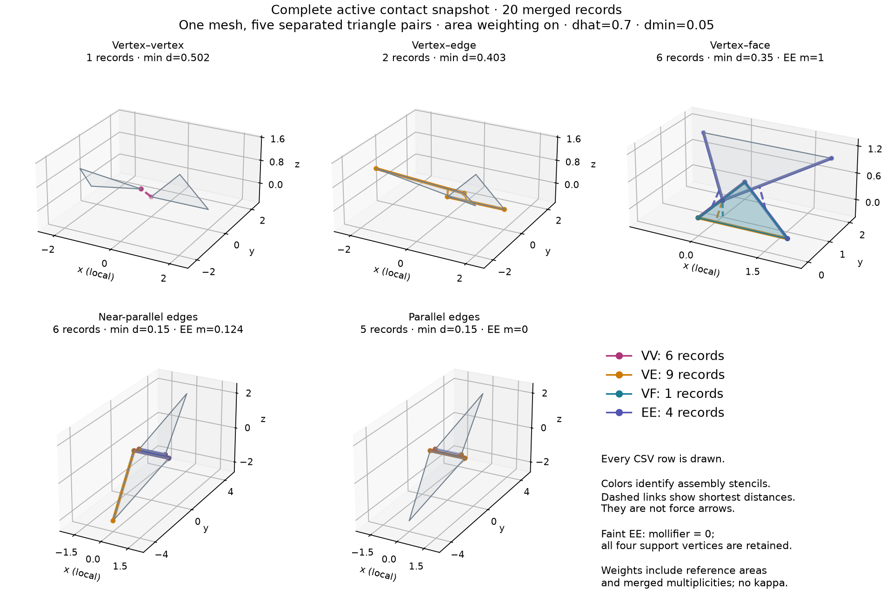

# Read-only active contact snapshot

[Back to Contact](./index.md)

The C++ and Python programs build **one mesh** containing five separated pairs
of triangles. They exercise VV, VE, VF, near-parallel EE and exactly parallel EE
contact. Each upper triangle moves down by `0.05` from its rest position before
querying native IPC with `dhat=0.7`, `min_distance=0.05` and default reference-area
weighting. No equilibrium solve or Hessian pattern update is needed.

## Reading a record

Start with the detail figure: **each panel shows just one selected CSV record**.
The `vN` labels identify its original mesh vertices. Yellow dots mark the closest
points, which need not be mesh vertices. The black dashed segment has the
reported length `distance`; it is not a force arrow.



For example, the VF panel shows vertex `v15` against the triangle with vertices
`v12`, `v13`, `v14`. Its CSV record is `VF,15,12,13,14,...`, with distance `0.35`.
The upper closest point is `v15`; the lower one is inside the triangle. A VE
record similarly stores one point followed by the edge's two endpoints. An EE
record stores the endpoints of two edges, even when the shortest connection
touches an endpoint or its mollifier `m` is zero. `m` multiplies the barrier term;
it does not measure the distance or determine whether the record is retained.

## Complete active set

The overview adds the other mesh geometry and draws every record together.
Its panel titles identify intended geometric scenarios, so a panel can contain
several record types. Use the detail figure to learn the field meanings and the
overview to inspect the full active set.



Both programs export all **20 merged active records**: 6 VV, 9 VE, 1 VF and 4 EE.
One EE has mollifier zero and remains in the snapshot with all four support
vertices. The programs check that the count and minimum distance agree with
the existing diagnostics and the Hessian pattern stays empty. A scenario can
have several closest-feature types; the panel title identifies its intended
geometric configuration, not a filter on exported records.

## Run and plot

From the litepgo repository root after configuring the release build:

```sh
cmake --build build/release --target contact_snapshot litepgo_python
build/release/examples/contact/contact_snapshot
PYTHONPATH=build/release/python uv run --no-sync python examples/contact/contact_snapshot.py
```

C++ writes `output/contact_snapshot/`; Python writes
`output/python/contact_snapshot/`. Pass an optional output directory as the
first argument to either program. Each directory contains:

- `mesh.obj`: the complete mesh at the **queried current positions**, with original vertex IDs.
- `contacts.csv`: `type,v0,v1,v2,v3,distance,weight,mollifier`, one row per active assembly record; unused IDs are `-1`.

Use either directory with the separate plotting script (Matplotlib comes from
the optional `plot` dependency group):

```sh
uv run --no-sync python examples/contact/plot_contact_snapshot.py output/python/contact_snapshot
```

The script writes `contacts.png` (all records) and `contacts_details.png` (one
selected record per scene). Override the overview path with
`--output path/to/snapshot.png`; the detail path then becomes
`path/to/snapshot_details.png`. This script expects the example's five scenes.
The overview draws **every exported row**, including zero-mollifier EE. Dashed
lines connect actual closest points; their lengths are checked against the CSV
distances. For parallel overlapping edges the closest points are not unique;
the plot chooses one valid pair. Coordinates are translated locally per panel.

## API contract

```python
snapshot = barrier.contact_snapshot(current_surface_positions.ravel())
```

The input contains every contact-mesh vertex in its original numbering. For
volume displacements, first evaluate the surface map `x_s = X_s + W @ u`.
The queried positions can differ from the reference surface. The result owns
its data independently of the energy, input and subsequent queries. Python
arrays are read-only views that keep the snapshot alive; `types` is a tuple.

| Field | Shape | Meaning |
| --- | --- | --- |
| `positions` | `(N, 3)` | All current surface vertices, copied from the input |
| `types` | `M` | `VV`, `VE`, `VF` or `EE` |
| `vertex_ids` | `(M, 4)` | VV: two vertices; VE: vertex then edge; VF: vertex then face; EE: two edges; pad with `-1` |
| `distances` | `(M,)` | Unsquared distance `d`, without subtracting `min_distance` |
| `weights` | `(M,)` | Sum of candidate area weights (or one without area weighting) times optional group multipliers; excludes kappa and mollifiers |
| `mollifiers` | `(M,)` | EE mollifier; one for other types |

Mollified EE always retains its four-vertex stencil, even when the closest
distance feature is VV or VE. `M == barrier.num_active_pairs(x)`. With no active
records, arrays have zero rows, `types == ()`, and `min_active_distance(x)` is
positive infinity. Queries validate input as the existing active-set diagnostics
do; they do not update the Hessian pattern or solver state. C++ returns an owned
`contact::ContactSnapshot` value whose fields callers may modify locally.

The optional IPC Toolkit backend exposes the same method and fields. Ordering
is backend-specific; row numbers are not persistent contact IDs. A snapshot
observes the assembled active set, not every broad-phase candidate. It is not
a collision-freedom certificate and does not provide contact pressure or force.
Queries rebuild the active set and copy its data on demand; they are intended
for diagnostics/export, rather than implicit work at every energy evaluation.

::: details Complete Python source — `contact_snapshot.py`

<<< ../../../examples/contact/contact_snapshot.py

:::

::: details Complete C++ source — `contact_snapshot.cpp`

<<< ../../../examples/contact/contact_snapshot.cpp

:::

::: details Complete plot source — `plot_contact_snapshot.py`

<<< ../../../examples/contact/plot_contact_snapshot.py

:::
