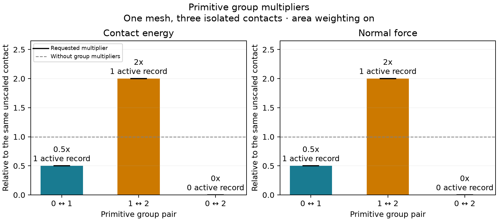

# Three primitive groups

[Back to Contact](./index.md)

One mesh contains three separated pairs of triangles, with group pairs `(0, 1)`,
`(1, 2)` and `(0, 2)`. The geometry and gap are identical in all three scenes.
Each has a single active VF record with `dhat=0.7`, `min_distance=0.05` and default
reference-area weighting. The symmetric group table requests multipliers
`0.5`, `2` and `0` respectively.



The C++ and Python programs evaluate the whole mesh with and without group
multipliers. Both check that the energy and normal force of each scene scale by
its table entry, its active-record count is `1`, `1` or `0`, and the snapshot's
per-scene energy contributions sum to the actual energy. The normal force is
the magnitude of the summed z-gradient on the upper triangle. This example
evaluates prescribed positions without an equilibrium solve.

The tags are arbitrary integers rather than built-in owned/ghost roles. Every
triangle here has uniform vertex tags, so the example can assign its edges the
same tag. General callers, especially periodic bands, must explicitly determine
the groups of vertices, edges and faces separately. See the
[API and zero-multiplier contract](../../guide/contact/pair-weights.md).

## Run and plot

From the litepgo repository root after configuring the release build:

```sh
cmake --build build/release --target contact_pair_weights litepgo_python
build/release/examples/contact/contact_pair_weights
PYTHONPATH=build/release/python uv run --no-sync python examples/contact/contact_pair_weights.py
```

C++ writes `output/contact_pair_weights.csv`, Python writes
`output/python/contact_pair_weights.csv`. Each accepts an output CSV path as its
first argument. Columns contain pair index, both group IDs, requested multiplier,
reference/group-weighted energy and normal force, and the weighted active count.

Use either CSV with the separate plot script (Matplotlib is in the optional
`plot` dependency group):

```sh
uv run --no-sync python examples/contact/plot_contact_pair_weights.py \
  output/python/contact_pair_weights.csv
```

The PNG defaults to the input stem; choose another path with `--output`.
Bars show the ratio to each scene's own reference value. Black markers show the
requested multiplier and the dashed line denotes multiplier one.

::: details Complete C++ source — `contact_pair_weights.cpp`

<<< ../../../examples/contact/contact_pair_weights.cpp

:::

::: details Complete Python source — `contact_pair_weights.py`

<<< ../../../examples/contact/contact_pair_weights.py

:::

::: details Complete plot source — `plot_contact_pair_weights.py`

<<< ../../../examples/contact/plot_contact_pair_weights.py

:::
