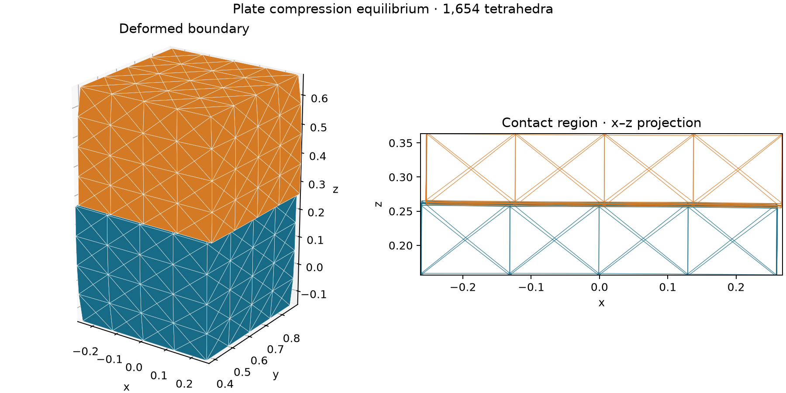

# Compression between penalty plates

[Back to Contact](./index.md)

Contact uses the default fixed reference-area weighting. Its coefficient is
set directly on the raw barrier energy; no normalization conversion is applied.

Two tetrahedral boxes start with a small gap along z. Place the bottom and top
plates inside the outer faces by 20% of one box height, then solve for static
equilibrium. The lateral DOFs on the outer faces are fixed to suppress rigid
motion. Their z coordinates remain free, so the plates load the stack through
their penalty forces.

The solver minimizes a `WeightedEnergySum` of the Neo-Hookean elastic energy,
native IPC self-contact, and two `PlanePenaltyEnergy` terms. The Lamé
parameters are $(\lambda,\mu)=(0.5,0.75)$. The three surface
terms share the affine map from volume displacements to current boundary
positions. The bottom plate penalizes vertices below it, and the top plate
penalizes vertices above it. The plate stiffness is set on each penalty energy.
The IPC stiffness is set by its weight in the sum.

The IPC barrier activates at 0.4% of one box height. Its weight is `1e7` for
this mesh and loading. The boxes remain positively separated at equilibrium,
so the contact-region plot can show a thin gap while the barrier carries load.

Both programs check that Newton converges, both plates exert load, and the two
boxes come within the IPC activation distance with positive separation. They
print the penalty energies and minimum active contact distance, then write a
deformed VEG and boundary OBJ. The default output stem is
`output/tet_p1_plate_compression` in C++ and
`output/python/tet_p1_plate_compression` in Python. Both programs accept optional
input and output VEG paths.



```sh
cmake --build build/release --target tet_p1_plate_compression litepgo_python
build/release/examples/contact/tet_p1_plate_compression
PYTHONPATH=build/release/python uv run --no-sync python examples/contact/tet_p1_plate_compression.py
```

After either run, use the separate plotting script to read the deformed VEG
and its same-stem OBJ. It writes a PNG beside the input with a 3D boundary view
and an x–z projection of the contact region.

```sh
uv sync --locked --group plot
PYTHONPATH=build/release/python uv run --no-sync python examples/contact/plot_tet_p1_plate_compression.py \
  output/python/tet_p1_plate_compression.veg
```

For C++ output, pass `output/tet_p1_plate_compression.veg` instead. Use
`--output path/to/result.png` to choose another destination.

::: details Complete Python source — `tet_p1_plate_compression.py`

<<< ../../../examples/contact/tet_p1_plate_compression.py

:::

::: details Complete C++ source — `tet_p1_plate_compression.cpp`

<<< ../../../examples/contact/tet_p1_plate_compression.cpp

:::
