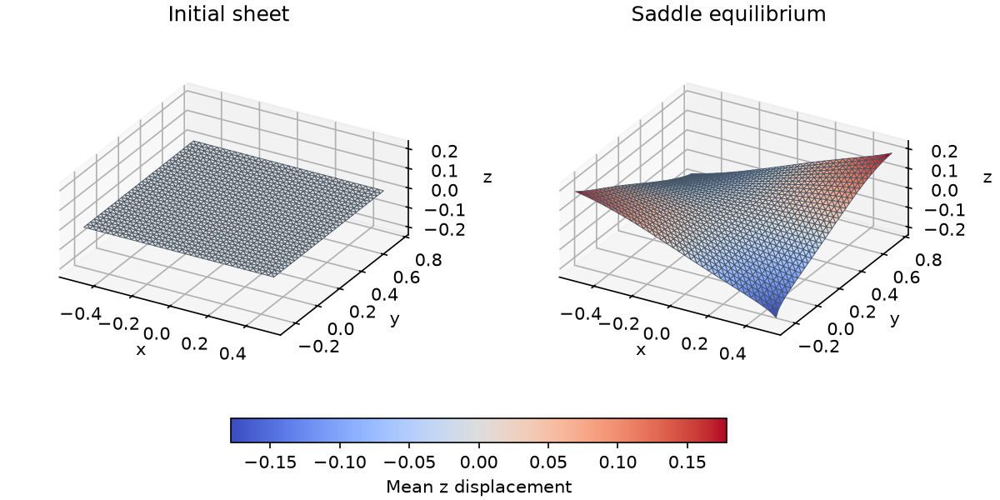

# Elastic equilibrium with soft corner loads

The four examples minimize total potential from zero displacement:

$$
\Pi(u)=E_{\rm elastic}(u)+\frac{k}{2}\sum_{i\in\mathcal C}\|u_i-t_i\|^2.
$$

Here $\mathcal C$ is the pulled-corner set and $t_i$ is an anchor displacement,
not an absolute position. The springs remove rigid motions; the examples use
`DofReduction(num_dofs, [])`, with no hard constraints. `WeightedEnergySum`
combines elastic and spring energies; Newton uses projected element Hessians,
feasible steps, and free-gradient tolerance $10^{-8}$.

For solids, $F=I+\nabla_Xu$, $F_p=I$, $(\lambda,\mu)=(2,3)$, and

$$
E_{\rm elastic}=\sum_{e,q}w_q\det J_X\,
\left[\frac\mu2(\|F\|_F^2-3)-\mu\log\det F
+\frac\lambda2(\log\det F)^2\right].
$$

All four accept optional input and output paths, in that order. Defaults use
bundled assets. C++ writes `output/<name>.veg` (or `.obj` for shell), Python
`output/python/<name>.*`; volume cases also write boundary OBJ beside VEG.
Rerunning replaces these files. Exit status reports convergence. Printed potential,
elastic/pulling energies, free residual, and corner-to-anchor gap help interpret
soft-load equilibrium; the gap need not be zero.

All commands run from the repository root after [configuring the release build](../guide/build.md). Python commands explicitly select that build. Expand the source sections for complete programs, including imports, setup, checks, and output handling.

## Tet P1 corner pull

**Problem.** Read `assets/box-tet.veg` and pull its eight bounding-box corners
toward an enlarged box. For the minimum corner $X_{\min}$,

$$
t_i=0.3(X_i-X_{\min}),\qquad k=1.
$$

The minimum corner's anchor remains at its rest position. Geometry and
displacement are Tet P1, so $F$ is elementwise constant and the centroid rule
integrates this density exactly for each fixed material element.

**API walkthrough.** `read_veg` supplies rest positions and topology.
`VertexDofMap(topology,3)` gathers coordinate and displacement data.
`InterpolatedField3D[TetP1Basis]` constructs rest fields;
`IdentityField3D` supplies $F_p=I$ and $\theta=(2,3)$.
Instantiate `VolumetricFemEnergy[NeoHookean,TetP1Basis,TetCentroidQuadrature]`,
add `VertexPullingEnergy`, and call `newton_solve` on their sum.

**Expected result.** A converged expanded shape, residual within tolerance,
and exported VEG/OBJ. Corners approach but do not exactly meet the anchors:
elastic restoring forces balance the springs. Input must have positive extent
in all axes and exactly the eight expected bounding-box corners.

### Run and inspect

```sh
cmake --build build/release --target tet_p1_corner_pull litepgo_python
build/release/examples/fem/equilibrium/tet_p1_corner_pull
PYTHONPATH=build/release/python uv run --no-sync python examples/fem/equilibrium/tet_p1_corner_pull.py
```

::: details Complete Python source — `tet_p1_corner_pull.py`

<<< ../../examples/fem/equilibrium/tet_p1_corner_pull.py

:::

::: details Complete C++ source — `tet_p1_corner_pull.cpp`

<<< ../../examples/fem/equilibrium/tet_p1_corner_pull.cpp

:::


## Hex Q1 corner pull

**Problem.** Apply the same $t_i=0.3(X_i-X_{\min})$, $k=1$ loads to
`assets/box-hex.veg`. Geometry and displacement are trilinear Q1; integration uses
`GaussLegendre3D[2]`, eight points per element.

**API walkthrough.** Use `VertexDofMap(topology,3)` and Q1 rest fields, then
`VolumetricFemEnergy[NeoHookean,HexQ1Basis,GaussLegendre3D[2]]`.
The spring composition, empty hard-constraint set, and Newton call match the tet
case. Keep geometry fields in element connectivity order.

**Expected result.** A converged pulled box with valid deformed meshes and a
small free residual. Unlike Tet P1, the quadrature-point determinant checks are
not a proof of injectivity everywhere inside a general trilinear element.
The output surface connects deformed corner positions.

### Run and inspect

```sh
cmake --build build/release --target hex_q1_corner_pull litepgo_python
build/release/examples/fem/equilibrium/hex_q1_corner_pull
PYTHONPATH=build/release/python uv run --no-sync python examples/fem/equilibrium/hex_q1_corner_pull.py
```

::: details Complete Python source — `hex_q1_corner_pull.py`

<<< ../../examples/fem/equilibrium/hex_q1_corner_pull.py

:::

::: details Complete C++ source — `hex_q1_corner_pull.cpp`

<<< ../../examples/fem/equilibrium/hex_q1_corner_pull.cpp

:::


## Hex Hermite corner pull

**Problem.** Use Q1 rest geometry and cubic Hermite displacement on
`assets/box-hex.veg`, with the same corner loads. There are 24 physical scalar
DOFs per vertex, and `GaussLegendre3D[4]` gives 64 integration points per element.

**API walkthrough.** Coordinate data uses a width-3 vertex map. Displacement
uses `VertexDofMap(topology,24)` and
`VolumetricFemEnergy[NeoHookean,HexHermiteBasis,GaussLegendre3D[4]]`.
The energy transforms physical derivative slots to reference coefficients and
pulls derivatives back. Spring DOFs are `24*v + {0,1,2}`; all derivative slots
remain free. Read [the physical-DOF convention](../guide/fem/hermite.md) before
changing these offsets.

**Expected result.** Converged equilibrium with a small free residual. Positive
axis-aligned affine rest boxes are required. VEG and ordinary extracted OBJ
store the displaced corners, not the full curved Hermite field; sampled-surface
output is demonstrated by the Hermite plastic-twist case.

### Run and inspect

```sh
cmake --build build/release --target hex_hermite_corner_pull litepgo_python
build/release/examples/fem/equilibrium/hex_hermite_corner_pull
PYTHONPATH=build/release/python uv run --no-sync python examples/fem/equilibrium/hex_hermite_corner_pull.py
```

::: details Complete Python source — `hex_hermite_corner_pull.py`

<<< ../../examples/fem/equilibrium/hex_hermite_corner_pull.py

:::

::: details Complete C++ source — `hex_hermite_corner_pull.cpp`

<<< ../../examples/fem/equilibrium/hex_hermite_corner_pull.cpp

:::


## Shell saddle pull

**Problem.** Read the flat xy sheet in `assets/shell.obj`. With center $c$
and in-plane bounding size $s$, set four corner displacement targets

$$
t_i=\left(0.1(X_{i,x}-c_x),\ 0.1(X_{i,y}-c_y),\
0.2s\,\operatorname{sign}[(X_{i,x}-c_x)(X_{i,y}-c_y)]\right),\quad k=10.
$$

Thickness is $t=0.1$, Young's modulus $Y=100$, and Poisson ratio
$\nu=0.3$. Convert to $\lambda_{ps}=Y\nu/(1-\nu^2)$ and
$\mu=Y/[2(1+\nu)]$. Per-face elastic energy is

$$
A_0\left[t\psi((a-\bar a)/2)+\frac{t^3}{12}\psi(b-\bar b)\right],\quad
\psi(S)=\frac{\lambda_{ps}}2[\operatorname{tr}(\bar a^{-1}S)]^2
+\mu\operatorname{tr}(\bar a^{-1}S\bar a^{-1}S).
$$

The [shell guide](../guide/fem/shell.md) defines the discrete forms and exact
kinematic derivatives.

**API walkthrough.** Build triangle mid-edge stencils, a width-3
`StencilDofMap`, and `TriangleMidEdgeRestData` per face.
`ShellFemEnergy[KoiterStVK]` supplies elastic terms and geometric step bounds.
Add corner springs and solve with the same empty hard-constraint set.

**Expected result.** A saddle-shaped equilibrium OBJ, converged free residual,
and finite elastic/pulling energies. Input must be a nonempty flat xy sheet
with the four expected corners. Springs are soft loads; they do not impose
clamped shell boundary directors or provide self-contact.



### Run and inspect

```sh
cmake --build build/release --target shell_saddle_pull litepgo_python
build/release/examples/fem/equilibrium/shell_saddle_pull
PYTHONPATH=build/release/python uv run --no-sync python examples/fem/equilibrium/shell_saddle_pull.py
```

Render the initial and deformed OBJs with a shared view and color scale.

```sh
uv sync --locked --group plot
PYTHONPATH=build/release/python uv run --no-sync python examples/fem/equilibrium/plot_shell_saddle_pull.py \
  assets/shell.obj output/python/shell_saddle_pull.obj
```

::: details Complete Python source — `shell_saddle_pull.py`

<<< ../../examples/fem/equilibrium/shell_saddle_pull.py

:::

::: details Complete C++ source — `shell_saddle_pull.cpp`

<<< ../../examples/fem/equilibrium/shell_saddle_pull.cpp

:::
