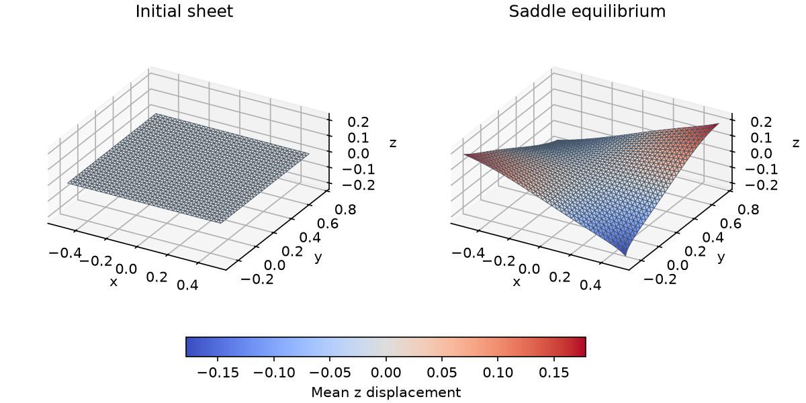

# Shell saddle pull

[Back to Elastic equilibrium](./index.md)

**Problem.** Read the flat xy sheet in `assets/shell.obj`. With center $c$
and in-plane bounding size $s$, set four corner displacement targets

$$
t_i=\left(0.1(X_{i,x}-c_x),\ 0.1(X_{i,y}-c_y),\
0.2s\,\operatorname{sign}[(X_{i,x}-c_x)(X_{i,y}-c_y)]\right),\quad k=10.
$$

Thickness is $t=0.1$, Young's modulus $Y=100$, and Poisson ratio
$\nu=0.3$. Convert to $\lambda_{ps}=Y\nu/(1-\nu^2)$ and
$\mu=Y/[2(1+\nu)]$. Per-face elastic energy is

$$
A_0\left[t\psi((a-\bar a)/2)+\frac{t^3}{12}\psi(b-\bar b)\right],\quad
\psi(S)=\frac{\lambda_{ps}}2[\operatorname{tr}(\bar a^{-1}S)]^2
+\mu\operatorname{tr}(\bar a^{-1}S\bar a^{-1}S).
$$

The [shell guide](../../guide/fem/shell.md) defines the discrete forms and exact
kinematic derivatives.

**API walkthrough.** Build triangle mid-edge stencils, a width-3
`StencilDofMap`, and `TriangleMidEdgeRestData` per face.
`ShellFemEnergy[KoiterStVK]` supplies elastic terms and geometric step bounds.
Add corner springs and solve with the same empty hard-constraint set.

**Expected result.** A saddle-shaped equilibrium OBJ, converged free residual,
and finite elastic/pulling energies. Input must be a nonempty flat xy sheet
with the four expected corners. Springs are soft loads; they do not impose
clamped shell boundary directors or provide self-contact.



## Run and inspect

```sh
cmake --build build/release --target shell_saddle_pull litepgo_python
build/release/examples/fem/equilibrium/shell_saddle_pull
PYTHONPATH=build/release/python uv run --no-sync python examples/fem/equilibrium/shell_saddle_pull.py
```

Render the initial and deformed OBJs with a shared view and color scale.

```sh
uv sync --locked --group plot
PYTHONPATH=build/release/python uv run --no-sync python examples/fem/equilibrium/plot_shell_saddle_pull.py \
  assets/shell.obj output/python/shell_saddle_pull.obj
```

::: details Complete Python source — `shell_saddle_pull.py`

<<< ../../../examples/fem/equilibrium/shell_saddle_pull.py

:::

::: details Complete C++ source — `shell_saddle_pull.cpp`

<<< ../../../examples/fem/equilibrium/shell_saddle_pull.cpp

:::
