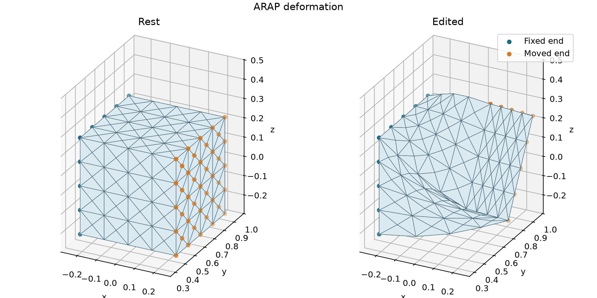

# ARAP local-global deformation

[Back to Mesh optimization](./index.md)

**Problem.** Let $p_{ij}=p_i-p_j$, $d_{ij}=x_i-x_j$, and $R_i$ be
proper rotations. Minimize

$$
E(x,R)=\frac14\sum_{\{i,j\}}
\left(\|d_{ij}-R_ip_{ij}\|^2+\|d_{ij}-R_jp_{ij}\|^2\right).
$$

The local step takes $S_i=\sum_jd_{ij}p_{ij}^T=U\Sigma V^T$ and
$R_i=U\operatorname{diag}(1,1,\det(UV^T))V^T$, excluding reflections.
During the global solve rotations are fixed. With $B=[I_3,-I_3]$,
$r_i=d-R_ip$, and $r_j=d-R_jp$,

$$
g_e=\tfrac12B^T(r_i+r_j),\qquad H_e=B^TB.
$$

The assembled global Hessian is $L\otimes I_3$. Alternate until the largest
coordinate update is below $10^{-8}$, with a 1,000-iteration cap.

**API walkthrough.** An edge map drives `MeshEnergy`. Each global iteration
captures its rotation array, then calls constrained Newton. The left edge stays
at rest; the right edge is rotated/translated before those positions are fixed.
Rotations are refitted only after the global solve.

**Expected result.** Rigid-motion invariance, energy descent, exact handles,
and interior displacement are checked. Output reports iteration count, energy
decrease, and update size. An optional output-directory argument replaces
`output/cpp/arap/` or `output/python/arap/`, containing `rest.obj`, `handles.obj`,
and `edited.obj`. This is a local alternating solution, with no global-optimality,
volume-preservation, injectivity, or collision guarantee.



The Python volume example fits rotations using all tetrahedral edges. It fixes
one x end face and rotates the other 60° around x while lifting it by a quarter
of the box width. The program exports the full tetrahedral states as VEG and
their boundaries as OBJ.

## Run and inspect

```sh
cmake --build build/release --target arap litepgo_python
build/release/examples/mesh/arap
PYTHONPATH=build/release/python uv run --no-sync python examples/mesh/arap.py
```

The plot script reads `rest.obj` and `edited.obj` from either language's output
directory. It uses the same view and scale in both panels and marks the two
handle edges or end faces.

```sh
uv sync --locked --group plot
PYTHONPATH=build/release/python uv run --no-sync python examples/mesh/plot_arap.py output/python/arap
```

```sh
PYTHONPATH=build/release/python uv run --no-sync python examples/mesh/arap.py \
  output/python/arap_volume --volume assets/box-tet.veg
PYTHONPATH=build/release/python uv run --no-sync python examples/mesh/plot_arap.py output/python/arap_volume
```

::: details Complete Python source — `arap.py`

<<< ../../../examples/mesh/arap.py

:::

::: details Complete C++ source — `arap.cpp`

<<< ../../../examples/mesh/arap.cpp

:::
