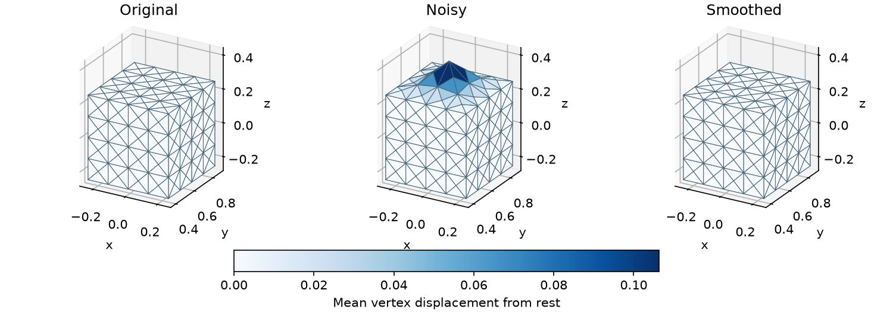

# Laplacian smoothing and editing

[Back to Mesh optimization](./index.md)

**Problem.** Let $L_{ii}=|N(i)|$, $L_{ij}=-1$ for neighbors, and
$K=L\otimes I_3$. Smoothing minimizes

$$
E_s(x)=\tfrac12x^TKx=\tfrac12\sum_{\{i,j\}}\|x_i-x_j\|^2
$$

with the whole boundary fixed at rest. Interior heights are perturbed. The
free equilibrium is the original flat grid. Editing instead preserves rest
coordinates $p$ through

$$
E_d(x)=\tfrac12\|Kx-Kp\|^2.
$$

The left edge stays at rest and the right edge is lifted by 0.5. A one-ring
residual is $r_i=\sum_j[(x_i-x_j)-(p_i-p_j)]$. With
$B_i=[|N(i)|I_3,-I_3,\ldots]$, local derivatives are $B_i^Tr_i$ and
$B_i^TB_i$. Squaring the whole one-ring sum preserves cross-neighbor terms;
the global editing Hessian is $K^TK$.

**API walkthrough.** Edge stencils `[i,j]` supply smoothing terms. One-ring
stencils `[i,*N(i)]` supply editing terms. The callback returns values `(B,)`,
gradients `(B,n)`, and stacked Hessians `(B*n,n)`. `DofReduction` selects fixed
coordinate indices; each initial position vector supplies the handle values.
Newton solves the quadratic free systems.

**Expected result.** Assertions check the flat result, exact handles, energy
reduction, and interior movement. An optional output-directory argument replaces
`output/cpp/laplacian_optimization/` or `output/python/laplacian_optimization/`.
Files are `rest.obj`, `noisy.obj`, `smoothed.obj`, `handles.obj`, and `edited.obj`;
rerunning replaces them. Uniform smoothing can shrink geometry. Editing is not
rotation invariant, and neither objective prevents collisions or inversion.



The Python volume example uses the 827-tetrahedron box in `assets/box-tet.veg`.
It raises a ripple on the top face by up to 32% of the box height, holds the
side and bottom faces fixed, and smooths displacements relative to the rest
mesh. The plot shows the exterior at the same scale in all three states and
colors it by displacement from rest. VEG files contain the full volume.

## Run and inspect

```sh
cmake --build build/release --target laplacian_optimization litepgo_python
build/release/examples/mesh/laplacian_optimization
PYTHONPATH=build/release/python uv run --no-sync python examples/mesh/laplacian_optimization.py
```

Pass either example's output directory to the separate plot script. It reads
`rest.obj`, `noisy.obj`, and `smoothed.obj` and writes
`laplacian_optimization.png` in that directory.

```sh
uv sync --locked --group plot
PYTHONPATH=build/release/python uv run --no-sync python examples/mesh/plot_laplacian_optimization.py \
  output/python/laplacian_optimization
```

To reproduce the volume figure, use the tetrahedral input and a separate output
directory.

```sh
PYTHONPATH=build/release/python uv run --no-sync python examples/mesh/laplacian_optimization.py \
  output/python/laplacian_optimization_volume --volume assets/box-tet.veg
PYTHONPATH=build/release/python uv run --no-sync python examples/mesh/plot_laplacian_optimization.py \
  output/python/laplacian_optimization_volume
```

::: details Complete Python source — `laplacian_optimization.py`

<<< ../../../examples/mesh/laplacian_optimization.py

:::

::: details Complete C++ source — `laplacian_optimization.cpp`

<<< ../../../examples/mesh/laplacian_optimization.cpp

:::
