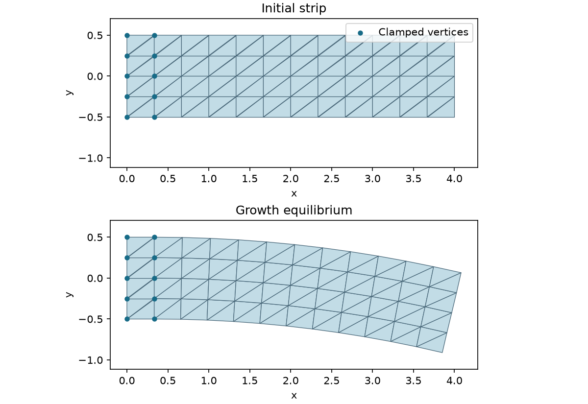

# Differential shell growth

[Back to Prescribed plastic fields](./index.md)

**Problem.** Generate a 4-by-1 xy strip with 65 vertices and 96 triangles.
Clamp its first two vertex columns, fixing both position and the strip direction.
With face-centroid coordinate $y_e$, prescribe

$$
F_{p,e}(\alpha)=\operatorname{diag}(e^{2\alpha y_e},1,1),\qquad
\alpha:0\longrightarrow0.04.
$$

The two sides acquire different natural in-plane lengths. For each original
stencil, define $Y_i=F_{p,e}(X_i-X_0)$, take natural forms from $Y$, and
minimize the [Koiter shell energy](../../guide/fem/shell.md) using original area
weights. Thickness is 0.2 and $(\lambda_{ps},\mu)=(2,3)$. There is no volume
$\det F_p$ factor or plastic-thickness update in this convention.

**API walkthrough.** Build generated topology, mid-edge stencils, the stencil
map, and rest data. Pass per-face `Fp` as the final `ShellFemEnergy[KoiterStVK]`
argument. Reconstruct the energy for each prescribed field, check the identity
state, and warm-start four growth increments. Only displacement is solved.

**Expected result.** An in-plane curved strip with nonzero displacement, fixed
clamp values, and small free-force residuals. The reported residual here is a
Euclidean norm, while Newton stops using its max norm. The optional argument is
an output directory, defaulting to `output/shell_plastic_field/` in C++ and
`output/python/shell_plastic_field/` in Python. Files are `rest.obj` and
`equilibrium.obj`. A planar natural stencil stays zero-curvature under its local
affine transform; this example does not prescribe an out-of-plane buckling branch.



## Run and inspect

```sh
cmake --build build/release --target shell_plastic_field litepgo_python
build/release/examples/fem/plasticity/shell_plastic_field
PYTHONPATH=build/release/python uv run --no-sync python examples/fem/plasticity/shell_plastic_field.py
```

Render the two OBJ files in plan view to show the in-plane curvature at the
same scale.

```sh
uv sync --locked --group plot
PYTHONPATH=build/release/python uv run --no-sync python examples/fem/plasticity/plot_shell_plastic_field.py \
  output/python/shell_plastic_field
```

::: details Complete Python source — `shell_plastic_field.py`

<<< ../../../examples/fem/plasticity/shell_plastic_field.py

:::

::: details Complete C++ source — `shell_plastic_field.cpp`

<<< ../../../examples/fem/plasticity/shell_plastic_field.cpp

:::
