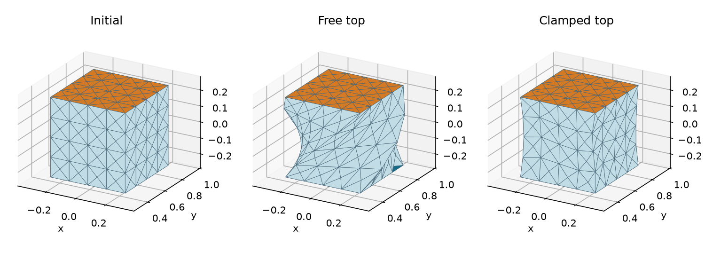

# Tet P1 plastic twist

[Back to Prescribed plastic fields](./index.md)

**Problem and discretization.** Use `assets/box-tet.veg`, P1 geometry and
P1 plastic/displacement fields with tetrahedron-centroid integration. The program
checks the identity plastic state, then advances the prescribed twist through
four nonzero increments, warm-starting each equilibrium.

**API walkthrough.** A width-3 `VertexDofMap` gathers rest and plastic nodal
values. Build `InterpolatedField3D[TetP1Basis]` for each, then
`DeformationGradientField3D(u_p, X)` for each $F_p$. Those borrowed inputs
must stay alive. Pass the fields to `VolumetricFemEnergy`, construct fixed xyz
indices for the bottom/top faces, and call Newton on the elastic energy alone.

**Expected result.** Both runs converge; the released run matches its compatible
plastic shape while clamping the top prevents full relaxation. The program also
writes `<stem>_rest.obj`. This validates a prescribed elastic rest-state change,
not a return-mapping plasticity algorithm.



The orange top face rotates 90° when released. When clamped, its orientation
stays fixed and the interior deforms to accommodate the prescribed plastic field.

## Run and inspect

```sh
cmake --build build/release --target tet_p1_plastic_twist litepgo_python
build/release/examples/fem/plasticity/tet_p1_plastic_twist
PYTHONPATH=build/release/python uv run --no-sync python examples/fem/plasticity/tet_p1_plastic_twist.py
```

To regenerate the comparison, pass the output stem to the plotting script.
It reads the three OBJ files and writes `<stem>.png`.

```sh
uv sync --locked --group plot
PYTHONPATH=build/release/python uv run --no-sync python examples/fem/plasticity/plot_tet_p1_plastic_twist.py \
  output/python/plastic_twist/tet_p1_plastic_twist
```

::: details Complete Python source — `tet_p1_plastic_twist.py`

<<< ../../../examples/fem/plasticity/tet_p1_plastic_twist.py

:::

::: details Complete C++ source — `tet_p1_plastic_twist.cpp`

<<< ../../../examples/fem/plasticity/tet_p1_plastic_twist.cpp

:::
