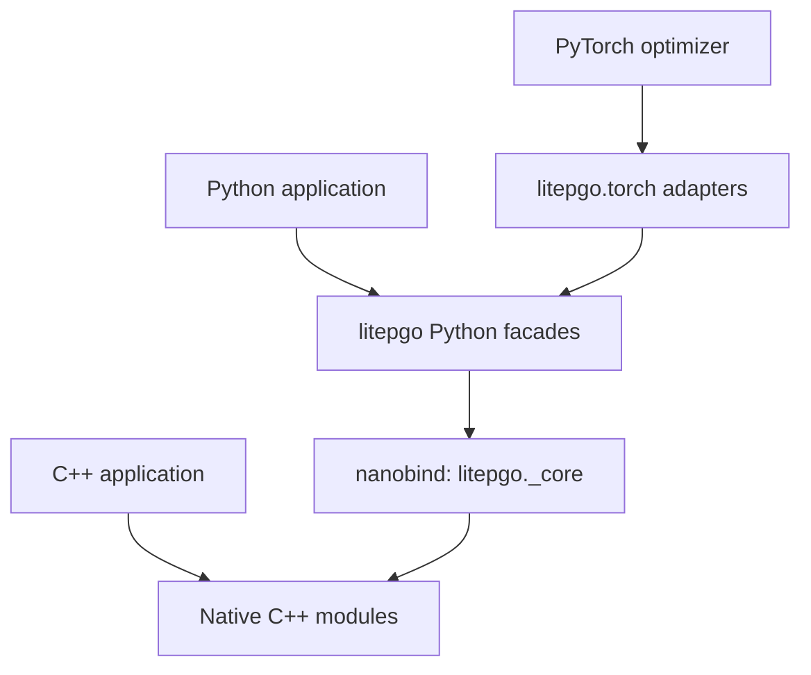
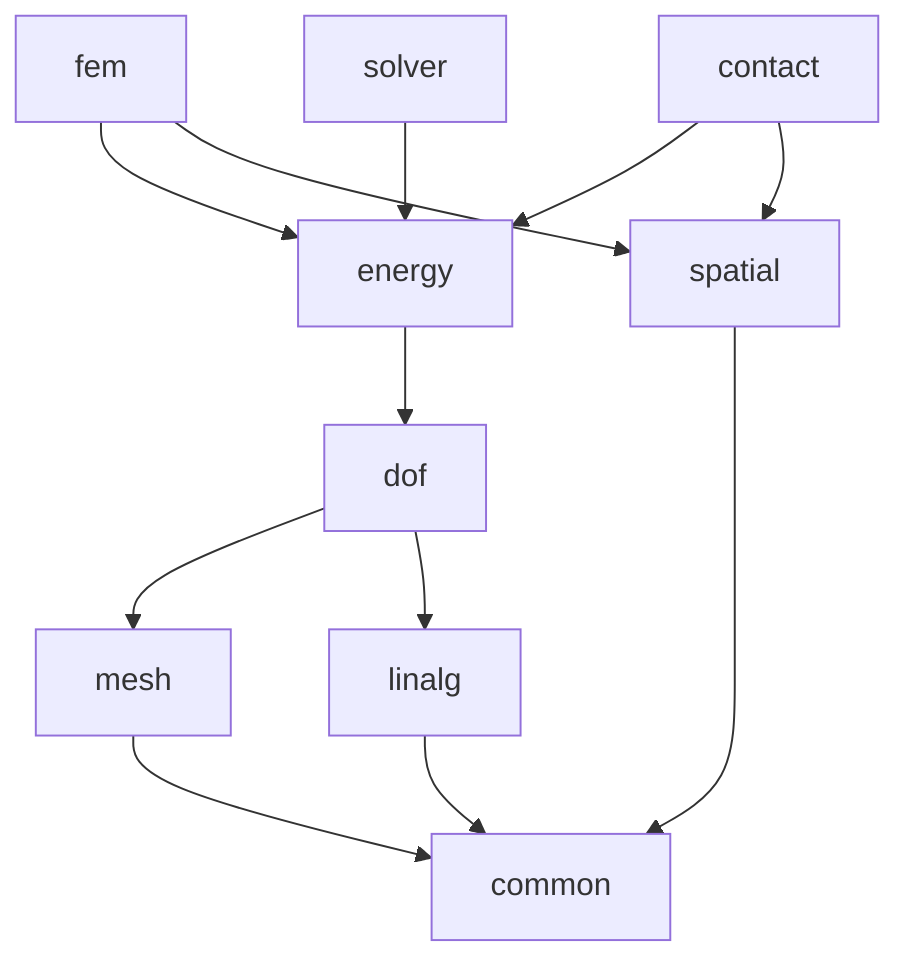

# System architecture

litepgo is a set of composable numerical modules. Applications choose geometry,
unknowns, local models, constraints, and a solver. The library's common boundary
between modeling and optimization is an `Energy` or a `Response` with analytic
derivatives. This page describes the software structure; [core conventions](concepts.md)
defines the numerical meaning of its vectors and matrices.

## C++ core and Python interface

The arrows below show how an application reaches an implementation.

The Python files in `src/python/` expose public names from the compiled
extension. They do not implement a second FEM or nonlinear solver. NumPy/SciPy
provide array and sparse-matrix interfaces; `fem.Template` selects concrete
instantiations already compiled into `_core`.

`litepgo.torch` is a Python integration layer. It evaluates a native model and
uses its gradient or Jacobian in backward. It does not trace the C++ solver's
iterations into a Torch graph. C++ users link individual CMake targets; Python
users import the corresponding facade modules.

## Native module dependencies

Here an arrow means **depends on**, from consumer to dependency. Redundant
edges are omitted to keep the graph readable: for example, FEM also directly
links DOF, mesh, and common. The complete direct-target table is in
[development](../development.md#source-layout-and-cmake-dependencies).

The dependency direction matters: `energy` supplies generic numerical interfaces
without depending on FEM, and `solver` consumes those interfaces without
depending on a material model or contact implementation. An application can
therefore use a custom objective with Newton, or combine FEM and contact in the
same objective.

The `litepgo::litepgo` target aggregates the nine base modules. Geometry I/O is
provided by `litepgo::io`; optional Gmsh I/O extends it with `litepgo::io_gmsh`.
The optional IPC Toolkit backend is `litepgo::ipctk`, which extends contact.
These targets are separate from the base aggregate.

## Responsibilities and public entry points

Each module page starts with its own architecture diagram and then explains its
API contracts and examples.

| Module | Owns | Main consumer |
| --- | --- | --- |
| [Common](common.md) | Shared numerical types and build capabilities | Every native module |
| [Mesh](mesh/index.md) | Topology, positions, surface extraction, shell stencils; I/O through separate targets | DOF maps and model construction |
| [DOF](dof/index.md) | Gather/scatter layouts, assembly plans, fixed/free reduction, surface maps | Energy/response assembly and solvers |
| [Linalg](linalg/index.md) | Sparse patterns and direct factorization backends | Nonlinear solves and sensitivities |
| [Energy](energy/index.md) | Scalar/vector interfaces, local batching, composition | Model implementations and solvers |
| [FEM](fem/index.md) | Bases, fields, kinematics, materials, integration, force responses and embedding | Elastic energies and measurements |
| [Solver](solver/index.md) | Newton, Gauss–Newton and equilibrium response | Forward and inverse applications |
| [Contact](contact/index.md) | Surface barrier energy, collision broad phase and feasible steps | A composed total potential |
| [Spatial](spatial.md) | Generic AABB indexing and overlap queries | Contact broad phase and FEM point location |
| [Torch](torch.md) | Optional first-order autograd bridge | Python optimizers |

Native module sources live under `src/cpp/<module>/`; public Python facades
live under `src/python/`. Common types and `build_info()` are exported in the
root `litepgo` namespace, rather than through a `litepgo.common` Python module.

## What a model owns

A mesh owns geometry; a DOF map owns the indexing convention. Fields provide
interpolation, while local material objects evaluate densities and derivatives.
Integration adds the geometric measure, and assembly scatters local results into
global vectors and sparse matrices. An optimizer then advances a caller-supplied
unknown vector.

Model geometry, prescribed plastic state, and callback configuration stay fixed
during the corresponding evaluation. Composed native fields may borrow other
fields; Python retains those dependencies. See [ownership and concurrency](concepts.md#ownership-and-concurrency)
before building custom model objects.

For a complete path through these layers, start with the [chain solve](quickstart.md),
then read [FEM](fem/index.md) or [contact](contact/index.md). For parameters that change
an equilibrium, follow the [inverse-problem data flow](solver/inverse.md).
