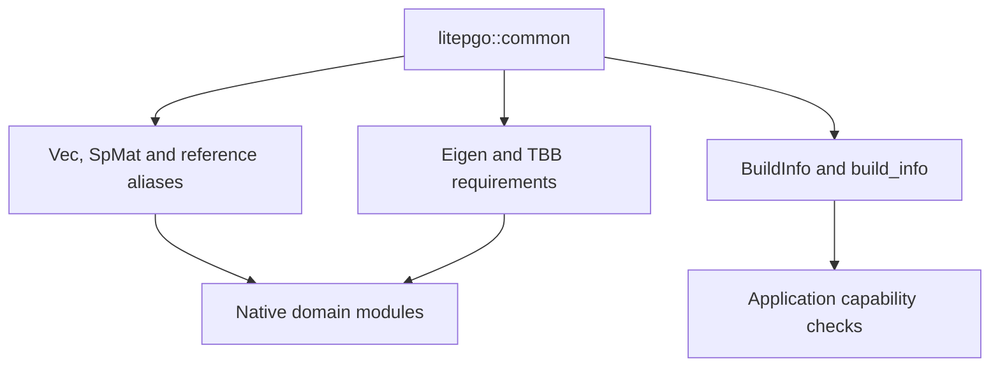

# Common types and build information

The `common` module is the native foundation shared by the domain modules. It
defines numerical storage conventions and reports which dependencies and sparse
backends are present in the compiled build.

## Module architecture

This diagram shows exports and their consumers, rather than an evaluation loop.



The public headers are `common/types.hpp` and `common/build_info.hpp` under
`src/core/`. Their public names live in `litepgo`, not a nested `common`
namespace. Python exposes `litepgo.build_info()`; it uses NumPy/SciPy arrays
instead of separate Python classes named `Vec` or `SpMat`.

## Numerical storage

| C++ type | Meaning |
| --- | --- |
| `Vec` | Owning double-precision dynamic vector |
| `ConstVecRef`, `VecRef` | Borrowed read-only/writable vector views |
| `StridedVecRef`, `StridedMatRef` | Borrowed outputs supporting strided batch rows or blocks |
| `SpMat` | Double-precision column-major sparse matrix with `int` indices |
| `Triplet` | A sparse row/column/value entry used during construction |

Borrowed views do not extend an array's lifetime. Respect each API's aliasing
rules when writing into them. Native symmetric sparse matrices store both
triangles; numerical index counts must fit the supported integer representation.
The [data conventions](concepts.md#arrays-and-packing) define physical packing,
and [linalg](linalg/index.md) defines valid sparse solver inputs.

## Inspect the active build

```python
import litepgo

info = litepgo.build_info()
assert "EigenLDLT" in info["sparse_backends"]
print(info["version"], info["eigen_version"])
print(info["sparse_backends"])
```

The result includes litepgo/Eigen versions, TBB header/runtime versions, available
sparse backends, and an optional IPC Toolkit version. An empty
`ipc_toolkit_version` means that backend was not compiled in. It does not disable
native IPC contact. For Gmsh I/O, inspect `mesh.has_gmsh` separately.

Use these capabilities when choosing a backend instead of assuming that the
host platform implies a particular configured feature. Link `litepgo::common`
for these headers in a native application; higher-level module targets already
propagate it.

In C++, `build_info()` reports the backends configured for the litepgo build.
Using a backend still requires its [CMake target](linalg/backends.md#cmake-targets);
linking only `litepgo::linalg` selects the Eigen automatic aliases even when the
build also provides an Accelerate or oneMKL target.

## Limiting TBB parallelism

By default litepgo adds no thread limit: TBB chooses concurrency from the logical
CPUs available to the process, subject to the host application's existing TBB
controls. This is a concurrency allowance, not a guarantee of full CPU usage.

```python
import litepgo

with litepgo.tbb_thread_limit(4):
    # Put assembly and the complete solve inside this scope.
    result = solver.solve(...)
```

The argument must be a positive Python integer; booleans are rejected. The limit
is installed on entering the context and removed on exit, including exceptions.
Nested or overlapping limits take the minimum. This affects all threads sharing
the same TBB runtime, including other libraries; it is not Python-thread-local.
Use a fresh context manager for each `with` statement.

The limit covers litepgo's TBB work and its MKL/PARDISO backend. This build uses
MKL's TBB threading layer, so `MKL_NUM_THREADS` and `OMP_NUM_THREADS` do not set
its parallelism. Accelerate and independent NumPy/SciPy or OpenMP thread pools
are outside this control. TBB limits active workers to at most `threads - 1`
(with TBB's enqueue exception); external application threads are not capped,
so this is not a limit on the total number of process threads.

C++ callers can use TBB directly. Keep the control alive for the desired scope:

```cpp
#include <tbb/global_control.h>
#include <tbb/task_arena.h>

tbb::global_control limit(tbb::global_control::max_allowed_parallelism, 4);
// Assembly and solve here share the runtime-wide limit.
```

For a limit on work executed in a particular arena, wrap the whole operation:

```cpp
tbb::task_arena arena(4);
arena.execute([&] {
    // Assembly, factorization, and solve here use this arena.
});
```

An arena still respects the runtime's global worker limit. The Python context
manager implements `global_control`, not arena-local execution.
