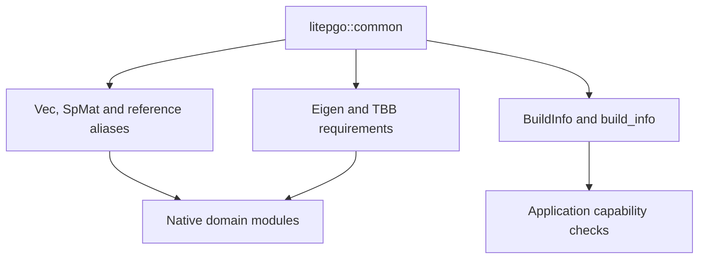

# Common types and build information

The `common` module is the native foundation shared by the domain modules. It
defines numerical storage conventions and reports which dependencies and sparse
backends are present in the compiled build.

## Module architecture

This diagram shows exports and their consumers, rather than an evaluation loop.



The public headers are `common/types.hpp` and `common/build_info.hpp` under
`src/core/`. Their public names live in `litepgo`, not a nested `common`
namespace. Python exposes `litepgo.build_info()`; it uses NumPy/SciPy arrays
instead of separate Python classes named `Vec` or `SpMat`.

## Numerical storage

| C++ type | Meaning |
| --- | --- |
| `Vec` | Owning double-precision dynamic vector |
| `ConstVecRef`, `VecRef` | Borrowed read-only/writable vector views |
| `StridedVecRef`, `StridedMatRef` | Borrowed outputs supporting strided batch rows or blocks |
| `SpMat` | Double-precision column-major sparse matrix with `int` indices |
| `Triplet` | A sparse row/column/value entry used during construction |

Borrowed views do not extend an array's lifetime. Respect each API's aliasing
rules when writing into them. Native symmetric sparse matrices store both
triangles; numerical index counts must fit the supported integer representation.
The [data conventions](concepts.md#arrays-and-packing) define physical packing,
and [linalg](linalg/index.md) defines valid sparse solver inputs.

## Inspect the active build

```python
import litepgo

info = litepgo.build_info()
assert "EigenLDLT" in info["sparse_backends"]
print(info["version"], info["eigen_version"])
print(info["sparse_backends"])
```

The result includes litepgo/Eigen versions, TBB header/runtime versions, available
sparse backends, and an optional IPC Toolkit version. An empty
`ipc_toolkit_version` means that backend was not compiled in. It does not disable
native IPC contact. For Gmsh I/O, inspect `mesh.has_gmsh` separately.

Use these capabilities when choosing a backend instead of assuming that the
host platform implies a particular configured feature. Link `litepgo::common`
for these headers in a native application; higher-level module targets already
propagate it.
