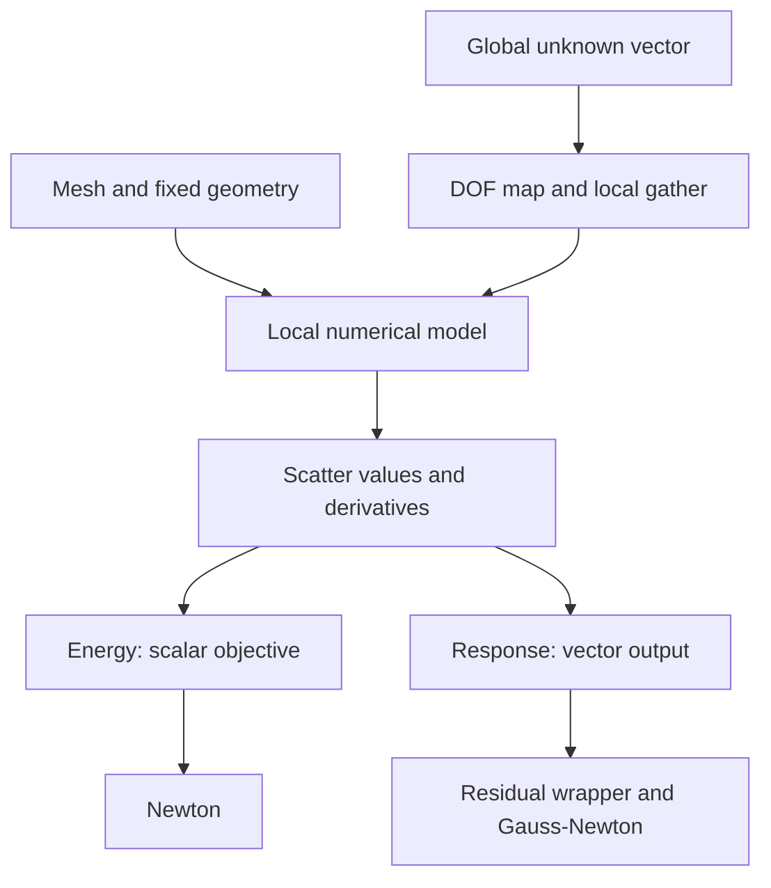

# Core concepts and numerical conventions

A model connects local numerical expressions to a global optimization vector.
This chapter defines the notation used throughout the manual.

## Data flow across the modules

This diagram shows one local-to-global evaluation. A DOF map fixes indexing;
a local model supplies numerical terms; assembly applies the scatter plan.
Changing the local material does not require changing the solver interface.



## From geometry to a solve

1. **Mesh:** rest positions and element connectivity.
2. **DOF map:** ordered global scalar indices used by each element or stencil.
3. **Response/element:** interpolation, coordinate conversion, and integration.
4. **Energy or response:** a scalar objective or vector-valued measurement.
5. **Solver:** an optimization algorithm using the assembled derivatives.

Let $z\in\mathbb R^n$ be global unknowns and $G_e$ an element's gather matrix.
The local unknown is $z_e=G_ez$. Scalar energies assemble as

$$
E(z)=\sum_e E_e(G_ez),\qquad
\nabla E=\sum_e G_e^Tg_e,\qquad
\nabla^2E=\sum_e G_e^TH_eG_e.
$$

For a response, $A_e$ scatters a local output into the global output vector:

$$
r(z)=\sum_e A_e r_e(G_ez),\qquad
J(z)=\sum_e A_e J_e G_e.
$$

`MeshEnergy` and `MeshResponse` implement these operations. They do not infer a
material, coordinate system, or integration measure from connectivity.

## Positions, displacements, and forces

For deformable models, $X$ denotes fixed rest coordinates, $u$ displacement,
and $x=X+u$ current coordinates. Volume and shell energies in this library
usually take **displacement DOFs**. Native contact takes **surface positions**.
Use an affine map to connect the two.

The reported FEM force is the **positive energy gradient**
$g=\partial E/\partial u$. A physical internal force under the opposite sign
convention is $-g$. The fitting examples use the positive convention for both
targets and predictions. Constrained entries of the gradient are the reactions
under that convention; free entries vanish at equilibrium.

## Arrays and packing

All numerical examples use double precision. Python positions have shape
`(num_vertices, 3)` and topology cells `(num_elements, vertices_per_element)`.
Optimizer unknowns are one-dimensional arrays. Most returned sparse matrices
are SciPy CSC matrices.

| Object | Ordering |
| --- | --- |
| Vertex xyz data | `3*v + c`, or `positions.ravel()` |
| Interpolated coefficients $C\in\mathbb R^{n_b\times m}$ | Row-major: `m*a + c` |
| Material matrices $F,F_p,P\in\mathbb R^{3\times3}$ | Column-major: `i + 3*j`, or `A.ravel(order="F")` |
| Derivative matrix | Output components in rows, input scalar DOFs in columns |
| Symmetric 3D spatial Hessian columns | `(11, 12, 13, 22, 23, 33)`; mixed terms occur once |

The coefficient ordering and matrix-vectorization ordering serve different
purposes. For instance, an interpolated vector field is row-packed while its
matrix-valued spatial derivative is column-vectorized for a material tangent.
Always state which quantity a vector represents before reshaping it.

## Sparse structure is part of the contract

A sparse **pattern** records every entry that may be nonzero, including entries
whose present value is zero. Ordinary Energy and Response evaluation prepares
required structure automatically and returns independent results. Solvers compare
returned matrix structures to reuse symbolic factorization; callers do not manage
current patterns or output buffers.

Exact derivatives and solver approximations have distinct meanings.
`evaluation.hessian()` is the energy's exact second derivative.
`evaluation.projected_hessian()` returns a PSD approximation, using local
projection where provided and global spectral clamping otherwise;
it is useful for Newton directions, and is not the derivative used in analytic
equilibrium sensitivities.

## Ownership and concurrency

Meshes and interpolated Responses own snapshots. Composed Responses own their
children, whose configuration must remain fixed. FEM energies and force responses
sample their fixed spatial configuration at construction and retain numerical
data rather than the source Responses. Rebuild them after changing configuration.

### Python ownership must remain acyclic

Energy/Response composites, contact broad phases, and spatial Response
dependencies retain child objects through C++. A strong reference from a child
back to its owner can create a cycle that survives `gc.collect()`. Native Energy
and Response instances support `weakref.ref`. Use a weak reference when a child
needs to reach its owner:

```python
import weakref

child.owner = weakref.ref(composite)
owner = child.owner()  # None after the owner has been released.
if owner is not None:
    # Use owner only for the duration of this operation.
    pass
```

For other bound types that do not support weak references, omit the back-reference
or refer weakly to a Python model container. No property named `owner` or
`energy` is required by the library.

`StaticEquilibriumResponse` exposes its factory and convergence callbacks to the cyclic garbage
collector. Cycles through those callbacks can be collected when all other
references in the cycle are visible to Python.

### Concurrent evaluation

Energy and Response implementations with shared workspaces (such as MeshEnergy,
MeshResponse, and cached energy composites) reject overlapping evaluation. The
mathematical Energy and Response bases have no global concurrency guard; custom
implementations own their thread-safety contract.
Batched callbacks can
run concurrently through TBB, so captured data must support concurrent reads and
must not depend on callback order. Python callbacks acquire the GIL; numerical
operations that release it can still perform parallel work. Rebuild model objects
when their documented fixed geometry or prescribed state changes.

Next read [DOF maps](dof/index.md) and [energy/response contracts](energy/index.md).
