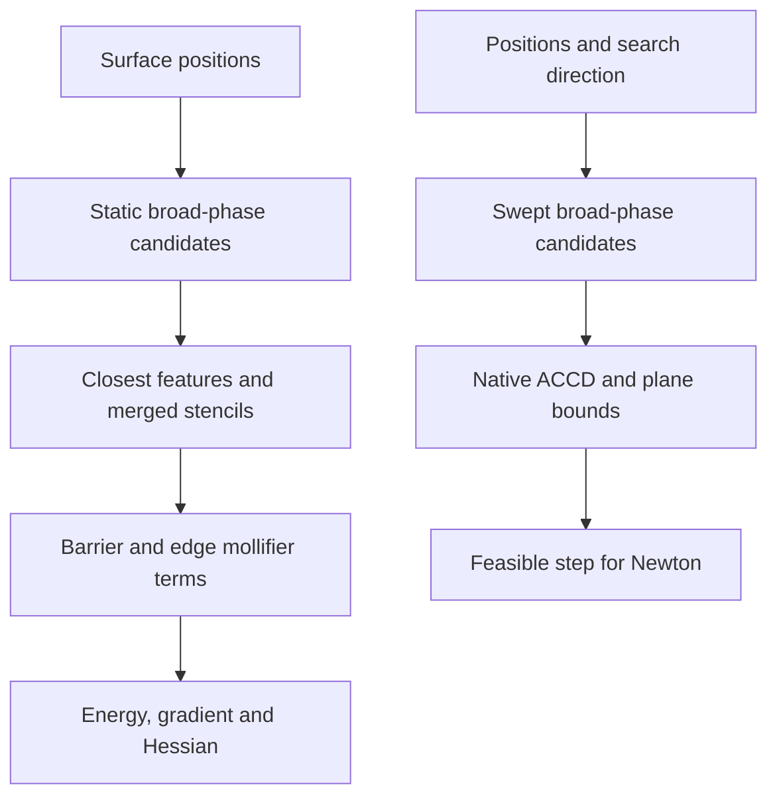

# Native IPC surface contact

Contact is a scalar energy over surface vertex positions. To combine it with a
volume or shell model whose unknown is displacement, explicitly map those DOFs
to surface positions. Native IPC is available without the optional IPC Toolkit.

## Module architecture

The contact module consumes a triangle surface and current **positions**. The
broad phase generates candidate primitive pairs; closest-feature tests form
active stencils, and local barrier terms assemble an energy. The feasible-step
path uses swept bounds and CCD rather than reusing a static active set.

For displacement-based simulation, `AffineMappedEnergy` connects surface
positions to the simulation vector. The generic energy composite and Newton stay
outside contact. Native code is under `src/core/contact/`; Python uses
`litepgo.contact`. The separate optional IPC Toolkit energy implements its own
backend path; see [collision safety and diagnostics](collision-safety.md).

## Read this module

| Topic | Read |
| --- | --- |
| Barrier density, candidate features and edge mollification | [Barrier formulation](barrier.md) |
| Connect surface positions to volume/shell displacement | [Displacement coupling](coupling.md) |
| Broad phase, CCD, validity, diagnostics and optional backend | [Collision safety and diagnostics](collision-safety.md) |

Start from a feasible nonintersecting surface and use the model's feasible-step
bound during a solve. The safety page states the geometric contracts and the
limits of the floating-point collision handling.
