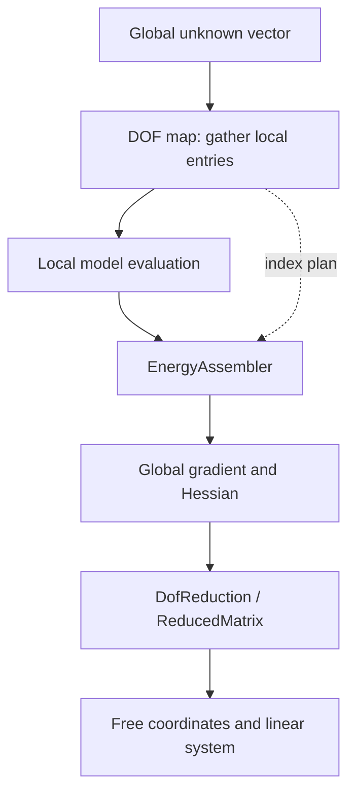

# DOF maps and hard constraints

A degree of freedom (DOF) is one scalar entry in a global vector. DOF maps define
which entries an element reads and the order of its local gradient, Hessian, or
Jacobian columns. They do not decide what those numbers mean physically.

## Module architecture

The module separates indexing, assembly, and constraint reduction. A map defines
the gather order. `EnergyAssembler` / `ResponseAssembler` precompute scatter
plans from indices. `DofReduction` selects a free system without changing the
underlying energy or response. Arrows show an energy assembly-and-reduction path.

`SurfaceKinematics` is a second consumer of DOF layouts: it holds a sparse map
from simulation unknowns to surface positions. The module owns no constitutive
law. Native headers are in `src/core/dof/`; the Python facade is `litepgo.dof`.
For vector responses, separate input/output maps define a rectangular Jacobian
assembled by `ResponseAssembler`; the square energy reduction above is a separate path.
The native assembly plans are used internally by the bound energy/response
wrappers; Python custom models usually select a map and `MeshEnergy` or
`MeshResponse` instead of driving those plans directly.

## Read this module

| Topic | Read |
| --- | --- |
| Vertex, stencil, element and shared parameter maps | [DOF maps](maps.md) |
| Fixed values, free coordinates and reduced matrices | [Hard constraints](constraints.md) |
| Map simulation displacement to a surface | [Surface kinematics](surface-kinematics.md) |

Maps establish indexing. Hard constraints select the free system without changing
the model, while surface kinematics supplies positions for consumers such as
contact. Read the [packing conventions](../concepts.md#arrays-and-packing)
before combining models with different DOF widths.
