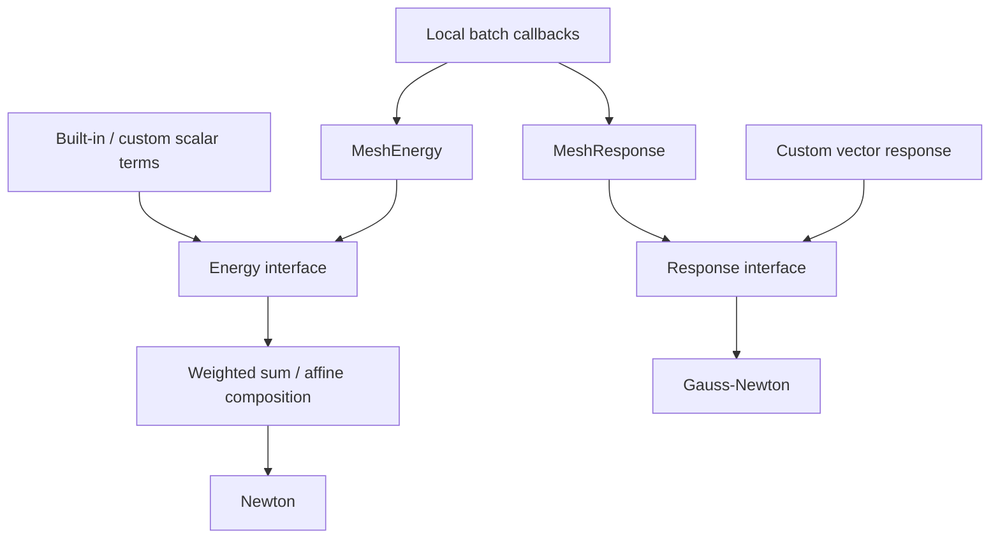

# Energies, responses, and sparse assembly

Use an **Energy** for a scalar objective $E:\mathbb R^n\to\mathbb R$.
Use a **Response** for a vector function $r:\mathbb R^n\to\mathbb R^m$.
A response is not inherently an error: Gauss–Newton interprets its output as a
residual targeting zero, so wrap measurements as prediction minus observation.

## Module architecture

`Energy` and `Response` are the solver-facing interfaces. Fixed/dynamic-pattern
subclasses let applications define a global term; mesh wrappers turn batches of
local terms into the same interfaces. Scalar composition stays in this module,
so neither assembly nor optimization needs to know a material law.

Arrows show construction and consumption. An `Energy` can also be passed directly
to Newton without composition. A `Response` may represent a measurement; a caller
subtracts observations before using it as a least-squares residual. Native code
is under `src/core/energy/`; Python uses `litepgo.energy`.

## Read this module

| Topic | Read |
| --- | --- |
| Evaluate derivatives and compose scalar objectives | [Evaluation and composition](evaluation.md) |
| Implement fixed/dynamic-pattern scalar or vector terms | [Custom energies and responses](custom.md) |
| Gather, batch and assemble local contributions | [Batched assembly](assembly.md) |

All paths share the sparse-pattern and feasibility contracts below and in
[core conventions](../concepts.md#sparse-structure-is-part-of-the-contract).

## Errors and feasibility

Malformed inputs/outputs and wrong patterns are contract errors. Infeasible or
unrepresentable numerical evaluations raise domain errors (`ValueError` in the
corresponding Python paths). Newton evaluation exceptions propagate. Gauss–Newton
can reject domain-infeasible trial residuals; arbitrary Python exceptions still
propagate. A sparsity change is not a claim that the mathematical function is
smooth across an active-set transition.
