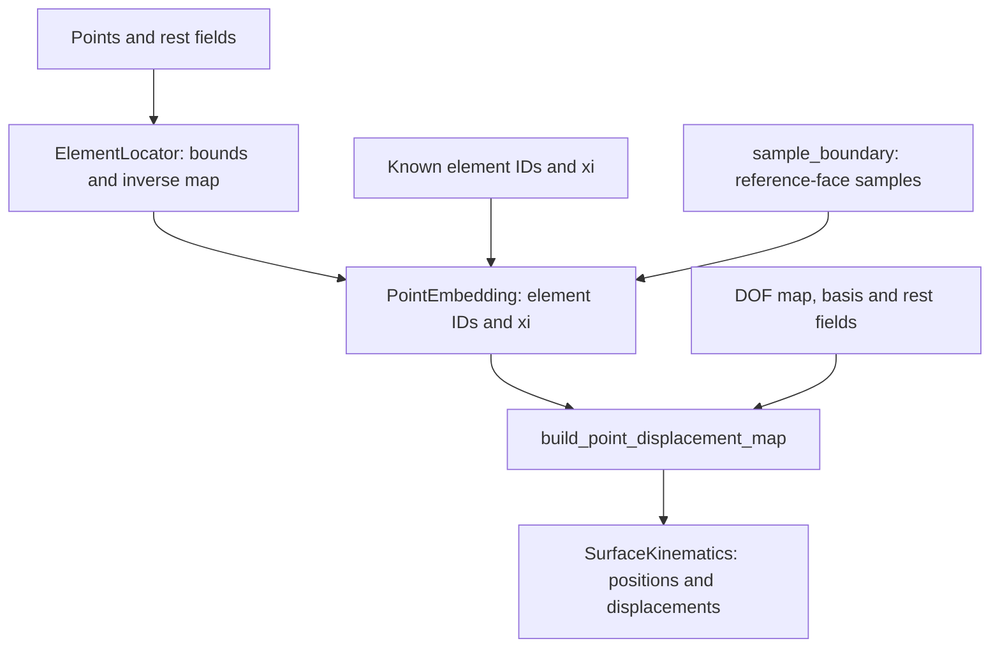

# Point embedding and boundary sampling

These FEM utilities evaluate a simulation displacement at points that need not
be mesh vertices. Geometry location, displacement interpolation, and surface
sampling share reference coordinates but have separate responsibilities.

## Architecture and data flow

`ElementLocator` and boundary sampling produce a `PointEmbedding`; the
embedding and displacement basis then define a sparse map. These APIs belong to
`fem`, using the generic [spatial index](../spatial.md) for candidate elements.
`SurfaceKinematics`, which consumes the resulting map, belongs to `dof`.



The displacement map interpolates an existing simulation field. Adding sample
points does not add simulation unknowns or change the elastic energy.

## Locate points in rest elements

Given rest fields $X_e(\xi)$ and point $p_i$, locate

$$
X_{e_i}(\xi_i)=p_i,\qquad\xi_i\text{ inside element }e_i.
$$

`fem.ElementLocator[GeometryBasis](X_fields).locate(points)` returns
`PointEmbedding.element_ids` and `.xi`. Points have shape `(n,3)`. Tet P1 and
Hex Q1 geometry are supported. The locator snapshots geometry, uses a spatial
hash of corner bounds, and solves the inverse map with damped Newton.
It checks physical residual and reference containment within numerical tolerances.
Shared-boundary points
select the lowest successful element ID. Outside points, singular inverse maps,
and failed solves produce an error identifying the point; there is no projection
or extrapolation. Rebuild when rest geometry changes. Curved high-order rest
geometry is not supported by these bounds.

If element IDs and reference coordinates are already known, construct
`fem.PointEmbedding(ids, xi)` directly. It copies the data; the displacement-map
builder checks it against the actual model.

## Interpolate the simulation displacement

For local physical-to-coefficient transform $T_e$, gather matrix $G_e$,
and vector interpolation operator $N(\xi)$, assemble

$$
u_s=Wu,\qquad W_i=N(\xi_i)T_{e_i}G_{e_i},\qquad x_s=X_s+Wu.
$$

Here $u_s$ is the sampled displacement. The matrix has `3*n` rows and `displacement_map.num_dofs` columns. Python returns CSC.

```python
embedding = fem.ElementLocator[fem.HexQ1Basis](X_fields).locate(points)
W = fem.build_point_displacement_map[fem.HexHermiteBasis](
    embedding, displacement_map, X_fields)
kinematics = dof.SurfaceKinematics(points, W)
positions = kinematics.positions(u)
```

`X_fields`, `displacement_map`, and the embedding must use the same element
ordering and rest geometry. The displacement basis can differ from geometry:
Hermite displacement with Q1 box geometry is supported. The builder pulls
interpolation through physical Hermite scales. It rejects invalid element IDs,
reference coordinates, dimensions, and unsupported geometry. Empty point sets
produce a zero-row map. The [embedding example](../../examples/spatial.md#point-embedding)
constructs all of these inputs and compares the result to direct interpolation.

For exact volume boundary vertices, prefer `extract_surface_with_vertices` and
`dof.build_vertex_displacement_map`. This avoids solving for known vertex IDs.

## Sample a hex boundary

For uniform subdivision count $s$, each boundary quad produces
$2s^2$ triangles. The sampler generates reference coordinates directly:

```python
sampled = fem.sample_boundary[fem.HexQ1Basis](topology, X_fields, subdivisions=4)
W = fem.build_point_displacement_map[fem.HexHermiteBasis](
    sampled.embedding, displacement_map, X_fields)
kinematics = dof.SurfaceKinematics(sampled.mesh.positions, W)
```

Shared edge/corner samples are welded with topology and integer interpolation
weights, not coordinate proximity. Original vertices come first in increasing
volume-vertex order. Subdivision one reproduces ordinary surface-extraction
connectivity, winding, and vertex order. Neighboring geometry fields must agree
exactly at shared corners; cells must be conforming and positively oriented.

Only Q1 rest geometry is bound. Hermite displacement still requires axis-aligned
boxes. Sampling evaluates its derivative DOFs between corners and adds surface
vertices without adding simulation DOFs. The triangle surface is an approximation
to the deformed field; the sampler does not certify global element injectivity.
