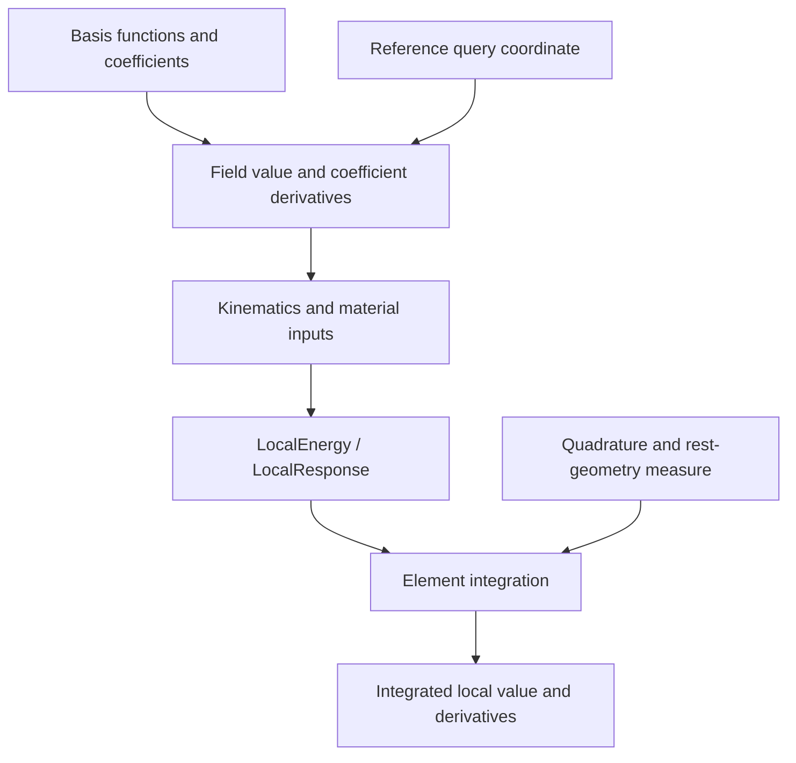

# Fields and quadrature

A field maps reference-element coordinates $\xi\in\mathbb R^D$ to an
$m$-component value. Parameter dimension $D$, component count $m$, and
coefficient count are independent. `Field2D` and `Field3D` describe $D$, not
the dimension of the value: a surface coordinate field can have three components
and a two-dimensional parameter domain.

## Architecture of a local evaluation

Bases supply shape functions. A field combines those functions with coefficients;
kinematics interprets field values, and a local material term supplies a density
or response. An element integrator adds quadrature and the rest-geometry measure.
This is the local path beneath the [FEM module wrappers](index.md).



## Interpolate a field

For basis functions $N_a$ and coefficient rows $C_a$,

$$
y(\xi)=\sum_{a=0}^{n_b-1}N_a(\xi)C_a=C^TN(\xi),\qquad
\frac{\partial y}{\partial\xi}=C^T\frac{\partial N}{\partial\xi}.
$$

`InterpolatedField2D[B]` / `InterpolatedField3D[B]` store an owning snapshot of
`C`. `IdentityField2D(c)` / `IdentityField3D(c)` return a spatially constant
vector; their coefficient derivative is identity, so constant-in-space parameters
can still be optimized.

```python
import numpy as np
from litepgo import fem

B = fem.TetP1Basis
X = np.array([B.coefficient_info(i).point for i in range(4)])
field = fem.InterpolatedField3D[B](X)
xi = np.array([0.1, 0.2, 0.3])
np.testing.assert_allclose(field.eval_value(xi), xi)
np.testing.assert_allclose(field.eval_dvalue_dxi(xi), np.eye(3))
assert field.eval_dvalue_dcoeffs(xi).shape == (3, 12)
```

The [Tet P1 example](../../examples/fem/tet-p1-basis.md#sample-a-target-and-construct-a-field)
shows the complete scalar workflow: define a target function, sample vertex
values, create a Field, and verify reconstruction at interior points.
The [Hermite example](../../examples/fem/hermite-interpolation.md#reconstruct-through-a-field)
also samples the derivative coefficients required by its corner slots.

In C++, template syntax is `InterpolatedField3D<TetP1Basis>`. Python uses
`fem.Template` objects: indexing with the C++ template arguments returns a bound
class. `.instances` lists supported argument tuples. Unsupported combinations
raise `TypeError`; Python cannot instantiate arbitrary C++ templates at runtime.

## Field derivative layouts

See [basis functions](basis.md) for the core basis API, shape-function
formulations, reference domains, and coefficient ordering. Field derivatives
use that same basis-function order.

For $n_b$ basis functions, $m$ components, and
$s=D(D+1)/2$ packed second derivatives:

| Field method | Shape |
| --- | --- |
| `eval_value(xi)` | `(m,)` |
| `eval_dvalue_dxi(xi)` | `(m, D)` |
| `eval_dvalue_dcoeffs(xi)` | `(m, n_b*m)` |
| `eval_dgrad_xi_dcoeffs(xi)` | `(m*D, n_b*m)` |
| `eval_d2value_dxi2(xi)` | `(m, s)` |
| `eval_dhess_xi_dcoeffs(xi)` | `(m*s, n_b*m)` |

Coefficient columns use row-major `C.ravel()`. Matrix outputs are vectorized by
column when differentiated. Second spatial derivative columns are `(11,12,22)`
in 2D and `(11,12,13,22,23,33)` in 3D, with mixed entries stored once. P1 simplex
bases have zero second derivatives. Q1 tensor-product bases can have nonzero
mixed derivatives despite zero pure second derivatives.

Generic custom fields are affine in their active coefficients and must implement
the requested derivative capabilities. The base interface's optional spatial
operations throw if unsupported. Python exposes bound fields for selection and
composition, not Python subclasses for per-quadrature-point execution.

## Two-dimensional parameter fields

For the [Quad Hermite coefficient order](basis.md#quad-hermite), a
three-component field stores `(16,3)` coefficients. A width-12 vertex gather
on a quad can be row-reshaped into this layout.

For a rectangular physical parameter chart with spans $(h_s,h_t)$, physical
slots scale to reference slots by $(1,h_s,h_t,h_sh_t)$. Sharing reference
coefficients without this conversion is generally wrong for unequal cells.
Compatible chart transitions require their own derivative transforms. This
lower-level field support does not turn the triangle mid-edge shell model into
a higher-order quad shell.

A [Triangle P1](basis.md#triangle-p1) nodal field stores three coefficient rows,
has constant first derivatives, and zero second derivatives. Shell curvature
reconstruction additionally uses neighboring vertices; it is not provided by
this P1 basis alone.

## Geometry and deformation are separate fields

Let $X(\xi)$ be rest coordinates and $u(\xi)$ displacement. For a solid,

$$
J_X=X_{,\xi},\qquad
F=I+u_{,\xi}J_X^{-1},\qquad
\frac{\partial F_{id}}{\partial u_{ab}}
=\delta_{ib}\frac{\partial N_a}{\partial X_d}.
$$

`DeformationGradientField3D(u_field, X_field)` implements this composition and
returns nine column-packed components of $F$. Geometry and displacement can
use different bases, but must refer to the same element and reference domain.
The coordinate Jacobian must be finite, invertible, and positively oriented.
The field holds rest geometry fixed when differentiating displacement coefficients;
coordinate optimization and spatial derivatives of $F$ are not part of this API.

C++ composed fields and local material objects borrow named inputs: keep them
alive, and avoid temporaries. Python retains those dependencies. Basic identity
and interpolated fields themselves own snapshots.

## Integration applies the measure once

For a solid local density $W$,

$$
E_e\approx\sum_q w_q\det J_X(\xi_q)\,W(\xi_q).
$$

`VolumetricElement3D[Q](X_field)` snapshots each quadrature point and physical
reference-volume weight. Rebuild it when rest geometry changes. `LocalEnergy3D`
supplies density and coefficient derivatives; `LocalResponse3D` supplies a vector
and optional Jacobian. Neither local object silently adds the geometric measure.

See [quadrature](quadrature.md) for the common API, supported reference rules,
weight sums, and polynomial exactness. The
[quadrature example](../../examples/fem/quadrature-integration.md) computes
analytic reference integrals directly from points and weights.

For a surface field $X(\xi,\eta)$, use
$w_q\|X_{,\xi}\times X_{,\eta}\|$. The triangle rule's $1/2$ already
accounts for reference area; do not multiply by another $1/2$.

Python local-energy calls return `(value, gradient_or_None, hessian_or_None)`.
Element calls integrate those quantities. Native `accumulate` adds into initialized,
correctly sized buffers; `eval` resizes/overwrites owning outputs. Strided native
`accumulate_into` / `eval_into` permit direct writes into batch output blocks.
These views must stay alive and must not alias the input fields.
