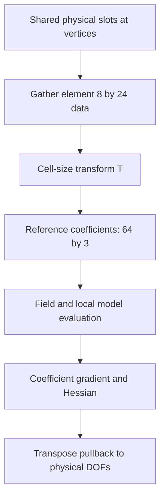

# Hex Hermite physical DOFs

Hex Hermite uses a cubic tensor-product displacement basis with 64 scalar basis
functions per component. To share meaningful derivative DOFs between differently
sized boxes, litepgo stores derivatives with respect to physical rest coordinates.
Rest geometry and displacement interpolation are separate.

## Physical DOFs and reference coefficients

The transform connects shared physical derivative data to an element's reference
interpolant. It is also part of derivative assembly, not only interpolation.



## Slots and physical-to-reference conversion

Each vertex has eight three-vector slots, hence 24 scalar DOFs:

$$
[u,\ u_{,X},\ u_{,Y},\ u_{,Z},\ u_{,XY},\ u_{,XZ},\ u_{,YZ},\ u_{,XYZ}].
$$

The scalar offset is `24*v + 3*slot + component`. An element gather returns an
`(8,24)` matrix. `BasisDofTransform[HexHermiteBasis]` converts it to `(64,3)`
reference interpolation coefficients. For box lengths $h_x,h_y,h_z$, the
per-slot scales are

$$
S=\operatorname{diag}(1,h_x,h_y,h_z,h_xh_y,h_xh_z,h_yh_z,h_xh_yh_z),
\qquad c=T u_e,
$$

where $T$ repeats these scales over components and vertices. Consequently

$$
g_u=T^Tg_c,\qquad H_u=T^TH_cT,\qquad J_{\text{force},u}=T^TJ_{\text{force},c}.
$$

Failing to pull derivatives back would change the physical problem with cell
size. `VolumetricFemEnergy` and the FEM force responses perform this transform.
For manual field evaluation:

```python
transform = fem.BasisDofTransform[fem.HexHermiteBasis](X_field)
coefficients = transform.to_coefficients(displacement_map.gather(e, u))
u_field = fem.InterpolatedField3D[fem.HexHermiteBasis](coefficients)
```

Here `X_field` is the element's fixed coordinate field, `e` the element index,
and `u` the global physical-DOF vector. The [embedding example](../../examples/spatial.md)
shows a complete construction and checks the interpolated values independently.

## Supported rest geometry

The current transform requires positive axis-aligned affine boxes:

$$
X(\xi)=X_0+\operatorname{diag}(h_x,h_y,h_z)\xi,
\qquad h_x,h_y,h_z>0,\quad\xi\in[0,1]^3.
$$

Use a Hex Q1 coordinate field with the standard corner order. The implementation
checks corner consistency and finite positive scales; the caller must supply
geometry that is affine throughout, not a curved field with matching corners.
General rotated, skewed, or curved rest hexes need another physical derivative
mapping. Deformed states can rotate, shear, stretch, or bend within material
feasibility. Sharing all eight slots between aligned cells provides compatible
physical derivative data on their shared faces.

## Boundary constraints and output geometry

A face at constant $Z$ is determined by the slots
$u,u_{,X},u_{,Y},u_{,XY}$. The plastic-twist examples fix these four slots at a
clamped end. Fixing only nodal values would not clamp the whole face field.
Corner-pulling examples attach springs to the value slots and leave derivatives
free.

A VEG output stores corner positions and connectivity. It cannot store all
Hermite derivative DOFs or display the curved deformed field. For a surface
visualization, sample the **rest** Q1 boundary, build the Hermite displacement
matrix, and evaluate

$$
x_s=X_s+Wu.
$$

The Hermite plastic-twist example uses subdivision 4, giving 32 triangles per
boundary quad. This evaluates derivative contributions between corners; it does
not simply subdivide a deformed corner-only mesh. See
[boundary sampling](embedding.md#sample-a-hex-boundary).
