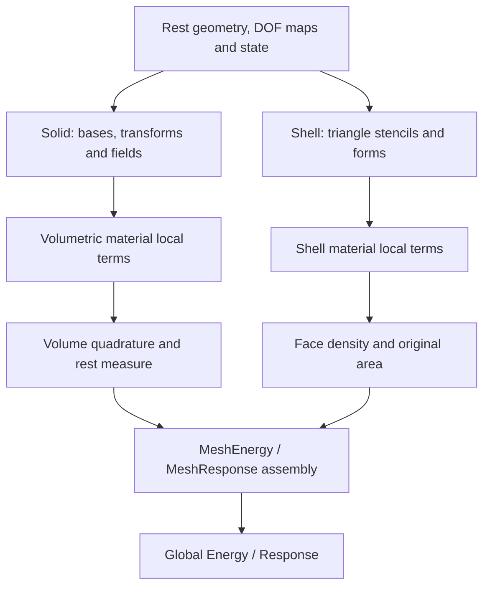

# Finite elements

The `fem` module turns interpolation and constitutive models into integrated
energies and force responses. It also locates points and builds displacement
interpolation maps. These APIs live in one module, with separate layers for
geometry, kinematics, material laws, integration, and global assembly.

## Module architecture

Arrows show evaluation data flow. The solid and shell branches use different
kinematics and integration rules, then meet at the generic energy/response
interfaces consumed by solvers.

Native headers are under `src/core/fem/`; Python's `litepgo.fem` facade
exposes the compiled basis, quadrature, and material combinations. Link
`litepgo::fem` in C++. The high-level wrappers perform basis transforms and
integration; custom local constructions must apply each measure and pullback
exactly once.

## Choose a layer

| Layer | Main objects | Read |
| --- | --- | --- |
| Shape functions | P1, Q1 and Hermite bases, reference derivatives and coefficient slots | [Basis functions](basis.md) |
| Interpolation and integration | `Field2D/3D`, local terms, quadrature, `VolumetricElement3D` | [Fields and quadrature](fields.md) |
| Solid elasticity | `DeformationGradientField3D`, `NeoHookean`, `VolumetricFemEnergy` | [Volumetric elasticity](volume.md) |
| Shell elasticity | Mid-edge stencils/forms, `KoiterStVK`, `ShellFemEnergy` | [Shells and natural geometry](shell.md) |
| Physical derivative DOFs | `BasisDofTransform[HexHermiteBasis]` | [Hex Hermite](hermite.md) |
| Geometry queries and sampling | `ElementLocator`, `PointEmbedding`, displacement maps, `sample_boundary` | [Embedding and boundary sampling](embedding.md) |
| Fixed-pose parameter derivatives | Volumetric/shell material-force and plastic-force responses | [Force responses](force-responses.md) |

## Energy and force-response paths

A FEM energy takes displacement DOFs $u$, holding rest geometry, material,
and prescribed plastic fields fixed. It returns integrated $E(u)$,
$g=\partial E/\partial u$, and an exact or locally projected Hessian.

A FEM force response takes material/plastic coefficients $p$, holding the
displacement pose fixed. It returns the same positive-gradient force and its
partial derivative $B=\partial g/\partial p|_u$. Parameter and displacement
maps therefore serve different roles. The response does not solve equilibrium.
To include the state change, wrap a model factory and this partial in
`solver.StaticEquilibriumResponse` as described in [inverse problems](../solver/inverse.md).

Solid energies use a rest-volume measure and the documented plastic volume
factor. Shell energies use original reference face area while plasticity changes
natural forms. Consult the corresponding model page before exchanging parameter
fields or interpreting a force. The shared [packing conventions](../concepts.md)
apply to both branches.

Start with the [complete one-tet energy](volume.md#complete-one-tet-energy), or run
an [equilibrium example](../../examples/equilibrium/index.md). Higher-order Hermite
displacement requires the physical-DOF transform even when the rest geometry
uses ordinary Q1 fields.
