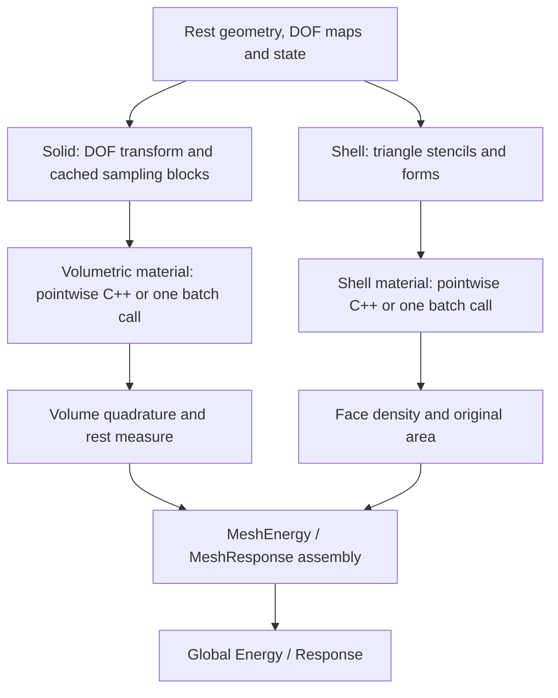

# Finite elements

The `fem` module turns interpolation and constitutive models into integrated
energies and force responses. It also locates points and builds displacement
interpolation maps. These APIs live in one module, with separate layers for
geometry, kinematics, material laws, integration, and global assembly.

## Module architecture

Arrows show evaluation data flow. The solid and shell branches use different
kinematics and integration rules, then meet at the generic energy/response
interfaces consumed by solvers.

Native headers are under `src/core/fem/`; Python's `litepgo.fem` facade
exposes the compiled basis, quadrature, and material combinations. Link
`litepgo::fem` in C++. The high-level wrappers perform basis transforms and
integration; custom local constructions must apply each measure and pullback
exactly once.

Spatial `InterpolatedResponse` and `DeformationGradientResponse` describe fixed
configuration as a function of reference coordinates. Native FEM samples that
configuration at construction. Volumetric displacement evaluation uses cached
affine coefficient maps. Shell evaluation recomputes nonlinear stencil geometry
from the current displacement; fixed-pose shell force Responses cache that geometry.
Neither path creates spatial Responses or a LocalEnergy/LocalResponse layer during assembly.

## Source layout

C++ headers use `litepgo/fem/<directory>/<file>.hpp`. The source directories
separate mathematical components from assembly and geometry queries:

| Directory | Responsibility |
| --- | --- |
| `basis/` | Reference shape functions and coefficient conventions |
| `quadrature/` | Reference points and integration weights |
| `material/` | Pointwise shell and volumetric constitutive laws; batch-material interfaces |
| `response/` | Spatial interpolation, coefficient sampling and parameter maps |
| `kinematics/` | Geometric quantities and feasible-step formulas |
| `integration/` | Physical quadrature data and integration helpers |
| `assembly/` | Physical DOF transforms, derivative pullbacks, FEM energies and force Responses |
| `assembly/detail/` | Internal face caches, batch views and shared assembly implementations |
| `embedding/` | Element location, point displacement maps and boundary sampling |

Bindings under `src/binding/fem/` and C++ tests under `tests/cpp/fem/` follow
these responsibilities. Python keeps the flat `litepgo.fem` API; directory names
do not create new Python submodules. Class names and C++ namespaces are unchanged.

Existing C++ callers must update include paths: assembled energies and force
Responses are under `assembly/`, `basis_dof_transform.hpp` and
`dof_derivatives.hpp` are also under `assembly/`, `volumetric_element.hpp` is under
`integration/`, and geometry-query headers are under `embedding/`.
`log_diagonal_fp_response.hpp` now belongs to `response/`.
The old include paths have no compatibility forwarding headers. Headers under
`assembly/detail/` are implementation details, not additional public API layers.

## Choose a layer

| Layer | Main objects | Read |
| --- | --- | --- |
| Shape functions | P1, Q1 and Hermite bases, reference derivatives and coefficient slots | [Basis functions](basis.md) |
| Coefficient sampling | Value, reference gradient, Hessian and deformation-gradient sampling factories | [Sampling responses](sampling-responses.md) |
| Spatial interpolation | `InterpolatedResponse[Basis]`, fixed coefficients and coordinate derivatives | [Spatial Response](interpolated-response.md) |
| Reference integration rules | Gauss-Legendre tensor products and simplex centroid rules | [Quadrature](quadrature.md) |
| Interpolation and integration | Sampling maps, material formulas, quadrature, `VolumetricElement3D` | [Spatial responses and coefficient maps](fields.md) |
| Solid elasticity | `deformation_gradient_sampling_response`, `NeoHookean`, `VolumetricFemEnergy` | [Volumetric elasticity](volume.md) |
| Shell elasticity | Mid-edge stencils/forms, `KoiterStVK`, `ShellFemEnergy` | [Shells and natural geometry](shell.md) |
| Materials in Python | `PyVolumetricMaterial`, `PyShellMaterial`, Torch subclasses | [Materials written in Python](python-materials.md) |
| Physical derivative DOFs | `BasisDofTransform[HexHermiteBasis]` | [Hex Hermite](hermite.md) |
| Geometry queries and sampling | `ElementLocator`, `PointEmbedding`, displacement maps, `sample_boundary` | [Embedding and boundary sampling](embedding.md) |
| Fixed-pose parameter derivatives | Volumetric/shell material-force and plastic-force responses | [Force responses](force-responses.md) |

## Energy and force-response paths

A FEM energy takes displacement DOFs $u$, holding rest geometry, material,
and prescribed plastic fields fixed. It returns integrated $E(u)$,
$g=\partial E/\partial u$, and an exact or locally projected Hessian.

A FEM force response takes material/plastic coefficients $p$, holding the
displacement pose fixed. It returns the same positive-gradient force and its
partial derivative $B=\partial g/\partial p|_u$. Parameter and displacement
maps therefore serve different roles. The response does not solve equilibrium.
To include the state change, wrap a model factory and this partial in
`solver.StaticEquilibriumResponse` as described in [inverse problems](../solver/inverse.md).

Solid energies use a rest-volume measure and the documented plastic volume
factor. Shell energies use original reference face area while plasticity changes
natural forms. Consult the corresponding model page before exchanging parameter
fields or interpreting a force. The shared [packing conventions](../concepts.md)
apply to both branches.

Start with the [complete one-tet energy](volume.md#complete-one-tet-energy), or run
an [equilibrium example](../../examples/equilibrium/index.md). Higher-order Hermite
displacement requires the physical-DOF transform even when the rest geometry
uses ordinary Q1 fields.
