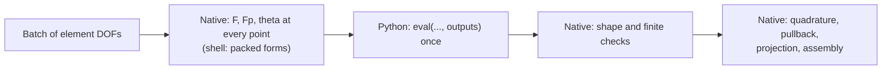

# Materials written in Python

A volumetric or shell material can be written in Python (NumPy, Numba, PyTorch,
...) and used by the native FEM templates. Only the constitutive formula moves to
Python. Interpolation, quadrature, derivative pullback, Hessian projection,
sparse assembly and the solvers stay native, for every compiled basis and
quadrature rule.

```python
from litepgo import fem

class MyMaterial(fem.PyVolumetricMaterial):
    num_parameters = 2

    def eval(self, F, Fp, theta, *, outputs):
        ...  # return {"W": ..., "dW_dF": ..., ...} for the requested names

potential = fem.VolumetricFemEnergy[fem.HexQ1Basis, fem.GaussLegendre3D[2]](MyMaterial(),
    displacement_map, rest_position_fields, Fp, theta)
```

FEM takes a batch material instance as its first constructor argument. The
volumetric template selects only displacement basis and quadrature. Shell FEM
uses ordinary classes. Python and C++ expose the same material hierarchy.

```python
native = fem.PointwiseVolumetricAdapter[fem.NeoHookean]()
shell = fem.PointwiseShellAdapter[fem.KoiterStVK]()
assert isinstance(native, fem.VolumetricBatchMaterial)
assert isinstance(shell, fem.ShellBatchMaterial)
```

`PointwiseVolumetricAdapter` and `PointwiseShellAdapter` evaluate the existing
pointwise C++ formulas through the batch interface. `PyVolumetricMaterial` and
`PyShellMaterial` implement that interface through a Python callback. Energy and
force responses can share one material instance.

## Evaluation path

Arrows show data flow during one `MeshEnergy` or `MeshResponse` batch.



A batch holds up to `batch_size` elements (default 256) of one DOF-stencil size,
so a volumetric call receives `elements × quadrature points` rows. Each row is
independent. Native and Python materials share the integration and pullback code;
a pointwise adapter evaluates its C++ formula for each point inside that batch.

## Volumetric materials

Subclass `fem.PyVolumetricMaterial`, set `num_parameters` (the width $k$ of
`theta`) and define an instance method `eval(self, F, Fp, theta, *, outputs)`. Call
`super().__init__()` in a custom constructor. Stateless formulas can also use static methods.

| Input | Shape | Meaning |
| --- | --- | --- |
| `F` | $(N,3,3)$ | total deformation gradient, `F[n,i,j]` $=F_{ij}$ |
| `Fp` | $(N,3,3)$ | plastic factor of $F=F_eF_p$ |
| `theta` | $(N,k)$ | material parameters |

All three are CPU float64 NumPy arrays owned by the call. `outputs` is a tuple of
names; return a `dict` containing at least those entries (extra entries are
ignored). Values are converted with `numpy.ascontiguousarray(value, float64)`,
so Torch tensors without gradients are accepted too.

| Name | Shape | Entry |
| --- | --- | --- |
| `W` | $(N,)$ | density per **original** reference volume |
| `dW_dF` | $(N,3,3)$ | $\partial W/\partial F_{ij}$ |
| `d2W_dF2` | $(N,3,3,3,3)$ | $\partial^2 W/\partial F_{ij}\partial F_{kl}$ |
| `d2W_dF_dtheta` | $(N,3,3,k)$ | $\partial^2 W/\partial F_{ij}\partial\theta_a$ |
| `d2W_dF_dFp` | $(N,3,3,3,3)$ | $\partial^2 W/\partial F_{ij}\partial (F_p)_{kl}$ |

Derivatives hold the other inputs fixed. Indices are tensor indices, not the
column-major `vec` packing used by native C++ materials; the binding converts.
The material owns the multiplicative split and any $\det F_p$ factor, as
`NeoHookean` does:
$W=\det(F_p)\,\psi(FF_p^{-1})$.

Each operation requests only what it needs:

| Caller | `outputs` |
| --- | --- |
| `VolumetricFemEnergy` value / gradient / Hessian | `("W",)`, `("W","dW_dF")`, `("W","dW_dF","d2W_dF2")` |
| `VolumetricFemForceMaterialResponse` value / Jacobian | `("dW_dF",)`, `("dW_dF","d2W_dF_dtheta")` |
| `VolumetricFemForceFpResponse` value / Jacobian | `("dW_dF",)`, `("dW_dF","d2W_dF_dFp")` |

Every material must support all listed outputs, including mixed derivatives.
Each call computes only its requested outputs: equilibrium uses energy, stress
and stiffness; [force responses](force-responses.md) also use mixed derivatives.
C++ pointwise adapters require the methods at compile time. Python callbacks
are checked at evaluation time for missing outputs, shapes and finite values.
Test Python materials with requests for every output before using them in a solve.
Compute shared intermediate values (for example $F_p^{-1}$, $\log\det F_e$ or a
Torch graph) once per call.

The inherited `eval_feasible_step(F, Fp, theta, dF)` is directly callable and
returns an $(N,)$ bound in $[0,1]$ keeping $\det F>0$ along $F+t\,dF$ using the
native determinant-step routine. For fixed $F_p$ with positive determinant this
also keeps $\det F_e>0$. Override it when the material needs a stricter bound;
`super().eval_feasible_step(...)` calls the default without re-entering the override.
Do not set the method to `None`.

```python
bounds = material.eval_feasible_step(F, Fp, theta, dF)
```

## Shell materials

Subclass `fem.PyShellMaterial` and define
`eval(ab, ab_bar, thickness, theta, *, outputs)`:

| Input | Shape | Meaning |
| --- | --- | --- |
| `ab` | $(N,6)$ | current forms $(a_{11},a_{12},a_{22},b_{11},b_{12},b_{22})$ |
| `ab_bar` | $(N,6)$ | natural forms in the same packing |
| `thickness` | $(N,)$ | face thickness |
| `theta` | $(N,k)$ | material parameters |

| Name | Shape | Entry |
| --- | --- | --- |
| `W` | $(N,)$ | density per original reference area |
| `dW_dab` | $(N,6)$ | $\partial W/\partial ab_r$ |
| `d2W_dab2` | $(N,6,6)$ | $\partial^2 W/\partial ab_r\partial ab_s$ |
| `d2W_dab_dtheta` | $(N,6,k)$ | $\partial^2 W/\partial ab_r\partial\theta_a$ |
| `d2W_dab_dabarbbar` | $(N,6,6)$ | $\partial^2 W/\partial ab_r\partial \bar{ab}_s$ |

Shell materials must also support every listed output, including both mixed derivatives.
The packed entries are independent variables and the mixed entries are not
scaled, matching `KoiterStVK`. A formula written on the packed vectors (or
autograd through them) therefore produces the expected derivatives; symmetric
2×2 matrices built from them must reuse the single off-diagonal entry. Energies request
`W`, `dW_dab` and `d2W_dab2`; `ShellFemForceMaterialResponse` requests
`d2W_dab_dtheta`; `ShellFemForceFpResponse` requests `d2W_dab_dabarbbar` and
chains the natural forms to $F_p$ natively. Shell line searches use the
geometric mid-edge bound only, so the density must stay finite wherever the
current metric remains positive definite.

## Material instances and ownership

FEM retains the material instance for its lifetime. Store fixed state, including
network modules, on that instance. Separate instances can carry different state
while sharing the same compiled FEM type.

```python
class Learned(TorchVolumetricMaterial):
    num_parameters = 2

    def __init__(self, model):
        super().__init__()
        self.model = model

    def W(self, F, Fp, theta):
        return self.model(F, Fp, theta)

material = Learned(model)
potential = fem.VolumetricFemEnergy[fem.TetP1Basis, fem.TetCentroidQuadrature](
    material, displacement_map, rest_position_fields, Fp, theta)
```

Keep material state fixed during evaluation and solve operations. Batch callbacks
may overlap, so shared mutable state requires synchronization. Use weak references
for material back-references to owning FEM objects.

## PyTorch materials

`litepgo.torch.TorchVolumetricMaterial` and `TorchShellMaterial` implement `eval`
from a density `W` written in Torch:

```python
import torch
from litepgo.torch import TorchVolumetricMaterial

class TorchNeoHookean(TorchVolumetricMaterial):
    num_parameters = 2

    @staticmethod
    def W(F, Fp, theta):
        Fe = F @ torch.linalg.inv(Fp)
        log_J = torch.linalg.det(Fe).log()
        lam, mu = theta.unbind(-1)
        psi = 0.5 * mu * (Fe.square().sum((-2, -1)) - 3) - mu * log_J + 0.5 * lam * log_J.square()
        return torch.linalg.det(Fp) * psi
```

Each call builds one graph: the first derivative is one backward pass and each
requested second derivative nine more (six for shells), all batched over $N$.
Inputs that do not influence `W` get zero derivatives. Calls run with gradients
enabled even inside `torch.no_grad()` or `torch.inference_mode()`. Network
weights are constants for FEM; to differentiate a loss with respect to physical
`theta` or `Fp`, use the force responses with
[`litepgo.torch.response`](../torch.md).

## Errors, domains and threads

- A non-finite returned value is a domain error, like a native material outside
  its domain: Newton shortens the trial step, and a direct evaluation raises
  `ValueError`. Returning NaN outside the domain is the usual way to reject inputs.
- Exceptions raised by `eval` propagate unchanged. A missing requested entry raises
  `KeyError`; a wrong shape raises `ValueError`; a non-`dict` result raises `TypeError`.
- Each callback enters Python with the GIL held, but Torch/NumPy operations can
  release it, allowing callbacks to overlap. Protect shared mutable state;
  `functional_call` temporarily replaces module parameters and requires a lock
  when callbacks share that module. Native work before and after the call runs
  in parallel without the GIL; larger `batch_size` values mean fewer, larger calls.

## From C++

C++ defines abstract `VolumetricBatchMaterial` and `ShellBatchMaterial` bases.
FEM constructors accept `std::shared_ptr<const VolumetricBatchMaterial>` or the
shell equivalent as their first argument. Native batch implementations derive
from the appropriate base and implement `num_parameters()` and `eval(inputs,
outputs)`. Volumetric implementations also provide `eval_feasible_step(inputs,
dF)`. Non-null output pointers request results, which the material resizes and
writes. Columns hold independent points in native column-major packing.

```cpp
#include "litepgo/fem/material/volumetric/pointwise_volumetric_adapter.hpp"
auto material = std::make_shared<fem::PointwiseVolumetricAdapter<fem::NeoHookean>>();
fem::VolumetricFemEnergy<fem::TetP1Basis, fem::TetCentroidQuadrature> potential(
    material, displacement_map, rest_position_fields, Fp, theta);
```

See the [NumPy Neo-Hookean](../../examples/fem/numpy-neohookean.md),
[NumPy Koiter shell](../../examples/fem/numpy-koiter-shell.md),
[Torch Neo-Hookean](../../examples/torch/torch-neohookean.md) and
[Torch shell fit](../../examples/torch/torch-shell-material-fit.md) examples.
