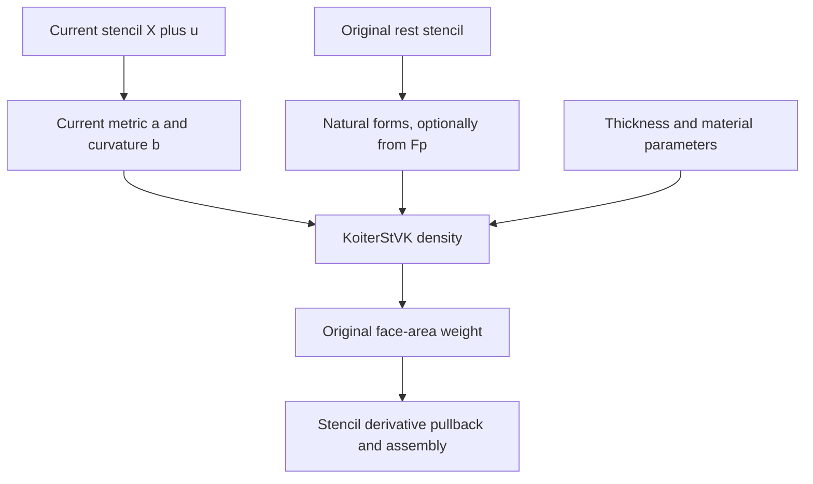

# Triangle mid-edge shell FEM

The shell model uses triangle positions with three displacement DOFs per vertex.
A neighboring-face stencil supplies bending information. Geometry, kinematics,
material density, and integration are distinct steps.

## Shell evaluation pipeline

The stencil supplies enough neighboring positions to reconstruct bending. Rest
or plastic natural forms and current forms enter the material separately;
original face area is applied after evaluating the density.



This separation explains why prescribed shell plasticity changes natural forms
without changing the current-position map or original integration area.

## Build the face stencils

For a triangle topology, `make_triangle_mid_edge_stencils(topology)` returns one
ordered vertex list and three opposite-row indices per face. The first three
rows are the central triangle. Opposite vertices across edges 0, 1, 2 are appended
in order, with duplicates included only once; a stencil contains 3–6 vertices.
An opposite row of `-1` denotes a boundary edge, not a global vertex.

```python
stencils = mesh.make_triangle_mid_edge_stencils(topology)
mapping = dof.StencilDofMap(topology.num_vertices, stencils.vertices, 3)
rest = [fem.TriangleMidEdgeRestData(
            mapping.gather(e, nodes.ravel()), stencils.opposite[e])
        for e in range(mapping.num_elements)]
Energy = fem.ShellFemEnergy[fem.KoiterStVK]
elastic = Energy(mapping, rest, [0.1] * mapping.num_elements,
                 [np.array([2.0, 3.0])] * mapping.num_elements)
```

Here `nodes` is the `(n,3)` rest-position array and `topology` its triangle
connectivity. Import NumPy and `dof`, `fem`, `mesh` from litepgo. The
[shell equilibrium example](../../examples/equilibrium/shell-saddle-pull.md)
contains the complete file-backed setup, solve, and output.

Topology must be consistently wound and edge-manifold. Duplicate faces,
inconsistent shared-edge directions, and edges with more than two incident faces
are rejected. The topology builder does not repair geometry.

## Metric and curvature discretization

For the current central triangle $(x_0,x_1,x_2)$, define

$$
J=[x_1-x_0,\ x_2-x_0],\qquad a=J^TJ.
$$

Edge $k$ joins $x_{k+1}$ and $x_{k+2}$, opposite $x_k$, with indices modulo
three. Let $p_k$ be the neighboring face's opposite vertex. The area-weighted
mid-edge construction uses

$$
N=(x_1-x_0)\times(x_2-x_0),\qquad
N_k=(x_{k+2}-x_{p_k})\times(x_{k+1}-x_{p_k}),
$$

$$
c_k=-\frac{[(x_{k+1}-x_k)+(x_{k+2}-x_k)]\cdot N_k}{\|N+N_k\|},
\qquad b=\begin{bmatrix}c_0+c_1&c_0\\c_0&c_0+c_2\end{bmatrix}.
$$

At boundary edges set $c_k=0$, corresponding to one-sided normal
extrapolation. This does not impose a clamped boundary director. The sign agrees
with the smooth convention $b_{\alpha\beta}=n\cdot x_{,\alpha\beta}$.
The numerical routine `eval_triangle_mid_edge_kinematics` returns $a,b$
and optional analytic first/second derivatives with respect to the full stencil.
Collapsed triangles and cancelling averaged normals are invalid.

## Koiter StVK density and integration

Let $\bar a,\bar b$ be natural forms, $t>0$ thickness, and
$\theta=(\lambda_{ps},\mu)$ plane-stress parameters. Define

$$
\epsilon=\tfrac12(a-\bar a),\qquad\kappa=b-\bar b,
$$

$$
\psi(S)=\frac{\lambda_{ps}}2[\operatorname{tr}(\bar a^{-1}S)]^2
+\mu\operatorname{tr}(\bar a^{-1}S\bar a^{-1}S),\qquad
W=t\psi(\epsilon)+\frac{t^3}{12}\psi(\kappa).
$$

For Young's modulus $Y$ and Poisson ratio $\nu$,
$\lambda_{ps}=Y\nu/(1-\nu^2)$ and $\mu=Y/[2(1+\nu)]$.
The plane-stress $\lambda_{ps}$ is not the 3D Lamé coefficient. The material
requires finite symmetric forms, positive-definite current/natural metrics,
$\mu>0$, and $\lambda_{ps}+\mu>0$.

`TriangleMidEdgeRestData` owns original stencil positions and opposite rows.
For one original reference face, let
$A_0=\frac12\sqrt{\det\bar a_0}$. Its contribution is

$$
E_e(u_e)=A_0W\!\left(a(X+u),b(X+u),\bar a,\bar b,t,\theta\right).
$$

The density is constant on the central face, so the centroid rule integrates this
discrete density exactly. Neighbor vertices contribute curvature support; they
are not additional integration faces in this term.

Pack independent forms as $s=(a_{11},a_{12},a_{22},b_{11},b_{12},b_{22})$.
An off-diagonal scalar changes both symmetric matrix entries. With
$B=\partial s/\partial u_e$, the exact derivatives include geometry:

$$
g_e=A_0 B^TW_{,s},\qquad
H_e=A_0\left(B^TW_{,ss}B+\sum_{i=1}^6 W_{,s_i}\nabla^2s_i\right).
$$

Dropping the second term is not the exact shell Hessian.
`ShellMaterialLocalEnergy2D[KoiterStVK]` evaluates a density for one reference
stencil and displacement matrix. `ShellFemEnergy` snapshots per-face data,
adds geometric feasible-step bounds, and assembles the integrated energies.

## Prescribed plastic natural geometry

Optional `Fp` supplies one fixed $3\times3$ matrix per face. In a stencil
centered at its first vertex, form

$$
Y_i=F_{p,e}(X_i-X_0),\qquad
(\bar a_p,\bar b_p)=s(Y).
$$

The energy replaces natural forms with these values. Current coordinates remain
$X+u$; **original** integration area, thickness, and material parameters stay
fixed. There is no $\det F_p$ multiplier or plastic-thickness update in this
shell convention. Each face has a local virtual natural stencil; neighboring
natural stencils need not form a compatible global mesh.

Matrices must be finite with positive determinant and nondegenerate natural
stencils. A constant affine transform of a planar stencil keeps its natural
curvature zero. Incompatible in-plane growth can still bend the sheet through
the equilibrium solve. Rebuild the energy to change the prescribed plastic state.

`ShellFemForceMaterialResponse` and `ShellFemForceFpResponse` differentiate
positive displacement-gradient force at a **fixed pose**. The former has two
material parameters per parameter block; the latter has nine column-packed
plastic entries. Full plastic identification is generally rank-deficient:
left rotations preserve natural forms and planar stencils cannot observe the
normal input direction. The fitting examples deliberately restrict parameters.

For plastic-force differentiation at fixed current geometry, let
$B_u=\partial s(x)/\partial u$, $B_Y=\partial s(Y)/\partial Y$, and
$T=\partial Y/\partial\operatorname{vec}F_p$. Then

$$
\frac{\partial f_e}{\partial\operatorname{vec}F_p}
=A_0B_u^TW_{,s\bar s}B_YT,\qquad
T_{3i+k,k+3l}=(X_i-X_0)_l.
$$

The material mixed derivative differentiates the natural metric inverse as well
as strain/curvature differences:
$d\bar a^{-1}=-\bar a^{-1}(d\bar a)\bar a^{-1}$.
It is therefore not generally the negative current-form Hessian. The API
`KoiterStVK.eval_d2W_dab_dabarbbar` uses the same six-entry order for both form
blocks. A plastic coefficient field is sampled at the local query coordinate and
applied uniformly to that face's full stencil; its spatial derivatives are not
a global natural-geometry interpolation.

## Scope and geometric feasibility

The shell step routine bounds triangle areas and averaged-normal margins along
the whole affine displacement segment. It does not provide collision prevention.
The model has a fixed thickness, per-face parameters, and the specified boundary
normal rule. It does not add plastic evolution, friction, adaptive remeshing,
or a general shell director model. See [contact](../contact/index.md) for explicit
collision-energy composition.
