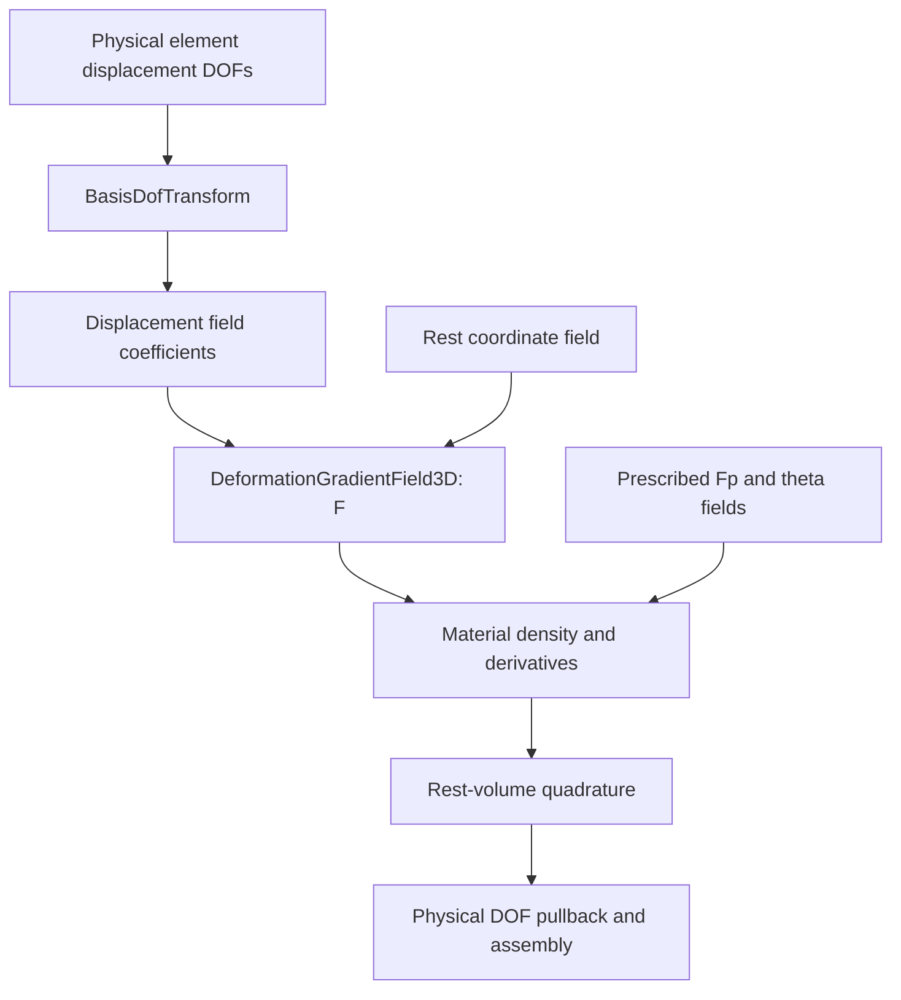

# Volumetric elasticity and prescribed plasticity

A volumetric energy maps displacement DOFs to a scalar elastic energy. Geometry,
plastic state, and material fields are fixed during each energy's displacement
solve. This chapter defines the implemented model and builds one complete element.

## Solid evaluation pipeline

The high-level energy gathers physical displacement DOFs and transforms them
before field evaluation. Material derivatives travel back through the same
kinematics and transform; reference volume is applied once during integration.



The arrows show forward evaluation order; gradient and Hessian pullbacks apply
the chain rule in reverse. The same local ingredients also support fixed-pose
material/plastic force responses.

## Kinematics and Neo-Hookean density

Let $F=I+\nabla_Xu$ be the total deformation gradient and $F_p$ a prescribed
plastic gradient. Multiplicative kinematics uses

$$
F=F_eF_p,\qquad F_e=FF_p^{-1},\qquad J_e=\det F_e.
$$

`NeoHookean` uses material parameters $\theta=(\lambda,\mu)$ and density per
original rest volume

$$
\psi(F_e)=\frac\mu2(\|F_e\|_F^2-3)-\mu\log J_e
+\frac\lambda2(\log J_e)^2,
$$

$$
W(F,F_p,\theta)=\det(F_p)\,\psi(F_e).
$$

The admissible domain has $\det F>0$, $\det F_p>0$, $\lambda\ge0$,
and $\mu>0$, with finite representable evaluations. For $F_p=I$, the rest
state $F=I$ has zero energy and stress. The first Piola stress is

$$
P=\frac{\partial W}{\partial F}
=\det(F_p)\left[\mu F_e+(\lambda\log J_e-\mu)F_e^{-T}\right]F_p^{-T}.
$$

`eval_dW_dF` returns the $3\times3$ stress. `eval_d2W_dF2` returns its
$9\times9$ derivative using column-major vectorization. The gradient of
integrated energy is the positive nodal force used by the examples.

## Complete one-tet energy

```python
import numpy as np
from litepgo import dof, energy, fem, mesh

X = np.array([[0., 0., 0.], [1., 0., 0.], [0., 1., 0.], [0., 0., 1.]])
topology = mesh.TetTopology(4, np.array([[0, 1, 2, 3]], dtype=np.int32))
mapping = dof.VertexDofMap(topology, 3)
XField = fem.InterpolatedField3D[fem.TetP1Basis]
geometry = [XField(mapping.gather(0, X.ravel()))]
plastic = [fem.IdentityField3D(np.eye(3).ravel(order="F"))]
material = [fem.IdentityField3D(np.array([2., 3.]))]
Energy = fem.VolumetricFemEnergy[fem.NeoHookean, fem.TetP1Basis,
                                  fem.TetCentroidQuadrature]
elastic = Energy(mapping, geometry, plastic, material)
u = np.zeros(mapping.num_dofs)
value, gradient, hessian = elastic.eval(u, gradient=True,
                                       hessian=energy.HessianKind.Exact)
assert abs(value) < 1e-12
assert np.linalg.norm(gradient) < 1e-12
assert hessian.shape == (12, 12)
```

For multiple elements, pass one geometry, plastic, and material field per element,
in the same order as the DOF map. Python shares ownership of the bound fields;
C++ stores field vectors by value, whose internally borrowed dependencies must
still remain alive. The geometry basis is independent of the displacement basis.

## Basis and quadrature choices

| Displacement | DOFs per vertex | Typical geometry | Bound quadrature |
| --- | --- | --- | --- |
| Tet P1 | 3 | Tet P1 | Tet centroid |
| Hex Q1 | 3 | Hex Q1 | Gauss–Legendre 2 or 4 per axis |
| Hex Hermite | 24 | Axis-aligned affine Hex Q1 boxes | Gauss–Legendre 2 or 4 per axis |

The Python template has arguments `[Material, DisplacementBasis, Quadrature]`.
Its field-type arguments are erased to shared `Field3D` objects. C++ additionally
selects concrete field types. `.instances` lists the compiled Python combinations.
See [Hex Hermite](hermite.md) before constructing a 24-DOF map.

The global energy is

$$
E(u)=\sum_{e,q}w_q\det J_{X,e}(\xi_q)
 W\!\left(I+u_{e,\xi}J_{X,e}^{-1},F_{p,e},\theta_e\right).
$$

`VolumetricFemEnergy` composes transforms, deformation fields, local material
energies, cached integration, and batched `MeshEnergy` assembly. For a custom
integrator, the lower-level C++ construction is

```cpp
fem::DeformationGradientField3D F(u_field, X_field);
fem::VolumetricMaterialLocalEnergyF3D<fem::NeoHookean> local(F, Fp_field, theta_field);
fem::VolumetricElement3D<fem::TetCentroidQuadrature> element(X_field);
Eigen::VectorXd g;
Eigen::MatrixXd H;
const double E = element.eval(local, &g, &H);
```

The `fem` alias denotes `litepgo::fem`. Keep all named fields alive. The local
energy differentiates the active $F$-field coefficients; a composed deformation
field makes these displacement coefficients. The element applies quadrature
weights and reference volume exactly once.

## Plastic fields and parameter-force derivatives

An identity field describes a constant $F_p$; a
`DeformationGradientField3D(u_p, X)` describes
$F_p=I+\nabla_Xu_p$, where $u_p$ is a prescribed compatible displacement.
The latter includes shear induced by a spatially varying rotation. It is not
merely a rotation matrix field. If the displacement space contains $u_p$,
$u=u_p$ is a stress-free state when boundary conditions permit it.

`VolumetricFemForceMaterialResponse` varies material coefficients at a fixed
pose. `VolumetricFemForceFpResponse` varies column-packed plastic coefficients at
a fixed pose. They expose $f=\partial E/\partial u$ and the mixed derivatives
$\partial f/\partial\theta$ or $\partial f/\partial\operatorname{vec}F_p$.
They do not solve equilibrium. See [inverse problems](../solver/inverse.md) for total
derivatives through a solve and [plasticity examples](../../examples/plasticity/index.md)
for prescribed-field equilibria.

## Feasibility and scope

The solid energy bounds steps using the same quadrature points as evaluation.
`eval_positive_det_feasible_step(A, dA)` bounds the first zero of
$\det(A+\alpha dA)$, including interior/repeated roots, and leaves a safety
margin. Tet P1 has constant $F$ per element; Hex Q1/Hermite quadrature checks
are not a certificate of injectivity everywhere inside the element. Positive
determinants also do not prevent floating-point overflow at extreme scales.

These are elastic solves with a supplied plastic state. Yield surfaces,
plastic-state evolution, dynamic time integration, and contact are not implicitly
added. Compose contact or loads explicitly in a total potential.
