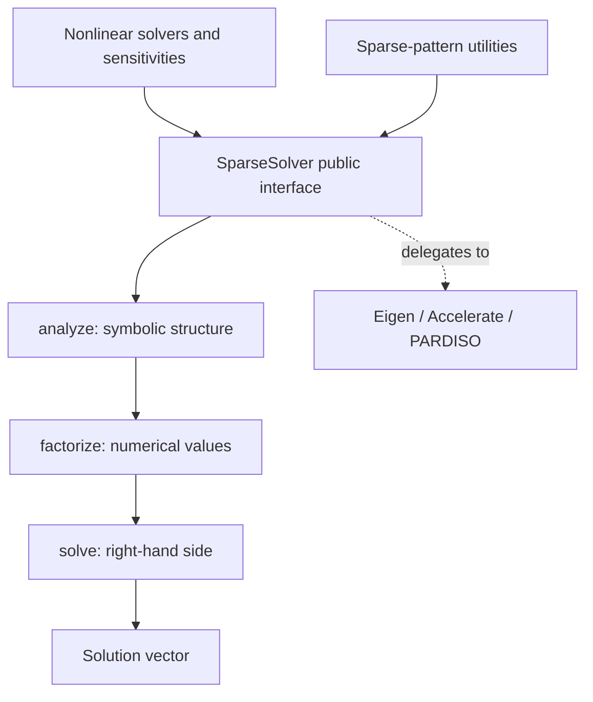

# Sparse linear algebra

The `linalg` module owns sparse-pattern utilities and direct linear solvers.
It factors numerical systems supplied by a caller; it does not define energies,
constraints, Newton iterations, or material models.

## Module architecture

The public `SparseSolver` interface validates the matrix lifecycle and delegates
factorization to a concrete backend. Newton, Gauss–Newton, and equilibrium
sensitivities are callers of that interface.

Native code is in `src/cpp/linalg/`, with public solver headers under
`linalg/sparse_solver/`. Python exports the interface and concrete classes through
`litepgo.linalg.sparse_solver`, also re-exported by `litepgo.linalg`.

## Read this module

| Topic | Read |
| --- | --- |
| Analyze, factorize, solve, reuse and matrix contracts | [Factorization lifecycle](factorization.md) |
| Eigen, Accelerate, PARDISO and automatic aliases | [Backend selection](backends.md) |

Use the lifecycle page for a standalone linear solve. Nonlinear algorithms in
[solver](../solver/index.md) manage that lifecycle for their own sparse systems.
