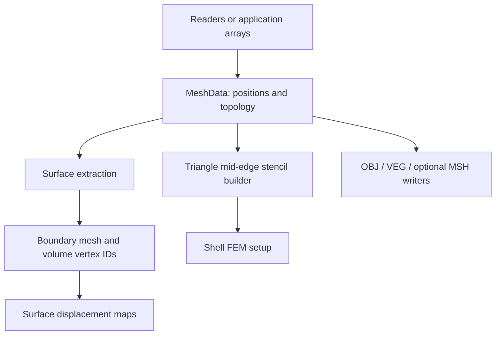

# Meshes and geometry I/O

A mesh owns vertex positions and topology. Mesh I/O preserves geometry and
connectivity; it does not infer materials, boundary conditions, or simulation
DOFs. FEM and contact perform additional geometric validity checks.

## Module architecture

The native `mesh` module owns topology, mesh data, boundary extraction, and
triangle shell-stencil construction, and OBJ/VEG file I/O. Its Python facade
exposes the same operations. Optional MSH support uses `litepgo::mesh_gmsh`.
Arrows below show construction and derived-geometry data flow.

Topology describes connectivity; it does not carry materials or DOFs. Derived
boundary IDs connect to the [DOF module](../dof/index.md), and shell stencils connect to
[FEM](../fem/index.md). Native sources are in `src/core/mesh/`; Python imports
these operations through `litepgo.mesh`.

## CGAL surface processing

Configure with `-DLITEPGO_WITH_CGAL=ON` to enable triangle surface queries and
remeshing. In C++, link `litepgo::mesh_cgal` and include
`<litepgo/mesh/self_intersections.hpp>` or `<litepgo/mesh/isotropic_remesh.hpp>`.
In Python, check `litepgo.mesh.has_cgal` for availability.

- `has_self_intersections(mesh)` reports crossings, overlapping faces, and
  degenerate triangles. Contact confined to a shared indexed vertex or edge is
  allowed.
- `isotropic_remesh(mesh, target_edge_length, num_iter, constrained_vertices)`
  returns a new triangle mesh. It preserves open boundary edges and the
  positions of specified input vertices. Target edge length and iteration count
  must be positive. Input faces must be nondegenerate and compatible with an
  oriented surface mesh. A protected boundary edge longer than
  `4/3 * target_edge_length` causes an error. Vertex and face indices may change.
  In Python, pass all arguments after `mesh` by keyword.

See the [constrained remeshing example](../../examples/mesh-processing/constrained-remesh.md)
for both languages.

## Read this module

| Topic | Read |
| --- | --- |
| Position arrays, connectivity, ownership and mesh types | [Mesh data and topology](data.md) |
| OBJ/VEG/MSH, boundary extraction and file behavior | [I/O and surface extraction](io.md) |

Start with mesh data when constructing geometry in memory, or the I/O page for
bundled assets and simulation boundaries. Materials and DOFs are configured by
the consuming modules.
