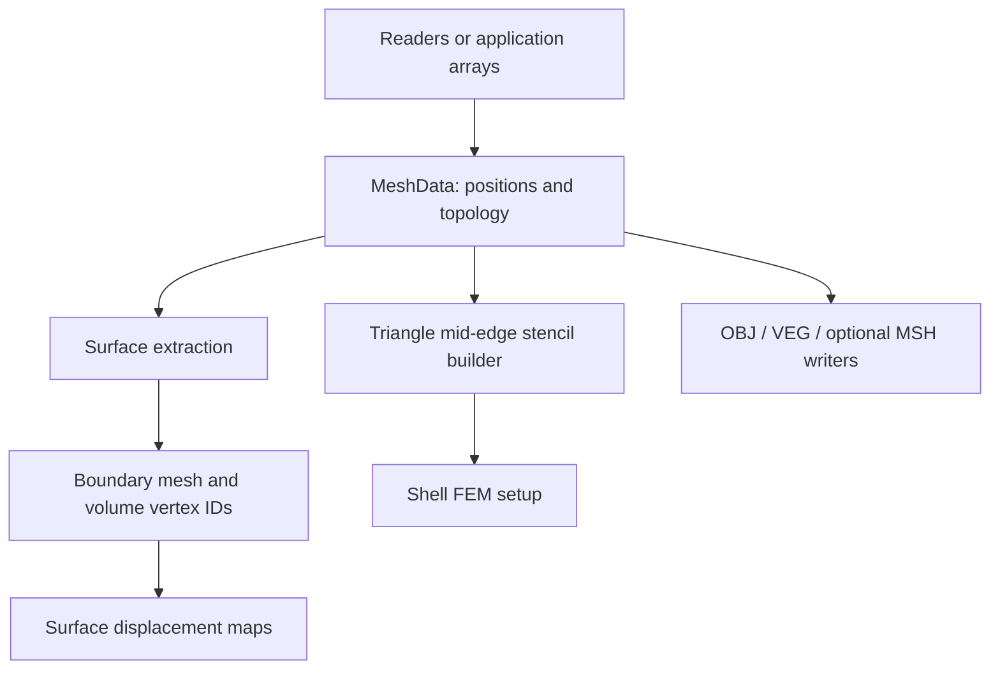

# Meshes and geometry I/O

A mesh owns vertex positions and topology. Mesh I/O preserves geometry and
connectivity; it does not infer materials, boundary conditions, or simulation
DOFs. FEM and contact perform additional geometric validity checks.

## Module architecture

The native `mesh` module owns topology, mesh data, boundary extraction, and
triangle shell-stencil construction, and OBJ/VEG file I/O. Its Python facade
exposes the same operations. Optional MSH support uses `litepgo::mesh_gmsh`.
Arrows below show construction and derived-geometry data flow.

Topology describes connectivity; it does not carry materials or DOFs. Derived
boundary IDs connect to the [DOF module](../dof/index.md), and shell stencils connect to
[FEM](../fem/index.md). Native sources are in `src/core/mesh/`; Python imports
these operations through `litepgo.mesh`.

## Read this module

| Topic | Read |
| --- | --- |
| Position arrays, connectivity, ownership and mesh types | [Mesh data and topology](data.md) |
| OBJ/VEG/MSH, boundary extraction and file behavior | [I/O and surface extraction](io.md) |

Start with mesh data when constructing geometry in memory, or the I/O page for
bundled assets and simulation boundaries. Materials and DOFs are configured by
the consuming modules.
