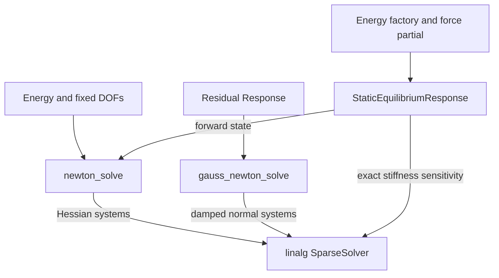

# Nonlinear solvers

Newton minimizes a scalar energy with hard fixed DOFs. Gauss–Newton minimizes the
squared norm of a response. Both need analytic derivatives and an explicit finite
`gradient_tolerance`; the default tolerance is NaN to require a deliberate choice.
Newton accepts a nonnegative tolerance; Gauss–Newton requires a positive one.

## Module architecture

The module contains two nonlinear algorithms and one differentiable equilibrium
wrapper. Each algorithm consumes an abstract energy/response and delegates sparse
systems to [linalg](../linalg/index.md). `StaticEquilibriumResponse` calls Newton for the
state and solves an additional exact stiffness system when a Jacobian is requested.

Arrows identify supplied inputs or delegated solves. The module does not own
geometry or materials; callers build those through model factories. Native code
is in `src/cpp/solver/`; Python uses `litepgo.solver`. The
[inverse-problem guide](inverse.md) explains how state and force derivatives form
an observation Jacobian.

## Read this module

| Topic | Read |
| --- | --- |
| Minimize an Energy with fixed DOFs and feasible steps | [Constrained Newton](newton.md) |
| Fit a residual Response with damped normal equations | [Gauss–Newton](gauss-newton.md) |
| Differentiate a solved state and its reactions | [Equilibrium sensitivities](equilibrium.md) |
| Select observations, parameters and an outer optimizer | [Inverse-problem workflow](inverse.md) |

A small gradient is a stationarity criterion. Check the returned status before
using a state or parameter vector as a converged result.

## Choose a sparse backend

The [linalg module](../linalg/index.md) defines `SparseSolver`, the analyze/factorize/solve
lifecycle, and the automatic or explicit backend choices. Newton accepts a
caller-selected sparse solver; Gauss–Newton has a native overload taking one.
The nonlinear algorithms manage symbolic analysis and numerical retries.

A forward solve may use projected or shifted Hessians for a useful descent
direction. [Equilibrium sensitivities](equilibrium.md) instead use the exact,
unshifted free stiffness through `StaticEquilibriumResponse`.
