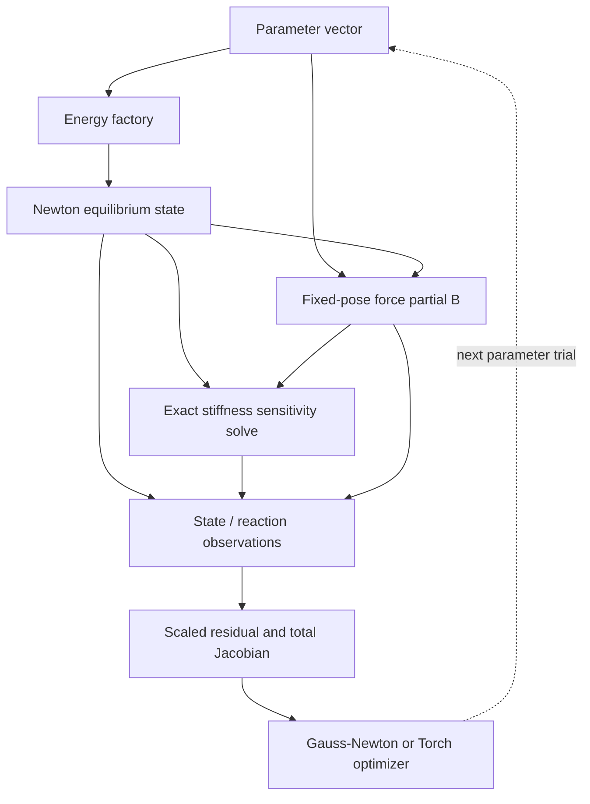

# Inverse problems and differentiation through equilibrium

An inverse problem chooses parameters so model predictions match observations.
The distinction between **a fixed pose** and **an equilibrium pose** determines
which Jacobian is correct. Both kinds use `Response` objects and can be fitted
with the native Gauss–Newton solver or the Torch adapters.

## Architecture of an inverse evaluation

This workflow crosses modules: FEM provides energies and force partials,
`solver.StaticEquilibriumResponse` adds state sensitivities, and an outer
optimizer fits the observation residual. Value-only trials can skip Jacobian work.

A fixed-pose experiment omits the equilibrium and state-sensitivity steps. The
[Torch module](../torch.md) describes how the same residual/Jacobian connects to
an outer tensor graph.

## Choose the observation model

Let $p$ be parameters, $y(p)$ model predictions, $y_{\rm obs}$ observations,
and $S$ a fixed observation scale. Minimize

$$
\Phi(p)=\tfrac12\|r(p)\|^2,\qquad r(p)=S^{-1}[y(p)-y_{\rm obs}].
$$

| Experiment | Derivative | Read |
| --- | --- | --- |
| Displacement prescribed | Fixed-pose force partial | [FEM force responses](../fem/force-responses.md) |
| Displacement solved at equilibrium | Total state and reaction Jacobians | [Equilibrium sensitivities](equilibrium.md) |
| Residual fitted by a native optimizer | Analytic residual Jacobian | [Gauss–Newton](gauss-newton.md) |
| Residual fitted through autograd | Analytic vector-Jacobian product | [Torch adapters](../torch.md) |

The [fitting examples](../../examples/fitting.md) state complete experiments,
parameter choices, and validation checks.

## Parameterizations and identifiability

For positive parameters, use $\theta_j=e^{q_j}$. The chain rule is

$$
J_q=J_\theta\operatorname{diag}(e^q).
$$

For diagonal plastic stretches,
$F_p(q)=\operatorname{diag}(e^{q_0},e^{q_1},e^{q_2})$, select column-major
columns $0,4,8$ of the nine-column derivative and apply the same factors.
Flat-shell examples fix the normal stretch to one and select columns $0,4$.
Exponentials enforce positivity mathematically; overflow/underflow trials still
need validation.

A small residual does not prove parameter uniqueness. The examples check
$\sigma_{\min}(J)/\sigma_{\max}(J)>10^{-6}$ at selected states to establish
local full column rank for their chosen experiment. Arbitrary full $F_p$
matrices contain rotational/planar ambiguities. Noise, regularization, spatially
varying identification, and yield evolution require their own models.

## Use a Torch optimizer

The [Torch module](../torch.md) connects these responses to autograd using
their analytic Jacobians. Its guide explains the forward/backward data flow,
CPU/dtype requirements, a complete runnable example, and exception behavior.
The [four Torch fitting examples](../../examples/torch.md) use the same native
models and equilibrium derivatives with an L-BFGS outer optimizer.
