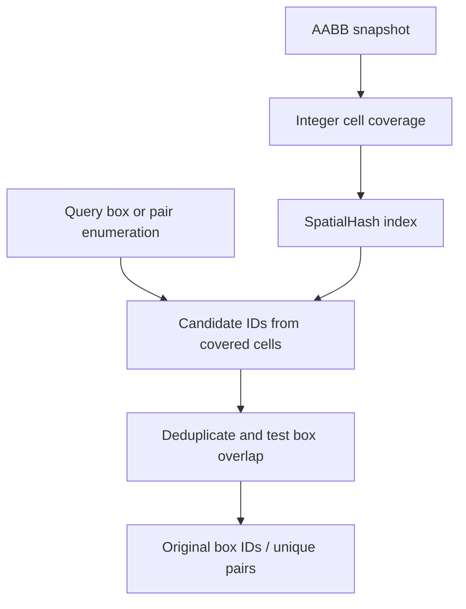

# Spatial box queries

The `spatial` module indexes axis-aligned bounding boxes (AABBs). It returns
box IDs and overlapping pairs; consumers interpret those candidates using their
own geometric tests.

## Module architecture

`AABB` is the geometric bound; `SpatialHash` owns a snapshot of those bounds and
indexes the cells they cover. Queries enumerate candidate IDs, deduplicate them,
and test actual box overlap. Pair queries return unique unordered pairs.



Native implementation is the header `src/cpp/spatial/spatial_hash.hpp`;
Python uses `litepgo.spatial`. Triangle distances, inverse element maps, and CCD
are performed by consumers, not by this generic box index.

## Query axis-aligned boxes

For boxes $[l_i,h_i]$ and $[l_j,h_j]$, inclusive overlap requires

$$
\max(l_{i,k},l_{j,k})\le\min(h_{i,k},h_{j,k})\quad\text{for }k=1,2,3.
$$

```python
from litepgo import spatial
boxes = [spatial.AABB([0., 0., 0.], [1., 1., 1.]),
         spatial.AABB([0.5, 0.5, 0.5], [2., 2., 2.])]
index = spatial.SpatialHash(boxes, cell_size=1.)
hits = index.query(spatial.AABB([0.75]*3, [0.75]*3))
pairs = index.overlapping_pairs()
assert sorted(hits) == [0, 1]
assert pairs == [[0, 1]]
```

The index owns a snapshot. A point query is a zero-width box. Pair IDs satisfy
$i<j$, are unique, and refer to original input order; general output order is
unspecified. A Python pair filter runs serially after native enumeration and does
not prune the native search. A C++ predicate must support concurrent calls.

Cell coverage includes every integer cell from $\lfloor l/h\rfloor$ through
$\lfloor h_{\rm box}/h\rfloor$. Invalid/nonfinite bounds, unrepresentable cell
coordinates, and excessive cell records throw rather than falling back to a scan.
Dense overlapping boxes retain quadratic worst-case pair work. Rebuild after
changing boxes. This generic index is separate from `contact.SpatialHash`, which
adapts collision-primitive filtering to it.

## Consumers and module boundaries

Contact's broad phase adapts primitive boxes and pair filters to this generic
index. FEM's `ElementLocator` uses element bounds to find inverse-map candidates.
Neither operation changes the spatial index's box-overlap semantics. Point
location, displacement embedding, and boundary sampling are documented under
[FEM](fem/embedding.md).
