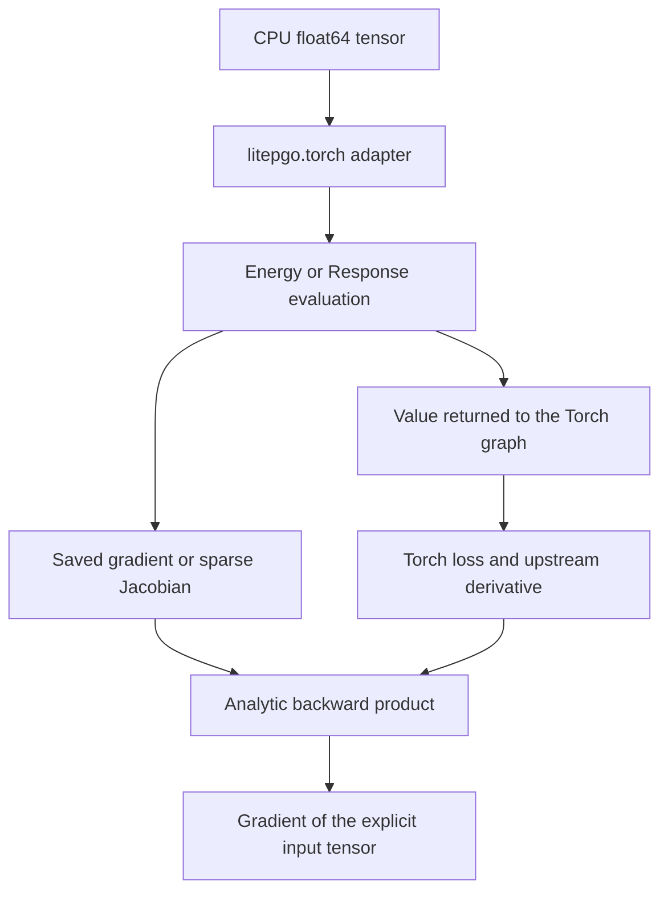

# Torch autograd adapters

`litepgo.torch` is an optional Python module connecting an `Energy` or `Response`
to PyTorch autograd. It supplies a derivative bridge around an existing model;
Torch owns the outer tensor graph and optimizer.

## Module architecture

The diagram shows a forward call with gradients enabled, followed by backward.
`energy` saves a copied energy gradient; `response` saves a copied sparse
Jacobian. Backward uses these saved derivatives rather than evaluating the model
again. Implementation lives in `python/litepgo/torch.py`.



An equilibrium model is a `solver.StaticEquilibriumResponse`, so its native
Jacobian already includes the inner equilibrium sensitivity. The adapter applies
the same vector-Jacobian product as for any other response. See
[inverse problems](solver/inverse.md) for the distinction between fixed-pose and total
derivatives.

## Use the adapter

Install PyTorch with `uv pip install torch`. Importing the base package does not
require it. `litepgo.torch.energy(E, x)` and `.response(R, x)` accept **CPU
float64 one-dimensional** tensors. The backward rules are

$$
\bar x=\bar E\,\nabla E(x),\qquad \bar x=J(x)^T\bar r.
$$

Only the explicit tensor argument is differentiable. The model/callback
configuration stays fixed; C++ evaluation does not trace Python callbacks into a
Torch graph. The adapter supports first-order derivatives, without GPU execution,
batched tensor inputs, or double backward.
Domain errors propagate to the Torch optimizer; the adapter does not implement
Gauss–Newton's rejection and retry of infeasible trial residuals.

A complete small example differentiates a quadratic:

```python
import numpy as np
import scipy.sparse as sp
import torch
from litepgo import energy
from litepgo.torch import energy as torch_energy

E = energy.QuadraticEnergy(sp.eye(2, format="csc"))
x = torch.tensor([1., 2.], dtype=torch.float64, requires_grad=True)
loss = torch_energy(E, x)
loss.backward()
np.testing.assert_allclose(x.grad.numpy(), [1., 2.])
```

The [four Torch fitting examples](../examples/torch.md) use L-BFGS with analytic
response Jacobians. The native [fitting examples](../examples/fitting.md) explain
the same experiments and their formulations in detail.
