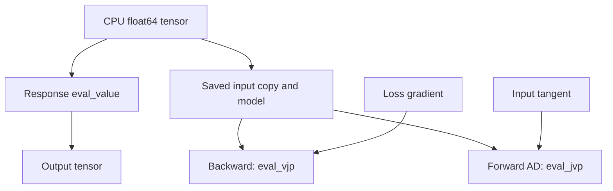

# Torch autograd adapters

`litepgo.torch` is a Python module connecting an `Energy` or `Response`
to PyTorch autograd. It supplies a derivative bridge around an existing model;
Torch owns the outer tensor graph and optimizer.

## Module architecture

The response adapter copies the input and retains the model. Forward requests
only values; backward calls `eval_vjp(saved_x, upstream)`. Forward-mode AD
calls `eval_jvp(saved_x, tangent)`. Before either product, the adapter updates
the model's pattern at the saved point, including when several forwards share
one model. No response Jacobian is saved. The energy adapter is unchanged:
it saves the energy gradient for backward.



A `StaticEquilibriumResponse` uses its adjoint VJP and directional JVP.
Each product currently re-solves equilibrium; the adapter does not cache
linearizations. Other responses can implement direct products or use the
explicit-Jacobian fallback. Wrapping an equilibrium response inside a custom
residual does not automatically forward its fast paths: that residual must
implement its own product hooks to avoid the fallback.
See [inverse problems](solver/inverse.md) for fixed-pose versus total derivatives.

## Use the adapter

`uv sync --locked` installs PyTorch with the project's default Python dependencies.
The Python API reference always includes this module.
`litepgo.torch.energy(E, x)` and `.response(R, x)` accept **CPU
float64 one-dimensional** tensors. The backward rules are

$$
\bar x=\bar E\,\nabla E(x),\qquad \bar x=J(x)^T\bar r.
$$

Only the explicit tensor argument is differentiable. The model/callback
configuration must stay fixed from forward until all derivative calls finish; C++ evaluation does not trace Python callbacks into a
Torch graph. The adapter supports first-order derivatives, without GPU execution,
batched tensor inputs, or double backward. Response forward-mode AD is supported
through `torch.autograd.forward_ad`; `torch.func` transforms and Energy
forward-mode AD are not supported by this adapter.
Domain errors propagate to the Torch optimizer; the adapter does not implement
Gauss–Newton's rejection and retry of infeasible trial residuals.

A complete small example differentiates a quadratic:

```python
import numpy as np
import scipy.sparse as sp
import torch
from litepgo import energy
from litepgo.torch import energy as torch_energy

E = energy.QuadraticEnergy(sp.eye(2, format="csc"))
x = torch.tensor([1., 2.], dtype=torch.float64, requires_grad=True)
loss = torch_energy(E, x)
loss.backward()
np.testing.assert_allclose(x.grad.numpy(), [1., 2.])
```

The [four Torch fitting examples](../examples/torch/index.md) use L-BFGS with analytic
response derivatives. The native [fitting examples](../examples/fitting/index.md) explain
the same experiments and their formulations in detail.


For a response `R`, compute a directional derivative without reverse AD:

```python
from litepgo.torch import response as torch_response

with torch.autograd.forward_ad.dual_level():
    dual = torch.autograd.forward_ad.make_dual(x, torch.ones_like(x))
    value, jvp = torch.autograd.forward_ad.unpack_dual(torch_response(R, dual))
```

The saved input is a copy, but the model is a retained reference, not a snapshot.
Derivative exceptions propagate. Repeated backward calls recompute products.
