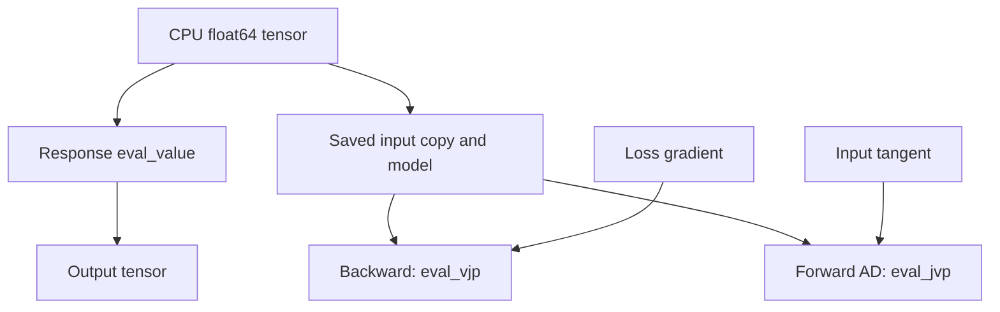

# Torch autograd adapters

`litepgo.torch` is a Python module connecting an `Energy` or `Response`
to PyTorch autograd. It supplies a derivative bridge around an existing model;
Torch owns the outer tensor graph and optimizer.

## Module architecture

The response adapter copies the input and retains the model. Forward requests
only values; backward calls `eval_vjp(saved_x, upstream)`. Forward-mode AD
calls `eval_jvp(saved_x, tangent)`. Before either product, the adapter updates
the model's pattern at the saved point, including when several forwards share
one model. No response Jacobian is saved. The energy adapter is unchanged:
it saves the energy gradient for backward.



A `StaticEquilibriumResponse` uses its adjoint VJP and directional JVP.
Each product currently re-solves equilibrium; the adapter does not cache
linearizations. Other responses can implement direct products or use the
explicit-Jacobian fallback. Wrapping an equilibrium response inside a custom
residual does not automatically forward its fast paths: that residual must
implement its own product hooks to avoid the fallback.
See [inverse problems](solver/inverse.md) for fixed-pose versus total derivatives.

## Use the adapter

`uv sync --locked` installs PyTorch with the project's default Python dependencies.
The Python API reference always includes this module.
`litepgo.torch.energy(E, x)` and `.response(R, x)` accept **CPU
float64 one-dimensional** tensors. The backward rules are

$$
\bar x=\bar E\,\nabla E(x),\qquad \bar x=J(x)^T\bar r.
$$

Only the explicit tensor argument is differentiable. The model/callback
configuration must stay fixed from forward until all derivative calls finish; C++ evaluation does not trace Python callbacks into a
Torch graph. The adapter supports first-order derivatives, without GPU execution,
batched tensor inputs, or double backward. Response forward-mode AD is supported
through `torch.autograd.forward_ad`; `torch.func` transforms and Energy
forward-mode AD are not supported by this adapter.
Domain errors propagate to the Torch optimizer; the adapter does not implement
Gauss–Newton's rejection and retry of infeasible trial residuals.

A complete small example differentiates a quadratic:

```python
import numpy as np
import scipy.sparse as sp
import torch
from litepgo import energy
from litepgo.torch import energy as torch_energy

E = energy.QuadraticEnergy(sp.eye(2, format="csc"))
x = torch.tensor([1., 2.], dtype=torch.float64, requires_grad=True)
loss = torch_energy(E, x)
loss.backward()
np.testing.assert_allclose(x.grad.numpy(), [1., 2.])
```

The [four Torch fitting examples](../examples/torch/index.md) use L-BFGS with analytic
response derivatives. The native [fitting examples](../examples/fitting/index.md) explain
the same experiments and their formulations in detail.


For a response `R`, compute a directional derivative without reverse AD:

```python
from litepgo.torch import response as torch_response

with torch.autograd.forward_ad.dual_level():
    dual = torch.autograd.forward_ad.make_dual(x, torch.ones_like(x))
    value, jvp = torch.autograd.forward_ad.unpack_dual(torch_response(R, dual))
```

The saved input is a copy, but the model is a retained reference, not a snapshot.
Derivative exceptions propagate. Repeated backward calls recompute products.

## Constitutive energy written in Torch

`TorchVolumetricFemEnergy` is the reverse direction of the adapters above: write
an energy density in Torch, and let native FEM assembly and Newton consume its
value, force, and stiffness. It is a Python `MeshEnergy` subclass, available from
`litepgo.torch`:

```python
from litepgo.torch import TorchVolumetricFemEnergy

potential = TorchVolumetricFemEnergy(
    displacement_map, rest_position_fields, Fp, theta,
    material=material, batch_size=256,
)
E, force, stiffness = potential.eval(u, gradient=True, hessian=energy.HessianKind.Exact)
```

The first version fixes TetP1 displacement interpolation, centroid quadrature,
and CPU float64. `displacement_map` is a `VertexDofMap` with four vertices per
element and three DOFs per vertex. As with native volumetric FEM, the three lists
have one spatial `Response` per element: reference positions (3 components), `Fp` (9
column-major components), and `theta` (a common positive component count).
Reference geometry derivatives and field samples are cached at construction.
Rebuild the energy after changing those fields. `u` is displacement, not position.

The callable contract is:

```python
class Material(torch.nn.Module):
    def forward(self, F, Fp, theta):
        # F, Fp: (B, 3, 3); theta: (B, k), all CPU float64.
        # Return W: (B,), per ORIGINAL reference volume.
        ...
```

Each row must be independent and the formula twice differentiable in `F`.
The callable owns the multiplicative split and any `det(Fp)` factor. No material
factor is added automatically. It can be a plain function or an `nn.Module`;
module parameters and buffers remain fixed for this energy. The adapter does
not call `.eval()`, change dtype/device, or populate network `.grad` buffers.
Use deterministic, read-only, thread-safe material evaluation; batch-coupled
operations such as training-mode batch normalization are outside this contract.
Do not detach `F` from autograd when implementing a nonconstant density.

The adapter constructs the local linear map from basis derivatives and the geometry
Response Jacobian, then caches it. It differentiates the density in the nine `F`
components, pulls the derivatives back to the twelve local displacement DOFs,
and returns batches to C++. There is no global Torch Hessian. Value-only calls
skip derivative construction. `Projected` uses the same per-element eigenvalue
clamp as native `MeshEnergy`, after the displacement pullback and before assembly.

The supported domain requires positive reference, plastic, and current deformation
determinants. The native determinant-step routine limits trial steps before a
singularity, including paths that cross zero and return to a positive determinant.
Non-finite densities/derivatives and inverted trial states reject the native trial;
wrong tensor types/shapes remain programming errors. Additional material-domain
restrictions require a suitable `eval_feasible_step_batch` override. This is an
orientation-preserving volumetric material interface, not a plastic evolution law.

The [Neo-Hookean comparison](../examples/torch/torch-neohookean.md) is a complete
working example. Replacing its callable with a neural density is supported for
fixed network weights. The [neural material example](../examples/torch/neural-neohookean.md)
trains an invariant MLP on native energy/stress samples and checks independent
loading paths, tangent stiffness, and equilibrium. An optional directional tangent
loss demonstrates that aggregate accuracy can improve while one component's
maximum error increases. This is a workflow example, not a guarantee of material
stability or extrapolation accuracy.

Optimizing those weights through equilibrium still needs
an explicit parameter-to-weight mapping and a corresponding `Response`; capturing a module does not make its weights
implicit inputs to `litepgo.torch.energy` or the native solver.

## Torch material and plastic force responses

The two fixed-state responses return the **positive energy gradient**
`g(u,p) = dE(u,p)/du`, assembled in global displacement-DOF order:

```python
from litepgo.torch import (
    TorchVolumetricFemMaterialResponse,
    TorchVolumetricFemFpResponse,
)

material_force = TorchVolumetricFemMaterialResponse(
    parameter_map, displacement_map, rest_position_fields, u, Fp,
    material=material, batch_size=256,
)
plastic_force = TorchVolumetricFemFpResponse(
    parameter_map, displacement_map, rest_position_fields, u, theta,
    material=material, batch_size=256,
)
```

Choose a parameter map with the appropriate local width for each constructor:

| Response | Active inputs per element | Fixed material fields | Explicit Jacobian |
|---|---|---|---|
| `TorchVolumetricFemMaterialResponse` | physical theta, width k > 0 | Fp, width 9 | dg/dtheta |
| `TorchVolumetricFemFpResponse` | column-major vec(Fp), width 9 | theta, common width k > 0 | dg/dvec(Fp) |

`ConstantDofMap` shares one parameter block across all elements;
`ElementDofMap` assigns an independent block to each element. Active inputs are
constant within each element, matching the native force responses. Fixed fields
are sampled at the centroid; geometry and displacement are snapshotted. All
other material conventions match `TorchVolumetricFemEnergy`, including the
reference-volume density and CPU float64 contract. The density must be twice
differentiable jointly in F and the active input. Network weights stay fixed.

```python
force, J = material_force.eval_value_and_jacobian(p)
jv = material_force.eval_jvp(p, v)
jtw = material_force.eval_vjp(p, w)
```

The explicit path differentiates the nine stress components with respect to
local parameters, then pulls back and assembles a sparse Jacobian. The product
paths do not build a local mixed-derivative matrix or a global Jacobian. Writing
`A = d vec(F)/du` in the adapter's row-major tensor convention and `a` for the
reference integration weight, their local computations are

$$
Jv = a A^T\,\partial_F[(\partial_p W)^T v],\qquad
J^Tw = \partial_p[(\partial_F W)^T(a A w)].
$$

Native assembly sums force contributions at shared nodes and VJP contributions
at shared parameter indices. Constant or parameter-independent densities have
zero mixed derivatives and are supported. Invalid Fp, non-finite density/force,
or non-finite products are rejected; malformed callable outputs raise errors.

For equilibrium differentiation, pass these objects through the existing
factories:

```python
def make_energy(p):
    active_theta = [energy.AffineResponse(np.zeros((len(p), 3)), p)] * displacement_map.num_elements
    return TorchVolumetricFemEnergy(
        displacement_map, rest_position_fields, Fp, active_theta, material=material,
    )

def make_response(u):
    return TorchVolumetricFemMaterialResponse(
        parameter_map, displacement_map, rest_position_fields, u, Fp, material=material,
    )

equilibrium = solver.StaticEquilibriumResponse(
    num_parameters, fixed, initial, options, make_energy, make_response,
)
```

Both factories must describe the same total energy system. The response supplies
the fixed-state partial `B = dg/dp`; `StaticEquilibriumResponse` adds implicit state
dependence through its directional/adjoint stiffness solves. Its explicit state
Jacobian remains available. `litepgo.torch.response(equilibrium, p_tensor)` uses
these products in reverse/forward AD.

Compose the force response with `ExpResponse` or `LogDiagonalFpResponse` to
optimize transformed parameters. For independent element blocks, use
`ElementwiseResponse` for the transform. The energy factory must use the same
transform to construct its field list. These force responses do not convert
captured `nn.Module` weights into implicit inputs; training those through equilibrium still requires
an explicit mapping from optimization inputs to weights. Direct training on
constitutive samples uses ordinary Torch optimizers, as shown in the
[neural Neo-Hookean example](../examples/torch/neural-neohookean.md), which then
uses frozen weights in native FEM equilibrium solves.

See [the complete equilibrium example](../examples/torch/torch-equilibrium-response.md)
and `tests/python/test_torch_fem_response.py` for native comparisons, finite
differences, and tests that forbid explicit Jacobians while evaluating products.

## Configuration lifetime and scale

Treat geometry, fixed fields, and captured material configuration as immutable
after construction; rebuild objects when they change. Native volumetric Python
FEM and Torch FEM both snapshot the fixed spatial responses at their quadrature points.
Mutating a custom field's captured data is not a portable update mechanism.

Equilibrium JVP/VJP avoid numerical Jacobian assembly, but the declared dense
free-state-by-parameter sparsity pattern is still allocated. Large parameter
fields or network-weight equilibrium training need a lazy pattern design first.
