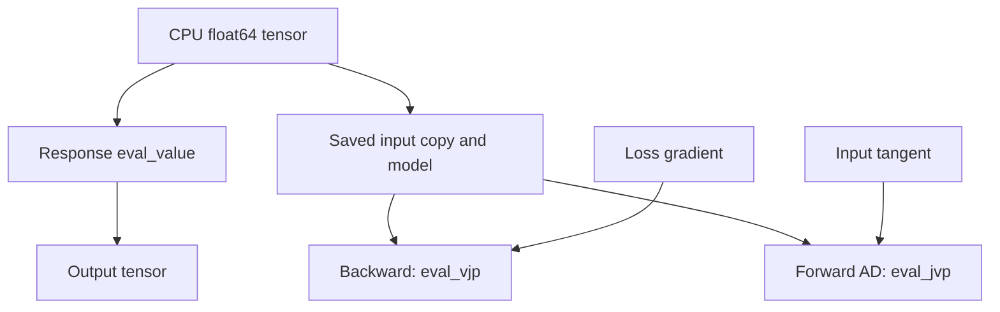

# Torch autograd adapters

For a progressive introduction with executable notebooks, start with the
[Torch material tutorial](../tutorials/torch/index.md).

`litepgo.torch` is a Python module connecting an `Energy` or `Response`
to PyTorch autograd. It supplies a derivative bridge around an existing model;
Torch owns the outer tensor graph and optimizer. In the other direction, it
provides base classes for [materials written in Torch](#constitutive-energy-written-in-torch)
that native FEM assembles.

## Module architecture

The response adapter copies the input and retains the model. Forward requests
only values; backward calls `eval_vjp(saved_x, upstream)`. Forward-mode AD
calls `eval_jvp(saved_x, tangent)`. Before either product, the adapter updates
the model's pattern at the saved point, including when several forwards share
one model. No response Jacobian is saved. The energy adapter is unchanged:
it saves the energy gradient for backward.



A `StaticEquilibriumResponse` uses its adjoint VJP and directional JVP.
Each product currently re-solves equilibrium; the adapter does not cache
linearizations. Other responses can implement direct products or use the
explicit-Jacobian fallback. Wrapping an equilibrium response inside a custom
residual does not automatically forward its fast paths: that residual must
implement its own product hooks to avoid the fallback.
See [inverse problems](solver/inverse.md) for fixed-pose versus total derivatives.

## Use the adapter

`uv sync --locked` installs PyTorch with the project's default Python dependencies.
The Python API reference always includes this module.
`litepgo.torch.energy(E, x)` and `.response(R, x)` accept **CPU
float64 one-dimensional** tensors. The backward rules are

$$
\bar x=\bar E\,\nabla E(x),\qquad \bar x=J(x)^T\bar r.
$$

Only the explicit tensor argument is differentiable. The model/callback
configuration must stay fixed from forward until all derivative calls finish; C++ evaluation does not trace Python callbacks into a
Torch graph. The adapter supports first-order derivatives, without GPU execution,
batched tensor inputs, or double backward. Response forward-mode AD is supported
through `torch.autograd.forward_ad`; `torch.func` transforms and Energy
forward-mode AD are not supported by this adapter.
Domain errors propagate to the Torch optimizer; the adapter does not implement
Gauss–Newton's rejection and retry of infeasible trial residuals.

A complete small example differentiates a quadratic:

```python
import numpy as np
import scipy.sparse as sp
import torch
from litepgo import energy
from litepgo.torch import energy as torch_energy

E = energy.QuadraticEnergy(sp.eye(2, format="csc"))
x = torch.tensor([1., 2.], dtype=torch.float64, requires_grad=True)
loss = torch_energy(E, x)
loss.backward()
np.testing.assert_allclose(x.grad.numpy(), [1., 2.])
```

The [four Torch fitting examples](../examples/torch/index.md) use L-BFGS with analytic
response derivatives. The native [fitting examples](../examples/fitting/index.md) explain
the same experiments and their formulations in detail.


For a response `R`, compute a directional derivative without reverse AD:

```python
from litepgo.torch import response as torch_response

with torch.autograd.forward_ad.dual_level():
    dual = torch.autograd.forward_ad.make_dual(x, torch.ones_like(x))
    value, jvp = torch.autograd.forward_ad.unpack_dual(torch_response(R, dual))
```

The saved input is a copy, but the model is a retained reference, not a snapshot.
Derivative exceptions propagate. Repeated backward calls recompute products.

## Constitutive energy written in Torch

The reverse direction of the adapters above is a material written in Torch and
assembled by native FEM. Subclass `TorchVolumetricMaterial` or
`TorchShellMaterial`, define the density `W`, and put the class in the Material
slot of any compiled FEM template:

```python
import torch
from litepgo import energy, fem
from litepgo.torch import TorchVolumetricMaterial

class TorchNeoHookean(TorchVolumetricMaterial):
    num_parameters = 2

    @staticmethod
    def W(F, Fp, theta):  # (N,3,3), (N,3,3), (N,k) -> (N,) per original volume
        Fe = F @ torch.linalg.inv(Fp)
        log_J = torch.linalg.det(Fe).log()
        lam, mu = theta.unbind(-1)
        psi = 0.5 * mu * (Fe.square().sum((-2, -1)) - 3) - mu * log_J + 0.5 * lam * log_J.square()
        return torch.linalg.det(Fp) * psi

Energy = fem.VolumetricFemEnergy[TorchNeoHookean, fem.HexHermiteBasis, fem.GaussLegendre3D[4]]
potential = Energy(displacement_map, rest_position_fields, Fp, theta)
E, force, stiffness = potential.eval(u, gradient=True, hessian=energy.HessianKind.Exact)
```

Native code computes the deformation gradients of a whole batch, calls the
material once, then integrates, pulls back, projects (`Projected`) and assembles.
Every basis and quadrature rule compiled for `NeoHookean` is available. Rows
must be independent and `W` twice differentiable in the inputs whose
derivatives are requested. The class owns the multiplicative split and any
`det(Fp)` factor. Network weights captured as class attributes are constants:
the native solver does not populate their `.grad`, does not call `.eval()`, and
does not change dtype or device. Batch-coupled operations such as training-mode
batch normalization are outside this contract.

The full contract (shapes, index conventions, which outputs each operation
requests, domains and threading) is in [materials written in Python](fem/python-materials.md).
The [Neo-Hookean comparison](../examples/torch/torch-neohookean.md) checks the
Torch density against the native one on tetrahedra and hexahedra. The
[neural material example](../examples/torch/neural-neohookean.md) trains an
invariant MLP on native energy/stress samples and then solves equilibrium with the
frozen network. The [network-weight equilibrium fit](../examples/torch/neural-equilibrium-fit.md)
shows the additional explicit parameter-to-weight mapping: two `theta` entries
supply final-layer weights to a stateless batched MLP, and the usual material force
response supplies their derivatives. Captured module parameters remain fixed.

## Force responses of a Torch material

The same class works in the fixed-pose force responses, which return the
**positive energy gradient** `g(u,p) = dE(u,p)/du` and its Jacobian with respect
to physical `theta` or column-major `vec(Fp)`:

```python
key = (TorchNeoHookean, fem.TetP1Basis, fem.TetCentroidQuadrature)
material_force = fem.VolumetricFemForceMaterialResponse[key](
    parameter_map, displacement_map, rest_position_fields, u, Fp)
plastic_force = fem.VolumetricFemForceFpResponse[key](
    parameter_map, displacement_map, rest_position_fields, u, theta)
force, J = material_force.eval_value_and_jacobian(p)
```

They request `d2W_dF_dtheta` or `d2W_dF_dFp` from the material, which the Torch
base computes with nine extra backward passes, and assemble explicit Jacobians
natively; JVP and VJP use those Jacobians. Shell responses work the same way with
`TorchShellMaterial`. See [force responses](fem/force-responses.md) for parameter
maps and conventions.

For equilibrium differentiation, pass both objects through the usual factories:

```python
def make_energy(p):
    active_theta = [energy.AffineResponse(np.zeros((len(p), 3)), p)] * displacement_map.num_elements
    return fem.VolumetricFemEnergy[key](displacement_map, rest_position_fields, Fp, active_theta)

def make_response(u):
    return fem.VolumetricFemForceMaterialResponse[key](
        parameter_map, displacement_map, rest_position_fields, u, Fp)

equilibrium = solver.StaticEquilibriumResponse(
    num_parameters, fixed, initial, options, make_energy, make_response,
)
```

Both factories must describe the same total energy system. The response supplies
the fixed-state partial `B = dg/dp`; `StaticEquilibriumResponse` adds the implicit
state dependence through directional/adjoint stiffness solves, and
`litepgo.torch.response(equilibrium, p_tensor)` uses those products in
reverse/forward AD. Compose the force response with `ExpResponse` or
`LogDiagonalFpResponse` (and `ElementwiseResponse` for element blocks) to
optimize transformed parameters; the energy factory must use the same transform.
See the [equilibrium example](../examples/torch/torch-equilibrium-response.md) and the
[Torch shell fit](../examples/torch/torch-shell-material-fit.md).

## Configuration lifetime and scale

Treat geometry, fixed fields, and captured material configuration as immutable
after construction; rebuild objects when they change. Native FEM snapshots the
fixed spatial responses at its quadrature points, whichever material it uses.
Mutating a custom field's captured data is not a portable update mechanism.

Equilibrium JVP/VJP avoid numerical Jacobian assembly, but the declared dense
free-state-by-parameter sparsity pattern is still allocated. Large parameter
fields or network-weight equilibrium training need a lazy pattern design first.
