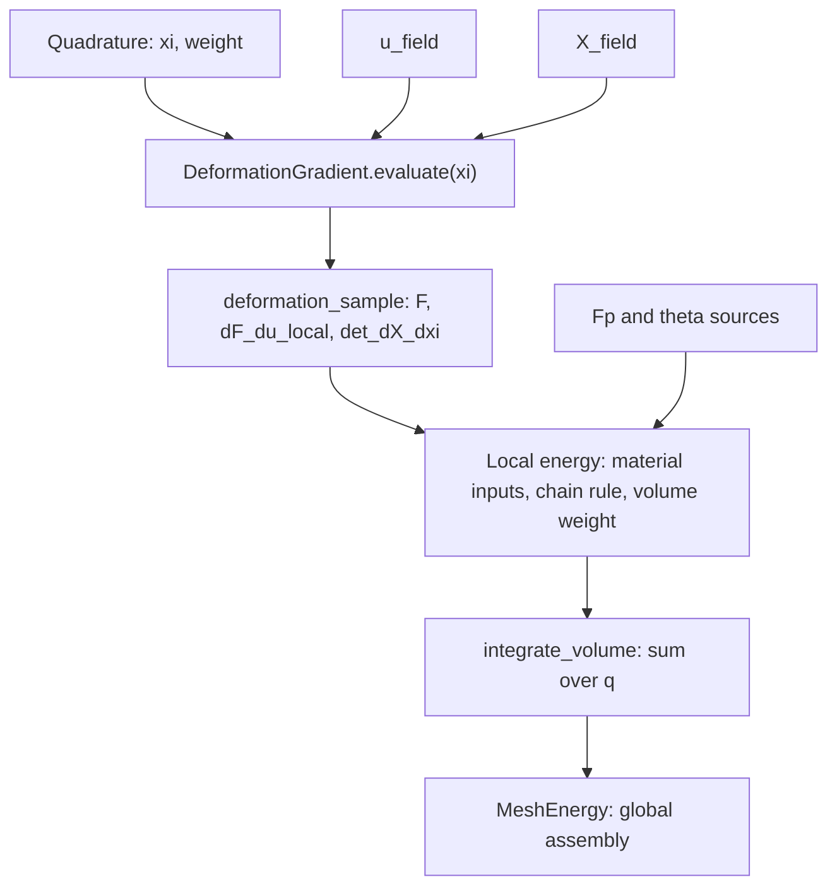

# FEM with MeshEnergy

Quadrature supplies reference coordinates `xi` and weights. A field evaluates at `xi`; its sample owns the resulting values and the information needed for coefficient derivatives. `DeformationGradient` binds displacement and coordinate fields and samples both at one `xi`. Materials consume numerical `F`, `Fp`, and `theta`. Local energies bind one active coefficient block and integrate its density and derivatives; `MeshEnergy` gathers and assembles the element results.



## Modules and ownership

| Module | Responsibility |
| --- | --- |
| `fem/basis/` | Scalar basis values `N` and reference derivatives `dN_dxi`, grouped into `1d/` and `3d/` |
| `fem/quadrature/` | Reference points and weights, grouped into `1d/` and `3d/` |
| `fem/field/` | `InterpolatedField`, `IdentityField`, and the Hex Hermite coefficient transform |
| `fem/kinematics/` | `ReferenceMapping` and `DeformationGradient` |
| `fem/material/` | Numerical constitutive inputs, density, and material derivatives |
| `fem/local/` | Active-input binding, derivative contractions, and volume integration |

The 1D basis building blocks are `LinearLagrangeBasis` and `CubicHermiteBasis`. Tensor-product types retain the `3D` suffix, mirrored as `_3d` in their filenames.

Fields own coefficient snapshots. `DeformationGradient` owns its two fields by value, accepting moves. Field samples and deformation samples own their data and remain valid after their producers are destroyed. Samples expose read-only data and can only be constructed by their corresponding evaluation methods. No global field numbering or geometry context is required by basic field evaluation.

The combination guarantees one reference coordinate for its two samples by construction. The caller must bind fields belonging to the same element and reference-coordinate convention. Different bases are allowed; the existing extrapolation rules outside their reference elements remain unchanged. No mesh IDs or shared evaluation-cache framework are introduced.

## Names and packing

| Name | Meaning |
| --- | --- |
| `x`, `x_local` | Global optimizer unknowns, and the matrix/vector returned by `map.gather(e, x)` |
| `coeffs` | Generic coefficients stored by a basic field |
| `X_local`, `u_local`, `theta_local` | Coefficients directly consumed by the coordinate, displacement, or parameter field |
| `X_field`, `u_field`, `theta_field` | Field objects |
| `X_sample`, `u_sample`, `theta_sample` | Their pointwise evaluation snapshots |
| `X`, `u`, `theta` | Values at one reference coordinate |
| `X_nodes` | Rest nodal positions, either an explicitly declared vertex-by-3 matrix or packed vector |
| `u_physical_local` | Physical Hermite DOFs before conversion to reference interpolation coefficients |
| `x_position` | Deformed position: `x_position(X) = X + u(X)` |

`e` indexes elements, `q` quadrature points, `a` basis functions, `v` vertices, `c` components, and `d` coordinate directions. Use `basis_sample` for basis evaluation results and a physical prefix such as `u_sample` for field results. Types may retain the nested name `Sample`.

For `n` basis functions and `m` components, interpolated coefficients have shape `n`-by-`m` and flatten **by row**:

```
flatten(coeffs)[m*a+c] = coeffs(a,c)
```

Derivative matrices place scalar output components in rows and scalar input coefficients in columns. Matrix outputs flatten **by column**, independently of Eigen storage order:

```
vec(F)[i+3*d] = F(i,d)
```

`IdentityField<Value>` preserves `Value`. Its matrix coefficients flatten by column, matching `vec(value)`, so its coefficient derivative is an identity matrix even for a row-major `Value`. `X_nodes(v,c)` and packed `X_nodes[3*v+c]` address the same vertex/component ordering.

## Basic fields and samples

```cpp
#include "litepgo/fem/basis/3d/hex_q1_basis.hpp"
#include "litepgo/fem/basis/3d/hex_hermite_basis.hpp"
#include "litepgo/fem/field/interpolated_field.hpp"
#include "litepgo/fem/field/identity_field.hpp"

const auto X_field = litepgo::InterpolatedField<litepgo::HexQ1Basis>(X_local);
const auto u_field = litepgo::InterpolatedField<litepgo::HexHermiteBasis>(u_local);
const auto u_sample = u_field.evaluate(xi);
```

`B::evaluate(xi)` returns a `basis_sample` containing `N` (`n`-by-1) and `dN_dxi` (`n`-by-3). An interpolated field sample stores `xi`, `value`, `dvalue_dxi`, and `basis_sample` as read-only owning data:

$$
y(\xi)=\mathrm{coeffs}^T N(\xi),\qquad
y_{,\xi}(\xi)=\mathrm{coeffs}^T N_{,\xi}(\xi).
$$

| API | Result | Shape for a vector output |
| --- | --- | --- |
| `field.value(xi)` | Value only | `m` |
| `field.dvalue_dxi(xi)` | Reference-coordinate derivative only | `m`-by-3 |
| `field.evaluate(xi)` | Owning pointwise sample | — |
| `field_sample.dvalue_dcoeffs()` | Derivative of value with respect to flattened coefficients | `m`-by-`n*m` |
| `field_sample.dgrad_xi_dcoeffs()` | Derivative of column-major `vec(dvalue_dxi)` with respect to coefficients | `3*m`-by-`n*m` |

Large coefficient derivative matrices are constructed only when requested. Value-only and spatial-derivative-only methods validate their own data dependencies independently; `evaluate` validates both. Non-finite coordinates, incompatible or non-finite coefficients, invalid basis data, and unrepresentable results are rejected.

`IdentityField` is spatially constant. Its sample has zero reference derivatives, an identity coefficient derivative, and a zero mixed reference/coefficient derivative; it needs no `basis_sample`. Being constant in space does not make its coefficients inactive.

Inactive material sources may provide only `value(xi)`. When that method exists, inactive inputs use it without requesting reference or coefficient derivatives. An active source additionally provides `num_dofs()` and an evaluation sample with `dvalue_dcoeffs()` (or the deformation sample's `dF_du_local()`). The active map must be affine in its coefficients; missing capabilities are rejected at binding. This also supports custom affine parameter maps whose coefficient count differs from their number of output components.

## Deformation and reference mapping

```cpp
#include "litepgo/fem/kinematics/deformation_gradient.hpp"

const auto deformation = litepgo::DeformationGradient(u_field, X_field);
const auto deformation_sample = deformation.evaluate(xi);
const auto F = deformation_sample.F();
const auto dF_du_local = deformation_sample.dF_du_local();
const double determinant = deformation_sample.det_dX_dxi();
```

The sample privately binds the two evaluations at the same `xi`. Its `ReferenceMapping` computes and validates `dX_dxi`, its positive determinant, and finite inverse `dxi_dX` once. `reference_mapping()` exposes a read-only view with `xi()`, `X()`, `dX_dxi()`, `dxi_dX()`, and `det_dX_dxi()` accessors. The same mapping is reused for deformation, coefficient derivatives, and volume measure.

$$
F=I+u_{,\xi}X_{,\xi}^{-1},\qquad
N_{,X}=N_{,\xi}X_{,\xi}^{-1}.
$$

`dF_du_local` is a 9-by-`3*n_u` derivative with respect to the displacement field's reference coefficients, holding `X_local` fixed:

$$
\frac{\partial F_{id}}{\partial u_{ab}}=\delta_{ib}\frac{\partial N_a}{\partial X_d}.
$$

For interpolated displacement, implementation directly fills diagonal 3-by-3 blocks at `(3*d, 3*a)` from `dN_dX(a,d)`. It does not form the former pair of Kronecker products and multiply them. Generic affine spatial-gradient samples use their explicit mixed coefficient derivative.

`dF_dxi` would differentiate spatial position and require second reference derivatives. It is not part of this API. `dF_dX_local` would differentiate coordinate coefficients and is also outside this fixed-geometry scope.

## Materials, local energies, and integration

`F`, `Fp`, and `Fe = F * inverse(Fp)` are 3-by-3 total, plastic, and elastic deformation gradients. `theta` is a pointwise material parameter vector; Neo-Hookean uses `[lambda, mu]`. Its energy density per original rest volume is `W = det_Fp * psi`, with `psi` measured per plastic intermediate volume.

Material APIs keep numerical `MaterialInputs{F, Fp, theta}`. They do not sample fields or select quadrature. `dW_dF` and `dW_dFp` return 3-by-3 matrices; their Hessians `d2W_dF2` and `d2W_dFp2` are 9-by-9 over column-major vectorization. `dW_dtheta` and `d2W_dtheta2` differentiate the pointwise parameter vector. Elastic derivatives use `dpsi_dFe` and `d2psi_dFe2`; inverse/determinant variables use `inv_Fp`, `inv_Fe_T`, `det_Fe`, `det_Fp`, and `log_det_Fe`. Directional changes use `delta_`; optimizer steps retain `dx` and `dx_local`.

```cpp
#include "litepgo/fem/material/neo_hookean.hpp"
#include "litepgo/fem/quadrature/3d/gauss_legendre_3d.hpp"
#include "litepgo/fem/local/material_local_energy.hpp"
#include "litepgo/fem/local/integrate_volume.hpp"

const auto local_energy = litepgo::make_material_local_energy<
    litepgo::NeoHookean, litepgo::MaterialVariable::F>(
        deformation, Fp_field, theta_field);

Eigen::VectorXd dE_du_local;
Eigen::MatrixXd d2E_du_local2;
const double E_element = litepgo::integrate_volume<litepgo::GaussLegendre3D<2>>(
    local_energy, &dE_du_local, &d2E_du_local2);
```

`GaussLegendre3D<PointsPerAxis>` uses `PointsPerAxis^3` integration points on `[0,1]^3`; `<2>` therefore uses eight points.

`MaterialVariable::F`, `Fp`, or `Theta` selects one constitutive input and pulls its derivatives back to that source's coefficient block. With a `DeformationGradient` source for `F`, the active coefficients are `u_local`. A plastic displacement can similarly supply `Fp` via its own deformation evaluator. Direct matrix-valued `F` coefficients use `IdentityField<Matrix3d>`; that factory call takes a fourth argument `X_field`, binding the volume mapping at construction. A deformation source already owns its coordinates, and the factory rejects a separate fourth coordinate argument for it.

`LocalEnergy::value(xi)`, `gradient(xi)`, and `hessian(xi)` return pointwise density `W` and coefficient derivatives. `accumulate(xi, quadrature_weight, ...)` applies `dV = quadrature_weight * det_dX_dxi` exactly once and adds requested derivatives to initialized buffers. The material implementation samples each input once and computes the active coefficient derivative once per accumulation, sharing it between gradient and Hessian. Inactive derivatives and unrequested material derivatives are not evaluated.

`integrate_volume<Q>(local_energy, ...)` receives no separate geometry. It checks independently requested gradient/Hessian capabilities before changing outputs, initializes output shapes, traverses `q`, and sums the accumulator's contributions. Output buffers are independently nullable, overwritten by integration, and must not alias energy data; an accumulator may not resize them. Weights, coordinates, mapping validity, derivative shapes, and finite active maps are validated.

For an affine active map `D`, pointwise pullbacks are

$$
g=D^T\operatorname{vec}(W_{,y}),\qquad H=D^TW_{,yy}D.
$$

Names distinguish pointwise `dW_du_local`, `d2W_du_local2` from integrated `dE_du_local`, `d2E_du_local2`. `dW_dtheta` and `dW_dtheta_local` have different denominators. The generic `MeshEnergy` boundary returns `dE_dx_local` and `d2E_dx_local2` for exactly the gathered unknowns.

## Hex Hermite physical DOFs

Geometry uses a Q1 coordinate field; displacement uses 64 reference coefficients per component. Each vertex supplies the physical slots `u, u_X, u_Y, u_Z, u_XY, u_XZ, u_YZ, u_XYZ`, each a three-vector. The gathered `u_physical_local` has shape 8-by-24; the field's `u_local` has shape 64-by-3.

```cpp
#include "litepgo/fem/field/hex_hermite_dof_transform.hpp"

const auto S = litepgo::hex_hermite_dof_transform(X_field); // Once per fixed rest element.
const Eigen::VectorXd u_local_flat = S * u_physical_local.reshaped<Eigen::RowMajor>();
const Eigen::MatrixXd u_local = u_local_flat.reshaped<Eigen::RowMajor>(64, 3);
const auto u_field = litepgo::InterpolatedField<litepgo::HexHermiteBasis>(u_local);
```

`S` is an owning 192-by-192 Eigen diagonal matrix storing only 192 scalars. Its eight slot factors are `1, hx, hy, hz, hx*hy, hx*hz, hy*hz, hx*hy*hz`, repeated over three components at each vertex. For example, `u_xi = hx*u_X`. This coefficient conversion precedes field construction; `dxi_dX` subsequently converts spatial gradients during deformation evaluation.

$$
\operatorname{flatten}(u_{\mathrm{local}})=S\operatorname{flatten}(u_{\mathrm{physical,local}}),\qquad
D_{\mathrm{physical}}=D_uS,\qquad
g_{\mathrm{physical}}=S^Tg_u,\qquad H_{\mathrm{physical}}=S^TH_uS.
$$

The example integrates into coefficient-specific buffers and then returns physical-DOF derivatives, without temporarily giving coefficient derivatives physical-DOF names. Because `S` is diagonal, pullback uses in-place diagonal scaling; no dense 192-by-192 transform is stored.

The transform supports positive axis-aligned Q1 rest boxes in consistent Hex corner order, with finite positive representable scales. Rotated, sheared, warped, collapsed, or inverted rest boxes are rejected. The deformed configuration may rotate, stretch, shear, or bend subject to material feasibility. General rest hexes require a different Hermite DOF mapping and compatible continuity conditions.

## C++ migration

These are source-breaking changes; old headers and compatibility aliases are not retained.

| Previous API/header | Replacement |
| --- | --- |
| `fem/geometry/interpolation.hpp` or `fem/interpolation/interpolation.hpp` | `fem/field/interpolated_field.hpp` |
| `Interpolation`, `InterpolatedValueField` | `InterpolatedField` |
| `fem/geometry/rest.hpp` or `fem/interpolation/rest_point.hpp` | `fem/kinematics/reference_mapping.hpp` |
| `rest_point(X_field, xi)`, `RestPointData` | `ReferenceMapping(X_field.evaluate(xi))` and read-only accessors |
| `fem/interpolation/hex_hermite_dof_transform.hpp` | `fem/field/hex_hermite_dof_transform.hpp` |
| `DeformationGradientField(u_local)` | `DeformationGradient(u_field, X_field)` |
| `field.value(point)` | `field.value(xi)`; deformation uses `evaluate(xi).F()` |
| `dvalue_dx_local(xi)`, `dgrad_xi_dx_local(xi)` | `evaluate(xi).dvalue_dcoeffs()`, `evaluate(xi).dgrad_xi_dcoeffs()` |
| `field.jacobian(point)` / `dF_dx_local` | `deformation.evaluate(xi).dF_du_local()` |
| `MaterialFields` and `MaterialLocalEnergyF/Fp/Theta` | Explicit sources and `make_material_local_energy<Material, MaterialVariable::...>` |
| `integrate_volume<Q>(geometry, energy, ...)` | `integrate_volume<Q>(bound_energy, ...)` |
| `Basis::Sample::values`, `gradients` | `N`, `dN_dxi` |
| `RestPointData::position`, `jacobian`, `inverse_jacobian`, `jacobian_determinant` | `X()`, `dX_dxi()`, `dxi_dX()`, `det_dX_dxi()` on the mapping |
| Material `gradient_F`, `hessian_F` and corresponding `Fp`/`theta` names | `dW_dF`, `d2W_dF2` and corresponding names |

Custom value sources implement `value(xi)`; custom active sources additionally implement the affine coefficient protocol above. The former `Field`/`AffineField` inheritance and runtime casts are removed. Local energies own snapshots rather than live references. Scope remains one active affine coefficient block with fixed rest geometry; coordinate optimization, mixed active-block Hessians, second spatial basis derivatives, and `dF_dxi` are not implemented.

## Examples and validation

Build and run each example from the repository root:

```sh
cmake --preset debug
cmake --build --preset debug --target hex_q1_mesh_energy tet_p1_mesh_energy hex_hermite_mesh_energy litepgo_tests
./build/debug/example/fem/hex_q1_mesh_energy
./build/debug/example/fem/tet_p1_mesh_energy
./build/debug/example/fem/hex_hermite_mesh_energy
ctest --preset debug --output-on-failure
```

Hex Q1 uses two boxes with widths 1 and 2 sharing nodal displacement DOFs and integrates with `GaussLegendre3D<2>`. Tet P1 uses two tetrahedra with volumes 1/6 and 1/3 and `TetCentroidQuadrature`. Hex Hermite uses two boxes of sizes (1,2,3) and (2,2,3), sharing all physical derivative DOFs at their common face, and `GaussLegendre3D<4>`.

Tests cover row/column packing, coefficient and physical finite differences, warped coordinate mappings, different displacement/coordinate bases, direct and derived deformation inputs, all active material inputs, shared/element/global DOF assembly, sample ownership, coefficient-transform validation, unsupported capabilities, and pointwise evaluation counts. Samples cannot be default-constructed or manually combined. Examples evaluate energy and derivatives only; feasible solver step bounds remain unimplemented.
