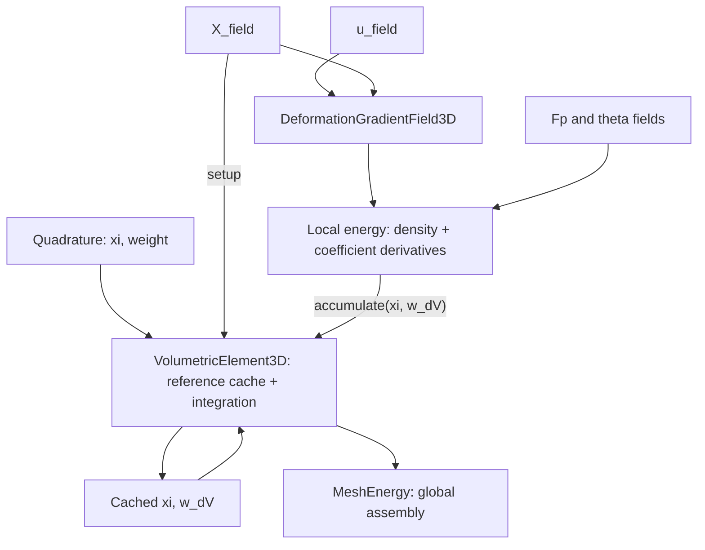

# FEM examples

C++ and Python pairs use the same basename. The CMake target is that basename;
the executable is under `build/<preset>/example/fem/<group>/`.

| Group | Cases | Purpose |
| --- | --- | --- |
| [equilibrium/](equilibrium/) | `tet_p1_corner_pull`, `hex_q1_corner_pull`, `hex_hermite_corner_pull`, `shell_saddle_pull` | Prescribe spring targets and solve elastic equilibrium |
| [plasticity/](plasticity/) | `{tet_p1,hex_q1,hex_hermite}_plastic_twist`, `shell_plastic_field` | Relax a body with a prescribed plastic field |
| [fitting/](fitting/) | `shell_fixed_pose_material_fit`, `{volume,shell}_fixed_pose_fp_fit` | Fit forces while displacement stays fixed |
| [fitting/](fitting/) | `{volume,shell}_equilibrium_material_fit`, `{volume,shell}_equilibrium_fp_fit` | Re-solve equilibrium for each parameter trial |
| [embedding/](embedding/) | `point_embedding` | Locate points and interpolate displacement DOFs |

Fit names follow `<volume|shell>_<fixed_pose|equilibrium>_<material|fp>_fit`.
`material` means constitutive parameters; `fp` means plastic stretches. Each case
states its observations and parameterization below. No volume fixed-pose material
fit example is currently provided.

```sh
cmake --build build/release --target volume_equilibrium_fp_fit
build/release/example/fem/fitting/volume_equilibrium_fp_fit
.venv/bin/python example/fem/fitting/volume_equilibrium_fp_fit.py
```

The former `*_mesh_energy` cases are now named for the corner/saddle pulling
experiment. Fitting and point-embedding cases moved out of this directory's root;
plastic twist cases moved into `plasticity/`. Use the paths and targets listed
above; old executable paths in existing build directories may be stale.

## FEM building blocks

Each example is a standalone `.cpp` with setup and its solve directly in `main()`. The deformation examples use Newton static equilibrium; the material-fitting examples use Gauss–Newton. There are no example headers. Regression fixtures live in the test `.cpp` files.

Tet P1, Hex Q1, and Hex Hermite use `VolumetricFemEnergy<Material, UBasis, Quadrature, XField, FpField, ThetaField>` from `litepgo/fem/volumetric_fem_energy.hpp`. Construct it with `(displacement_map, rest_position_fields, Fp_fields, theta_fields)`. The caller constructs all three field arrays in element order. `BasisDofTransform<UBasis>` specifies the physical DOF layout and converts gathered displacement to `InterpolatedField3D<UBasis>` coefficients: Tet P1 and Hex Q1 use three DOFs per vertex with identity conversion; Hex Hermite uses 24 physical DOFs per vertex. Reference fields may use a different basis but must use the same reference coordinates. The unknown is displacement. The energy owns snapshots of reference geometry and concrete `Field3D` inputs in `std::vector<XField>`, `std::vector<FpField>` and `std::vector<ThetaField>` stored by value (borrowed dependencies must outlive the energy). Each vector must contain one field per element in map order. Fields may differ between elements and vary over reference coordinates; rebuild the energy to change these inputs. Evaluation, derivatives, and feasible steps require no user callbacks. Hermite transforms are cached per element, applied to both displacement and direction, and pull gradients and Hessians back before projection and assembly. The Hermite transform accepts any `Field3D` representing a positive axis-aligned affine box throughout the reference domain. It checks corner values only; this does not certify the interior geometry of an arbitrary field. Unsupported bases require an explicit transform specialization; there is no identity fallback.

`ShellFemEnergy<Material>` in `fem/shell_fem_energy.hpp` wraps the triangle mid-edge shell.
Construct it with `(displacement_map, rest_data, thickness, theta)`: a `StencilDofMap`
with three DOFs per vertex, and one `TriangleMidEdgeRestData`, positive thickness, and
material parameter vector per face. Arrays and local rows must match the map order.
The first three stencil vertices form the central face; neighbor vertices contribute
to bending and the full stencil gradient/Hessian. Inputs are owned snapshots.
Construction validates reference geometry, area, stencil sizes and the starting material state.
Evaluation binds current displacements and integrates the constant face density with
reference area `0.5 * sqrt_det_a_bar`. The exact Hessian includes geometric second
derivatives; `MeshEnergy` handles projection and assembly. Feasible steps preserve
face areas and averaged normals and validate the starting material state. Materials
must introduce no extra deformation-dependent feasibility constraints beyond these
geometric conditions; the tested material is `KoiterStVK`. The shell StVK example uses
this class without user callbacks.

Quadrature supplies reference coordinates `xi` and weights. A `Field3D` computes values and derivatives at `xi` through virtual functions. `DeformationGradientField3D` composes displacement and coordinate fields at one `xi`, returning column-flattened `F`. Materials consume numerical `F`, `Fp`, and `theta`. Local energies bind one active coefficient block and supply density and coefficient derivatives. `VolumetricElement3D` caches fixed reference geometry and integrates the supplied local energy; `MeshEnergy` gathers and assembles the element results.

`VolumetricFemEnergy` uses `DeformationGradientKinematics3D<UBasis, Q>` from `fem/kinematics/deformation_gradient_kinematics.hpp` to cache `dF/dcoefficients` at each quadrature point. It supplies `F`, material derivatives, and feasible steps through indexed callbacks to `VolumetricElement3D`, which owns the quadrature loops, output initialization, and integrated-result checks. This cache owns its data and is not a `Field3D`; it performs no coordinate lookup. Rebuild it when reference geometry changes.



## Modules and ownership

| Module | Responsibility |
| --- | --- |
| `fem/basis/` | Scalar basis values `N`, reference derivatives `dN_dxi`, and `d2N_dxi2`, grouped into `1d/`, `2d/`, and `3d/` |
| `fem/quadrature/` | Reference points and weights, grouped into `1d/`, `2d/`, and `3d/` |
| `fem/field/` | `Field2D/3D`, `InterpolatedField2D/3D`, `IdentityField2D/3D`, and deformation-gradient fields |
| `fem/kinematics/` | Triangle mid-edge forms and reference data, reference geometry caching, quadrature integration of supplied local energies, determinant bounds, and the Hex Hermite coefficient transform |
| `fem/material/volumetric/` | Volumetric inputs, multiplicative kinematics, Neo-Hookean material, and the `VolumetricMaterialLocalEnergyF3D` |
| `fem/material/shell/` | Shell inputs, Koiter StVK material, `ShellMaterialLocalEnergy2D` |
| `fem/local/` | Shared `LocalEnergy2D/3D` interfaces and derivative contractions |

The 1D basis building blocks are `LinearLagrangeBasis` and `CubicHermiteBasis`. Tensor-product types use `2D` or `3D` suffixes, mirrored as `_2d` or `_3d` in their filenames.

`FieldT<ParamDim>`, `IdentityFieldT<ParamDim>`, and `LocalEnergyT<ParamDim>` support parameter dimensions 2 and 3. Use `Field2D` / `Field3D`, `IdentityField2D` / `IdentityField3D`, and `LocalEnergy2D` / `LocalEnergy3D` for dimension-specific interfaces. `InterpolatedField2D<B>` / `InterpolatedField3D<B>` select the parameter dimension of `InterpolatedFieldT<B, ParamDim>`. Component counts remain independent of parameter dimension. Dimensionless compatibility names have been removed, and the generic templates require an explicit parameter dimension. Update existing clients to the explicit `2D` / `3D` names and rebuild them.

`IdentityField3D` and `InterpolatedField3D` own coefficient snapshots. `DeformationGradientField3D` borrows two `const Field3D&` inputs: displacement `u` and fixed coordinates `X`. Those input objects must outlive the composed field and any local energy borrowing it; temporary inputs are rejected at compile time. All three inherit `Field3D` and return owning vectors and matrices directly, without a field-sample interface.

The composition uses the same reference coordinate for both inputs. The caller must bind fields belonging to the same element and reference-coordinate convention. Different bases are allowed; the existing extrapolation rules outside their reference elements remain unchanged. No mesh IDs or shared evaluation-cache framework are introduced.

## Names and packing

| Name | Meaning |
| --- | --- |
| `x`, `x_local` | Global optimizer unknowns, and the matrix/vector returned by `map.gather(e, x)` |
| `coeffs` | Generic coefficients stored by a basic field |
| `X_local`, `u_local`, `theta_local` | Coefficients directly consumed by the coordinate, displacement, or parameter field |
| `X_field`, `u_field`, `theta_field` | Field3D objects |
| `X`, `u`, `theta` | Values at one reference coordinate |
| `X_nodes` | Rest nodal positions, either an explicitly declared vertex-by-3 matrix or packed vector |
| `u_physical_local` | Physical Hermite DOFs before conversion to reference interpolation coefficients |
| `x_position` | Deformed position: `x_position(X) = X + u(X)` |

Numerical evaluation functions use `eval_<quantity>`; the combined energy entry point is `eval(...)`. Variables keep the quantity name without a prefix:

```cpp
const auto N = Basis::eval_N(xi);
const auto dvalue_dxi = field.eval_dvalue_dxi(xi);
const auto dW_dF = Material::eval_dW_dF(inputs);
```

This convention also applies to local and global energy values, gradients, and Hessians, including the Python energy API. Queries and operations retain names such as `num_dofs`, `reference_node`, `accumulate`, `assemble`, and `solve`. Previous evaluation names have been removed; update callers and custom overrides together.

`e` indexes elements, `q` quadrature points, `a` basis functions, `v` vertices, `c` components, and `d` coordinate directions. Basis functions and fields return their values and derivatives directly.

For `n` basis functions and `m` components, interpolated coefficients have shape `n`-by-`m` and flatten **by row**:

```
flatten(coeffs)[m*a+c] = coeffs(a,c)
```

Derivative matrices place scalar output components in rows and scalar input coefficients in columns. Matrix outputs flatten **by column**, independently of Eigen storage order:

```
vec(F)[i+3*d] = F(i,d)
```

`IdentityField3D` owns an `Eigen::VectorXd` and returns the same component vector. Flatten matrix coefficients by column before construction, for example `IdentityField3D(Fp.reshaped())`. The material input layer checks that `F` and `Fp` each contain nine components and restores their 3-by-3 shape. `X_nodes(v,c)` and packed `X_nodes[3*v+c]` address the same vertex/component ordering.

## Basic fields

```cpp
#include "litepgo/fem/basis/3d/hex_q1_basis.hpp"
#include "litepgo/fem/basis/3d/hex_hermite_basis.hpp"
#include "litepgo/fem/field/interpolated_field.hpp"
#include "litepgo/fem/field/identity_field.hpp"

const auto X_field = litepgo::fem::InterpolatedField3D<litepgo::fem::HexQ1Basis>(X_local);
const auto u_field = litepgo::fem::InterpolatedField3D<litepgo::fem::HexHermiteBasis>(u_local);
const litepgo::fem::Field3D& field = u_field;
const auto u = field.eval_value(xi);
const auto du_dcoeffs = field.eval_dvalue_dcoeffs(xi);
```

Basis values and derivatives are evaluated independently, where `n` is the number of basis functions and `D` is the parameter dimension:

```cpp
const auto N = B::eval_N(xi);              // n-by-1
const auto dN_dxi = B::eval_dN_dxi(xi);     // n-by-D
const auto d2N_dxi2 = B::eval_d2N_dxi2(xi);  // n-by-D*(D+1)/2
```

`InterpolatedFieldT` calls only the basis function needed for each requested quantity:

$$
y(\xi)=\mathrm{coeffs}^T N(\xi),\qquad
y_{,\xi}(\xi)=\mathrm{coeffs}^T N_{,\xi}(\xi).
$$

| API | Result | Shape for a vector output |
| --- | --- | --- |
| `field.eval_value(xi)` | Value only | `m` |
| `field.eval_dvalue_dxi(xi)` | Reference-coordinate derivative only | `m`-by-`D` |
| `field.eval_dvalue_dcoeffs(xi)` | Derivative of value with respect to flattened coefficients | `m`-by-`n*m` |
| `field.eval_dgrad_xi_dcoeffs(xi)` | Derivative of column-major `vec(dvalue_dxi)` with respect to coefficients | `D*m`-by-`n*m` |
| `field.eval_d2value_dxi2(xi)` | Packed second reference-coordinate derivatives | `m`-by-`D*(D+1)/2` |
| `field.eval_dhess_xi_dcoeffs(xi)` | Coefficient derivative of column-major `vec(d2value_dxi2)` | `m*D*(D+1)/2`-by-`n*m` |

Large coefficient derivative matrices are constructed only when requested. Each method validates its own data dependencies independently. Non-finite coordinates, incompatible or non-finite coefficients, invalid basis data, and unrepresentable results are rejected. `Field3D` requires values and coefficient derivatives; its default spatial-derivative methods throw `std::logic_error` when unsupported.

`IdentityField3D` is spatially constant. It returns zero reference derivatives, an identity coefficient derivative, and a zero mixed reference/coefficient derivative. Being constant in space does not make its coefficients inactive.

Every basis provides static `eval_N`, `eval_dN_dxi`, and `eval_d2N_dxi2` functions returning concrete fixed-size double matrices. The `Basis<B,D>` concept requires all three functions, including for custom bases. There is no combined sample object. Tensor products evaluate only the 1D values and derivative orders needed to form the requested array. Packed Hessian columns are `(11)` in 1D, `(11,12,22)` in 2D, and `(11,12,13,22,23,33)` in 3D. Mixed derivatives are stored once without doubling. Linear 1D and Tet P1 bases have zero second derivatives; bilinear and trilinear bases have zero pure second derivatives but generally nonzero mixed derivatives. Interpolated fields always support second spatial derivatives and their coefficient derivatives; non-interpolated fields retain their optional spatial-derivative protocol.

## Two-dimensional parameter domains

```cpp
#include "litepgo/fem/basis/2d/quad_hermite_basis.hpp"
#include "litepgo/fem/field/interpolated_field.hpp"
#include "litepgo/fem/quadrature/2d/gauss_legendre_2d.hpp"

// coeffs is 16-by-3: four vector slots at each of four corners.
const litepgo::fem::InterpolatedField2D<litepgo::fem::QuadHermiteBasis> u_field(coeffs);
const litepgo::fem::Field2D& field = u_field;
const Eigen::Vector2d xi(0.2, 0.3);
const auto u = field.eval_value(xi);        // 3 components
const auto du = field.eval_dvalue_dxi(xi);   // 3-by-2
const auto d2u = field.eval_d2value_dxi2(xi); // 3-by-3: (11,12,22)
using Q = litepgo::fem::GaussLegendre2D<4>;       // 16 points on [0,1]^2
```

`QuadHermiteBasis` uses corners `(0,0), (1,0), (1,1), (0,1)`. Index `4*vertex+slot` stores `[u, u_xi, u_eta, u_xi_eta]`, with the same row order for basis values and derivatives. `QuadTopology` is `MeshTopology<4>`. `VertexDofMap(topology,12)` gathers a three-component Hermite field as a 4-by-12 matrix, which reshapes by row into 16-by-3 coefficients.

For C1 continuity on aligned rectangular parameter charts, share derivatives with respect to the same chart coordinates. A cell with chart spans `(hs,ht)` converts the four vector slots to reference coefficients using scales `[1,hs,ht,hs*ht]`. A curved reference geometry also needs compatible smooth coordinate interpolation. General chart transitions require their own derivative transformations.

Triangles use a nodal P1 basis on `xi >= 0, eta >= 0, xi+eta <= 1`, with reference vertices `(0,0), (1,0), (0,1)`:

```cpp
#include "litepgo/fem/basis/2d/triangle_p1_basis.hpp"
#include "litepgo/fem/quadrature/2d/triangle_centroid_quadrature.hpp"

// triangle_displacements is 3-by-3: one displacement vector per vertex.
const litepgo::fem::InterpolatedField2D<litepgo::fem::TriangleP1Basis> u_field(triangle_displacements);
using Q = litepgo::fem::TriangleCentroidQuadrature;
```

`TriangleP1Basis` provides `N = (1-xi-eta, xi, eta)`, constant first derivatives, and zero second derivatives in columns `(11,12,22)`. It also supports scalar nodal fields with 3-by-1 coefficients. Reference positions and displacements can use separate fields with the same basis, keeping reference positions fixed while displacement coefficients change. Mid-edge curvature reconstruction requires a neighboring-face stencil and is separate from this basis.

`TriangleCentroidQuadrature` samples `(1/3,1/3)` with weight `1/2`, including the reference triangle's area, and integrates polynomials through degree 1 exactly. Multiply that weight by `norm(X_xi.cross(X_eta))` for the physical reference-area weight; the result is the triangle's area, without another factor of `1/2`. The square rules `GaussLegendre2D` use a different reference domain.

The element callback chooses the geometric measure. For a three-component surface coordinate field, its 3-by-2 derivative supplies reference area `norm(X_xi.cross(X_eta))`; pass this times the quadrature weight to `LocalEnergy2D::accumulate`. `MeshEnergy` and the DOF assembler already accept these elements. The deformation field `DeformationGradientField3D` and the material energy `VolumetricMaterialLocalEnergyF3D` are 3D solid APIs. Triangle mid-edge Koiter shells use `ShellMaterialLocalEnergy2D<KoiterStVK>` as described below.

Material input fields inherit `Field3D`. Only the selected active field needs usable coefficient derivatives and a positive DOF count; inactive fields may report zero DOFs and throw from unsupported derivatives. The active map must be affine in its coefficients. Custom affine parameter fields may have a coefficient count different from their number of output components.

## Deformation and coordinate derivatives

```cpp
#include "litepgo/fem/field/deformation_gradient_field.hpp"

const litepgo::fem::DeformationGradientField3D F_field(u_field, X_field);
const litepgo::fem::Field3D& field = F_field;
const Eigen::Matrix3d F = field.eval_value(xi).reshaped(3, 3);
const auto derivative = field.eval_dvalue_dcoeffs(xi);
```

`X_field` is an ordinary field whose values represent physical coordinates in the reference configuration. Its `eval_dvalue_dxi(xi)` supplies the derivative with respect to element parameter coordinates:

$$
\left[\frac{\partial X}{\partial\xi}\right]_{ij}
=\frac{\partial X_i}{\partial\xi_j},\qquad
\frac{\partial\xi}{\partial X}
=\left(\frac{\partial X}{\partial\xi}\right)^{-1}.
$$

`Field3D` assigns no geometric meaning to its values or derivatives. `DeformationGradientField3D` requests `X_field.eval_dvalue_dxi(xi)`, checks three components, a finite 3-by-3 derivative and a finite positive determinant, then computes and validates the inverse. For fixed reference geometry, `VolumetricElement3D` validates the Jacobian and determinant once at construction to compute volume weights; it does not compute or cache the inverse. Neither path needs `X_field.eval_value(xi)`.

$$
F=I+u_{,\xi}X_{,\xi}^{-1},\qquad
N_{,X}=N_{,\xi}X_{,\xi}^{-1}.
$$

Computing `F` queries `u_field.eval_dvalue_dxi(xi)` and `X_field.eval_dvalue_dxi(xi)` without evaluating either field's value. Displacement component counts, derivative dimensions and finiteness, and the resulting `F` remain validated.

`eval_dvalue_dcoeffs(xi)` is a 9-by-`3*n_u` derivative with respect to the displacement field's reference coefficients, holding `X` fixed. `num_components()` is 9 and `num_dofs()` is the displacement field's count:

$$
\frac{\partial F_{id}}{\partial u_{ab}}=\delta_{ib}\frac{\partial N_a}{\partial X_d}.
$$

The implementation obtains `eval_dgrad_xi_dcoeffs(xi)` from the displacement field and applies the coordinate conversion with `kron(dxi_dX.transpose(), I3)`. This uses the same mixed-derivative interface for interpolated and identity fields.

`dF_dxi` would differentiate spatial position and require second reference derivatives. It is not part of this API. `dF_dX_local` would differentiate coordinate coefficients and is also outside this fixed-geometry scope.

## Materials, local energies, and integration

`F`, `Fp`, and `Fe = F * inverse(Fp)` are 3-by-3 total, plastic, and elastic deformation gradients. `theta` is a pointwise material parameter vector; Neo-Hookean uses `[lambda, mu]`. Its energy density per original rest volume is `W = det_Fp * psi`, with `psi` measured per plastic intermediate volume.

Material APIs keep numerical `VolumetricMaterialInputs{F, Fp, theta}`. They do not sample fields or select quadrature. `eval_W` returns the density. `eval_dW_dF` returns the 3-by-3 stress and `eval_d2W_dF2` the 9-by-9 tangent over column-major vectorization. `eval_d2W_dF_dtheta` differentiates stress with respect to the pointwise parameter vector for material force responses. Elastic derivative helpers use `eval_dpsi_dFe` and `eval_d2psi_dFe2`; inverse/determinant variables use `inv_Fp`, `inv_Fe_T`, `det_Fe`, `det_Fp`, and `log_det_Fe`. Directional changes use `delta_`; optimizer steps retain `dx` and `dx_local`.

`VolumetricElement3D<Q>` in `fem/kinematics/volumetric_element.hpp` owns fixed
reference geometry and integrates a supplied `LocalEnergy3D`. Its only template
argument is the quadrature rule; it has no basis or material dependency.
Construction takes a `const Field3D& X_field` and snapshots each quadrature point's
`xi` and `w_dV = w_q * det(dX_dxi)`. It queries the
reference Jacobian exactly once per point and rejects malformed quadrature or
reference geometry. The fixed-size cache uses `std::array<Point, Q::num_points>`.
Changing rest geometry requires rebuilding the element.

The deformation field borrows `u_field` and `X_field` and evaluates the reference
Jacobian through the existing Field API. Its inverse is not cached by the element.
Both fields must outlive the deformation field.

```cpp
#include "litepgo/fem/kinematics/volumetric_element.hpp"
#include "litepgo/fem/field/deformation_gradient_field.hpp"
#include "litepgo/fem/material/volumetric/volumetric_material_local_energy.hpp"
#include "litepgo/fem/material/volumetric/neo_hookean.hpp"
#include "litepgo/fem/quadrature/3d/gauss_legendre_3d.hpp"

const litepgo::fem::VolumetricElement3D<litepgo::fem::GaussLegendre3D<2>> element(X_field);
const litepgo::fem::DeformationGradientField3D F(u_field, X_field);
const litepgo::fem::VolumetricMaterialLocalEnergyF3D<litepgo::fem::NeoHookean> local_energy(
    F, Fp_field, theta_field);
const double E = element.eval(local_energy, g, H);
const double alpha = element.max_feasible_step(local_energy, delta_coeffs);
```

`eval` takes `const LocalEnergy3D&`, obtains the DOF count from it, zeros and resizes
each independently nullable output, and calls
`local_energy.accumulate(xi, w_dV, g, H)` at each saved point. The local energy owns
density evaluation, material input sampling, and coefficient pullbacks. Outputs
must not alias local-energy inputs. Non-material local energies and different
active coefficient blocks use the same integrator.

`max_feasible_step` takes a local energy with
`eval_feasible_step(xi, delta_coeffs)` and returns the minimum pointwise bound.
The increment uses that local energy's DOF order. The pointwise step method is
required only when the element step method is used; it is not added to the
`LocalEnergy3D` virtual interface. Exceptions propagate without retrying.

The three solid examples use `VolumetricFemEnergy`, which owns separate vectors of coordinate fields, fixed material fields, integration caches, and basis DOF transforms. Evaluation and step callbacks bind current displacement, deformation, and local energy on the stack. `MeshEnergy` handles gathering, projection, and assembly. Element const methods use call-local scratch and may run concurrently when the supplied fields support it.

`GaussLegendre3D<PointsPerAxis>` uses `PointsPerAxis^3` integration points on `[0,1]^3`; `<2>` therefore uses eight points.

`VolumetricMaterialLocalEnergyF3D<Material>` differentiates with respect to the F field's coefficients, holding Fp and theta fixed. Its constructor accepts `(F_field, Fp_field, theta_field)` as three `const Field3D&` inputs. A material implements `eval_W`, `eval_dW_dF` and `eval_d2W_dF2`. Pure Fp/parameter energy derivatives and their LocalEnergy wrappers are not exposed; parameter fitting uses the material force response.

All three input fields must outlive the energy, and temporary input fields are rejected. A copied energy borrows the same fields, so subsequent field updates are visible. A composed `F` field activates displacement coefficients; direct `F` coefficients can use a nine-component `IdentityField3D`. Non-positive active DOF counts are rejected at construction.

`local_energy.eval_feasible_step(xi, delta_coeffs)` maps the coefficient direction
through the F field's `eval_dvalue_dcoeffs`, places the increment in `F`,
and calls `Material::eval_feasible_step(inputs, delta_inputs)`. Inactive
input increments are zero. This method is available for materials that supply the
pointwise step API; other materials can still use the existing value and derivative
APIs. Direction coefficients use the same packing as gradients and Hessians.

`NeoHookean::eval_feasible_step` requires a feasible initial material state and
preserves `det(F)>0`, `det(Fp)>0`, `lambda>=0`, and `mu>0` along the affine input
path. It also bounds positive parameter increments before floating-point overflow.
Since `det(Fe)=det(F)/det(Fp)`, separately bounding `F` and `Fp` also handles paths
where both change and `Fe` is not affine in the step.

The numerical helper `eval_positive_det_feasible_step(A, delta_A)` lives in
`fem/kinematics/positive_det_feasible_step.hpp`. It expands
`det(A+t*delta_A)` as a cubic using column multilinearity, splits `[0,1]` at its
stationary points, and bisects the first interval approaching zero. Stationary
values also detect repeated roots with no sign change. A relative rounding margin
and a factor of `0.9` keep the returned endpoint inside the domain. Linear,
quadratic, and constant cases follow the same logic. Invalid/non-finite inputs
are rejected; an infeasible initial determinant throws `std::domain_error`.

All three solid examples supply a `MeshEnergy` step callback that takes the
minimum of these bounds over the same quadrature points used by the energy.
For Hex Hermite, both displacement and direction use the physical-to-reference
coefficient transform. This certifies the quadrature-based energy's domain over
the full search segment. Tet P1 has constant `F` over each element; Hex Q1 and
Hermite need additional spatial checks to certify an entire element between
quadrature points. The Newton solver starts its line search at this bound and
shrinks only when a finite trial energy fails the decrease test. `std::domain_error`
propagates immediately to the caller and aborts the solve without retrying.
A positive determinant does not guarantee representable energy or
derivatives: finite inputs can overflow material evaluation, coefficient pullbacks,
weighted accumulation, Hessian projection, or global assembly. These numerical
failures throw `std::domain_error` and stop the solve, including at a trial point.
Invalid input dimensions, non-finite supplied data, and malformed callback outputs
retain their existing argument or contract errors.

`LocalEnergy3D::eval_value(xi)`, `eval_gradient(xi)`, and `eval_hessian(xi)` return pointwise density `W` and coefficient derivatives. `accumulate(xi, weight, ...)` receives a complete weight from its caller and adds weighted values and requested derivatives to initialized buffers. It performs no geometry evaluation. The material implementation samples each input once and computes the active coefficient derivative once per accumulation, sharing it between gradient and Hessian. Inactive derivatives and unrequested material derivatives are not evaluated.

For custom integration, callers can still compute `weight = w_q * det(dX_dxi)`
and use `local_energy.accumulate`. That lower-level API adds into initialized
buffers without resizing them. Geometry, material fields, and quadrature must use
the same element parameter domain. Cached elements apply the saved measure once,
delegate pointwise values and derivatives to the supplied local energy, and retain numerical
`std::domain_error` checks. The Hex Hermite callback converts physical DOFs to
reference coefficients before calling the element, then transforms the integrated
gradient and Hessian back to physical DOFs.

For an affine active map `D`, pointwise pullbacks are

$$
g=D^T\operatorname{vec}(W_{,y}),\qquad H=D^TW_{,yy}D.
$$

Names distinguish pointwise `dW_du_local`, `d2W_du_local2` from integrated `dE_du_local`, `d2E_du_local2`. The generic `MeshEnergy` boundary returns `dE_dx_local` and `d2E_dx_local2` for exactly the gathered unknowns.

## Triangle mid-edge stencil DOFs

`StencilDofMap` accepts ordered, variable-length vertex lists and a DOF width per vertex. It owns those lists, rejects repeated or invalid vertex IDs, and gathers a matrix with one row per stencil vertex. Scalar indices follow `width*global_vertex+slot`; flatten the local matrix by row for gradients and Hessians. Empty stencils and unused global vertices are supported.

```cpp
#include "litepgo/dof/stencil_dof_map.hpp"
#include "litepgo/mesh/triangle_mid_edge_stencils.hpp"

const auto stencils = litepgo::mesh::make_triangle_mid_edge_stencils(topology);
const litepgo::dof::StencilDofMap map(topology.num_vertices(), stencils.vertices, 3);
const auto X_local = map.gather(f, X_nodes_packed); // fixed reference positions
const auto u_local = map.gather(f, u);             // current displacements
const Eigen::MatrixXd positions = X_local + u_local;
const litepgo::fem::InterpolatedField2D<litepgo::fem::TriangleP1Basis> u_field(u_local.topRows(3));
```

For each triangle `f`, `stencils.vertices[f]` starts with its three vertices in connectivity order. Edge `k` joins local face vertices `(k+1)%3` and `(k+2)%3`. Opposite vertices across edges `0,1,2` are appended in that order, with shared opposite vertices included only once. A face therefore has 3 to 6 stencil vertices. `stencils.opposite[f][k]` is the neighbor's opposite vertex row in the gathered matrix; `-1` denotes a boundary edge and is never a global DOF. The builder rejects duplicate faces, inconsistent shared-edge directions, and edges with more than two incident faces. It does not choose a boundary curvature rule or validate geometry.

For the existing triangle mid-edge material model, use `ShellFemEnergy<Material>`. For a custom model, use `MeshEnergy(map, eval_batch, 256, step_batch)` directly. Its batch callback receives flattened stencil rows (B, 3*n), including neighbors, and returns one integrated central-face energy per row. Gradients are (B, 3*n), Hessians (B*3*n, 3*n). Callbacks may run concurrently. For `n` stencil vertices, requested outputs must overwrite all `3*n` gradient entries and the full `3*n`-by-`3*n` Hessian, including zero entries. `MeshEnergy` includes all stencil couplings in its fixed sparse pattern. Capture reference stencil positions and opposite-row metadata by value or through owned shared data. A shell callback must provide its own geometric feasibility step. Curvature reconstruction and Koiter energy remain separate from this DOF map.

## Triangle mid-edge kinematics

The numerical function `eval_triangle_mid_edge_kinematics` accepts a gathered position stencil and its opposite-row metadata. It returns two 2-by-2 matrices, `a` and `b`, without a field object or quadrature coordinate:

```cpp
#include "litepgo/fem/kinematics/triangle_mid_edge_kinematics.hpp"

const Eigen::MatrixXd x_local = X_local + u_local;
Eigen::MatrixXd dab_dx;
std::array<Eigen::MatrixXd, 6> d2ab_dx2;
const auto current = litepgo::fem::eval_triangle_mid_edge_kinematics(
    x_local, stencils.opposite[f], &dab_dx, &d2ab_dx2);
const auto reference = litepgo::fem::eval_triangle_mid_edge_kinematics(X_local, stencils.opposite[f]);
const Eigen::Matrix2d a_bar = reference.a;
const Eigen::Matrix2d b_bar = reference.b;
```

Both derivative outputs are independently optional and overwritten. They differentiate `(a11,a12,a22,b11,b12,b22)`, with mixed entries stored once without scaling, with respect to row-packed positions. `dab_dx` has shape 6-by-`3*n`; the six Hessians each have shape `3*n`-by-`3*n`. Since reference positions are fixed, these are also the derivatives with respect to `u_local`. Both derivative orders use analytic formulas, computing second derivatives only when requested; finite differences are used only in tests.

The first form is `a = J.transpose()*J`, where `J = [x1-x0, x2-x0]`. The second form uses area-weighted mid-edge normals, following the [mid-edge-average discretization](https://github.com/evouga/libshell/blob/master/src/SecondFundamentalForm/MidedgeAverageFormulation.cpp), with the sign chosen to agree with `b_ab = n.dot(x_,ab)` (the opposite of LibShell's sign). For central unnormalized normal `N`, neighbor normal `N_k`, and opposite row `p_k`,

$$
N=(x_1-x_0)\times(x_2-x_0),\qquad
N_k=(x_{k+2}-x_{p_k})\times(x_{k+1}-x_{p_k}),
$$
$$
c_k=-\frac{[(x_{k+1}-x_k)+(x_{k+2}-x_k)]\cdot N_k}{\|N+N_k\|},\qquad
b=\begin{bmatrix}c_0+c_1&c_0\\c_0&c_0+c_2\end{bmatrix},
$$

where central vertex indices are modulo 3. Boundary edges use `c_k = 0`, equivalent to a one-sided face-normal extrapolation; clamped boundary directors are not implemented. Degenerate central or neighboring triangles, or cancelling averaged normals, throw `std::domain_error`. Layout errors and non-finite inputs throw `std::invalid_argument`. Geometry singularity checks use a relative tolerance of `1e-12`. This function performs no area integration or material evaluation.

`eval_triangle_mid_edge_feasible_step(x, dx, opposite)` returns a conservative inclusive step bound. For `0 <= alpha <= 1`, each face normal is `N(alpha)=N0+alpha*N1+alpha^2*N2`, so its change is bounded by `alpha*(norm(N1)+norm(N2))`. Together with edge-length-product bounds, this preserves half of the initial relative area and averaged-normal feasibility margins over the whole segment. It can return zero for an unrepresentable direction. The caller validates material feasibility separately; the shell example delegates its geometric step calculation to this function.

## Koiter shell material and local energy

`KoiterStVK` consumes numerical `ShellMaterialInputs{a, b, a_bar, b_bar, thickness, theta}`. With `theta = [lambda_ps, mu]`, it returns density per reference area,

$$
\epsilon=\frac{a-\bar a}{2},\qquad\kappa=b-\bar b,\qquad
W=t\,\psi(\epsilon)+\frac{t^3}{12}\psi(\kappa),
$$
$$
\psi(S)=\frac{\lambda_{ps}}2[\operatorname{tr}(\bar a^{-1}S)]^2
+\mu\operatorname{tr}(\bar a^{-1}S\bar a^{-1}S).
$$

These are the [Koiter StVK membrane and bending factors](https://github.com/evouga/libshell/blob/master/src/MaterialModel/StVKMaterial.cpp). `lambda_ps` is the plane-stress coefficient, not the 3D Lamé coefficient. For Young's modulus `Y` and Poisson ratio `nu`, use `lambda_ps = Y*nu/(1-nu*nu)` and `mu = Y/(2*(1+nu))`. The material requires positive thickness, `mu > 0`, and `lambda_ps+mu > 0`; stable negative `lambda_ps` is supported. Forms must be finite and symmetric, and both metrics must be positive definite.

`eval_dW_dab` and `eval_d2W_dab2` differentiate the six independent entries `(a11,a12,a22,b11,b12,b22)`. Changing a mixed entry changes both symmetric matrix positions. The material Hessian is 6-by-6; area integration belongs to the caller.

Build fixed reference data once for each face:

```cpp
#include "litepgo/fem/material/shell/shell_material_local_energy.hpp"
#include "litepgo/fem/material/shell/koiter_stvk.hpp"
#include "litepgo/fem/quadrature/2d/triangle_centroid_quadrature.hpp"

std::vector<litepgo::fem::TriangleMidEdgeRestData> rest;
for (int f = 0; f < map.num_elements(); ++f)
    rest.emplace_back(map.gather(f, X_nodes_packed), stencils.opposite[f]);
```

Each record owns `X_local`, `opposite`, `a_bar`, `b_bar`, and `sqrt_det_a_bar`. In the `MeshEnergy` callback, `u_local` is the full stencil matrix gathered by `StencilDofMap`:

```cpp
const litepgo::fem::ShellMaterialLocalEnergy2D<litepgo::fem::KoiterStVK> local_energy(
    rest[f], u_local, thickness, Eigen::Vector2d(lambda_ps, mu));
if (g)
    g->setZero(local_energy.num_dofs());
if (H)
    H->setZero(local_energy.num_dofs(), local_energy.num_dofs());
using Q = litepgo::fem::TriangleCentroidQuadrature;
const Eigen::Vector2d xi = Q::points().row(0).transpose();
const double weight = Q::weights()[0] * rest[f].sqrt_det_a_bar;
return local_energy.accumulate(xi, weight, g, H);
```

The local energy owns snapshots, activates all `3*n` row-packed displacement DOFs, and holds reference data, thickness, and material parameters fixed. Its exact Hessian includes both `J.transpose()*d2W_dab2*J` and the six geometric Hessian contractions weighted by `dW_dab`. Gradient and Hessian outputs remain independently nullable; `accumulate` adds into correctly sized, initialized buffers. Pointwise density and derivatives are constant over this face, so the centroid rule integrates them exactly. Only the central face's contribution is returned; neighboring vertices supply its curvature support.

The current shell path optimizes displacement only and uses per-face constant parameters. It retains the mid-edge boundary normal extrapolation above. A solver still needs a geometric feasible-step callback; the local density implementation does not supply one.

## Hex Hermite physical DOFs

`BasisDofTransform<HexHermiteBasis>` accepts a reference `Field3D` and owns the physical-to-reference scales. The example uses a Q1 coordinate field to construct the cached volumetric element. Displacement uses 64 reference coefficients per component. Each vertex supplies the physical slots `u, u_X, u_Y, u_Z, u_XY, u_XZ, u_YZ, u_XYZ`, each a three-vector. The gathered `u_physical_local` has shape 8-by-24; the field's `u_local` has shape 64-by-3.

```cpp
#include "litepgo/fem/kinematics/basis_dof_transform.hpp"

const litepgo::fem::BasisDofTransform<litepgo::fem::HexHermiteBasis> transform(X_field);
const Eigen::MatrixXd u_local = transform.to_coefficients(u_physical_local);
const auto u_field = litepgo::fem::InterpolatedField3D<litepgo::fem::HexHermiteBasis>(u_local);
```

The transform stores only 192 scales, representing a diagonal matrix `S`. Its eight slot factors are `1, hx, hy, hz, hx*hy, hx*hz, hy*hz, hx*hy*hz`, repeated over three components at each vertex. For example, `u_xi = hx*u_X`. This coefficient conversion precedes field construction; `dxi_dX` subsequently converts spatial gradients during deformation evaluation.

$$
\operatorname{flatten}(u_{\mathrm{local}})=S\operatorname{flatten}(u_{\mathrm{physical,local}}),\qquad
D_{\mathrm{physical}}=D_uS,\qquad
g_{\mathrm{physical}}=S^Tg_u,\qquad H_{\mathrm{physical}}=S^TH_uS.
$$

The example integrates into coefficient-specific buffers and then returns physical-DOF derivatives, without temporarily giving coefficient derivatives physical-DOF names. Because `S` is diagonal, pullback uses in-place diagonal scaling; no dense 192-by-192 transform is stored.

The nodes must form a positive axis-aligned reference box:

$$
X_v=X_0+\operatorname{diag}(h_x,h_y,h_z)\xi_v,\qquad h_x,h_y,h_z>0.
$$

Here `xi_v` is the reference corner of vertex `v` on `[0,1]^3`. The transform checks matrix dimensions and finite coordinates, obtains `hx`, `hy`, `hz` from edges `0→1`, `0→3`, `0→4`, and verifies all eight vertices against this box in reference-corner order. Non-positive or non-finite lengths and non-positive or non-finite scaling products are rejected. Node consistency uses a dimensionless tolerance of `1e-12` after normalization by each axis length. General rest hexes require a different Hermite DOF mapping and compatible continuity conditions. The deformed configuration may rotate, stretch, shear, or bend subject to material feasibility.

## C++ migration

Use explicit `2D` / `3D` names for dimension-specific types. The dimensionless names and implicit 3D default have been removed; the older header and API migration is listed below.

| Previous API/header | Replacement |
| --- | --- |
| `fem/geometry/interpolation.hpp` or `fem/interpolation/interpolation.hpp` | `fem/field/interpolated_field.hpp` |
| `Interpolation`, `InterpolatedValueField` | `InterpolatedField2D` / `InterpolatedField3D` |
| `fem/geometry/rest.hpp` or `fem/interpolation/rest_point.hpp` | `fem/field/field.hpp` |
| `rest_point(X_field, xi)`, `RestPointData` | `X_field.eval_value(xi)` and `X_field.eval_dvalue_dxi(xi)`; geometric consumers validate and invert the derivative as needed |
| `fem/interpolation/hex_hermite_dof_transform.hpp` or `fem/field/hex_hermite_dof_transform.hpp` | `fem/kinematics/basis_dof_transform.hpp` |
| `DeformationGradient` and its sample interface | `DeformationGradientField3D(u_field, X_field)` with named, longer-lived inputs |
| `field.value(point)` | `field.eval_value(xi)`; composed deformation fields return nine components |
| `dvalue_dx_local(xi)`, `dgrad_xi_dx_local(xi)` | `eval_dvalue_dcoeffs(xi)`, `eval_dgrad_xi_dcoeffs(xi)` |
| `field.jacobian(point)` / `dF_dx_local` | `field.eval_dvalue_dcoeffs(xi)` |
| `fem/local/material_local_energy.hpp` | `fem/material/volumetric/volumetric_material_local_energy.hpp` |
| `fem/material/{material_inputs,multiplicative_kinematics,neo_hookean}.*` | Same filenames under `fem/material/volumetric/` |
| `fem/material/{shell_material_inputs,koiter_stvk}.*` | Same filenames under `fem/material/shell/` |
| `fem/local/volumetric_material_local_energy.hpp` or `fem/local/volumetric/volumetric_material_local_energy.hpp` | `fem/material/volumetric/volumetric_material_local_energy.hpp` |
| `fem/local/shell_material_local_energy.hpp` or `fem/local/shell/shell_material_local_energy.hpp` | `fem/material/shell/shell_material_local_energy.hpp` |
| `MaterialLocalEnergy3D` and `MaterialLocalEnergyF3D/Fp3D/Theta3D` | `VolumetricMaterialLocalEnergyF3D`; Fp/Theta energy wrappers were removed |
| `MaterialLocalEnergy3D<Material>(F, Fp, theta, active)` or `make_material_local_energy<Material, Active>` | `VolumetricMaterialLocalEnergyF3D`, with named `Field3D` inputs; parameter fitting uses `VolumetricFemForceMaterialResponse` |
| Volume integration helper | `VolumetricElement3D<Q>::eval(local_energy, ...)`; custom loops can still use `local_energy.accumulate` |
| `B::evaluate(xi)` and `Basis::Sample` | `B::eval_N(xi)`, `B::eval_dN_dxi(xi)`, `B::eval_d2N_dxi2(xi)` |
| `RestPointData::position`, `jacobian`, `inverse_jacobian`, `jacobian_determinant` | Field3D values, coordinate Jacobians, their inverses, and their determinants |
| Material `gradient_F`, `hessian_F` and corresponding `Fp`/`theta` names | `eval_dW_dF`, `eval_d2W_dF2`; pure Fp/theta derivatives were removed |

Custom solid-material inputs inherit `Field3D` and implement the value and affine coefficient protocol above. Material local energies borrow their three input fields; composed deformation fields in turn borrow displacement and coordinate fields. All referenced objects must remain alive during evaluation. Scope remains one active affine coefficient block with fixed rest geometry; coordinate optimization, mixed active-block Hessians, and `dF_dxi` are not implemented.

## Examples and validation

Build and run each example from the repository root:

```sh
cmake --preset debug
cmake --build --preset debug --target hex_q1_corner_pull tet_p1_corner_pull hex_hermite_corner_pull shell_saddle_pull litepgo_tests
./build/debug/example/fem/equilibrium/hex_q1_corner_pull
./build/debug/example/fem/equilibrium/tet_p1_corner_pull
./build/debug/example/fem/equilibrium/hex_hermite_corner_pull
./build/debug/example/fem/equilibrium/shell_saddle_pull
ctest --preset debug --output-on-failure
```

The regression fixtures use two Hex Q1 boxes with widths 1 and 2 sharing nodal displacement DOFs and integrates with `GaussLegendre3D<2>`. Tet P1 uses two tetrahedra with volumes 1/6 and 1/3 and `TetCentroidQuadrature`. Hex Hermite uses two boxes of sizes (1,2,3) and (2,2,3), sharing all physical derivative DOFs at their common face, and `GaussLegendre3D<4>`.

The shell StVK example is implemented entirely in `main()` in `equilibrium/shell_saddle_pull.cpp` and loads `assets/shell.obj`. Its regression fixture uses six vertices and four triangles `{0,1,2}`, `{2,1,3}`, `{0,2,4}`, `{1,0,5}`, with reference areas `1,2,1/2,2`. Setup builds edge-neighbor stencils, a three-DOF-per-vertex `StencilDofMap`, and fixed `TriangleMidEdgeRestData`. This reference-data type is declared in `fem/kinematics/triangle_mid_edge_kinematics.hpp` and has no material dependency. `ShellFemEnergy<KoiterStVK>` owns the per-face reference data, thicknesses, and parameters. Each face callback integrates the constant density from `ShellMaterialLocalEnergy2D<KoiterStVK>` at the centroid with the reference face area. Thickness is `0.1`; `Y=100` and `nu=0.3` are converted to plane-stress Lamé parameters.

All four executables minimize total potential `Pi(u) = E_elastic(u) + E_pulling(u)`
from zero displacement. `VertexPullingEnergy` (`litepgo/energy/scalar/vertex_pulling_energy.hpp`)
adds zero-rest-length springs `k/2 |u_i - t_i|^2` that pull each bounding-box corner
vertex toward an anchor, where `t_i` is the anchor minus the rest position.
`WeightedEnergySum` combines it with the elastic energy. The springs remove all rigid
motions, so no DOF is fixed. `newton_solve` uses `AutoSparseSolver`, projected element
Hessians, feasible-step bounds, line search, and a free-gradient infinity-norm
tolerance of `1e-8`.

| Example | Pulled vertices | Anchors | `k` |
| --- | --- | --- | --- |
| Tet P1, Hex Q1 | The eight box corners | The box enlarged by `1.3` about its minimum corner, whose anchor is its rest position | `1` |
| Hex Hermite | Same corners, displacement slots only; derivative DOFs stay free | Same | `1` |
| Shell StVK | The four corners of the flat xy-plane sheet | In-plane `1.1x` about the center, lifted by `+-0.2` sheet size with alternating signs, so they span a saddle | `10` |

Corner springs act like point loads: the corners nearly reach their anchors while
the faces between them lag behind. Each executable prints convergence, iteration
count, total potential, elastic and pulling energies, the free-DOF residual, and the
largest corner-to-anchor distance. A nonconverged solve or a residual above
tolerance returns a nonzero exit code.
CTest runs all four executables as equilibrium regressions; the existing unit tests
retain the analytical stretch and derivative checks.

Tests cover row/column packing, coefficient and physical finite differences, warped coordinate mappings, different displacement/coordinate bases, direct and derived deformation inputs, active displacement and passive material/plastic fields, shared/element/global DOF assembly, coefficient ownership, coefficient-transform validation, unsupported capabilities, and pointwise evaluation counts. Basis and interpolated-field tests also verify that unrequested quantities are not evaluated. Feasible-segment tests cover polynomial degree reduction, interior and repeated determinant roots, material parameter bounds, and physical Hermite directions. Constrained Newton relaxation is exercised by both tet and shell tests.

Element tests compare energy, both derivatives, and feasible steps against explicit quadrature integration for Tet P1, warped Hex Q1, and Hermite displacement with Q1 geometry. They also check directional finite differences, fixed integration weights, live material fields, independent output requests, construction-time geometry validation, non-material local energies with arbitrary DOF counts, and numerical overflow.

## File-backed examples

All four executables now read default meshes from `assets`.
Pass an input path as the first argument and an optional deformed output path
as the second. Without an output argument, results are always written to the repository
root `output/<executable-name>.obj` or `.veg`; the directory is created automatically
and ignored by Git. Shell uses OBJ; the three volume examples use VEG.
For example:

```sh
build/debug/example/fem/equilibrium/tet_p1_corner_pull assets/box-tet.veg /tmp/deformed.veg
build/debug/example/fem/equilibrium/shell_saddle_pull assets/shell.obj /tmp/deformed.obj
```

Each example also has a Python mirror beside it (`<name>.py`) that uses the same
classes, constructor arguments and template arguments through `litepgo`, line for
line. It takes the same optional arguments (see `--help`) and writes to `output/python/`
by default:

```sh
uv run --no-sync python example/fem/equilibrium/tet_p1_corner_pull.py assets/box-tet.veg /tmp/deformed.veg
```

`tests/python/test_fem.py` runs each pair and requires the same convergence,
iteration counts, and connectivity, with printed values and positions equal to
rounding: `AutoSparseSolver`'s threaded factorizations (PARDISO, Accelerate) need
not repeat bit for bit.

The volume examples also write the deformed boundary as a triangle OBJ beside the
VEG output (same name, `.obj` extension) through `extract_surface` (`litepgo/mesh/extract_surface.hpp`), for viewers
that do not read VEG. Hex Hermite still requires axis-aligned affine cells; its
output stores displaced corner positions, not derivative DOFs or the curved field.

## Plastic twist

`example/fem/plasticity/` holds three twist examples and their Python
mirrors (`tet_p1`, `hex_q1`, `hex_hermite`), with the same arguments as the examples
above. Each gives a bar the permanent deformation left after twisting it past yield.
The plastic displacement `u_p` is the twist a released bar keeps: about the vertical
center axis, growing linearly from 0 at the bottom to 90 degrees at the top. It is
interpolated in the displacement space: Tet P1 and Hex Q1 interpolate its nodal values;
Hex Hermite gives each vertex the twist's value and derivatives `u, u_X, u_Y, u_Z, u_XY,
u_XZ, u_YZ, u_XYZ`, which `BasisDofTransform<HexHermiteBasis>` converts to each element's
basis coefficients, so `u_p` is C1 like the displacement. Then

```
Fp = DeformationGradientField3D(u_p, X) = I + du_p/dX
```

is the gradient of the interpolated `X + u_p`, containing shear as well as
rotation. The smooth twist is volume preserving; its finite-element interpolation
need not have exactly unit determinant. `W = det(Fp) psi(F Fp^-1)` then equals the elastic energy measured from the
shape `X + u_p`, so that shape is the bar's stress-free state. `DeformationGradientField3D`
borrows `u_p` and `X`: in C++ both field vectors are filled before taking references and
outlive the energy; in Python the field keeps them alive.

Each run solves the two boundary conditions and writes `<stem>_free` and `<stem>_clamped` VEG and surface OBJ
files: `free` clamps the bottom face, so the bar twists; `clamped` also holds the top
face, so it cannot and keeps residual stress. Hermite clamps fix `u, u_X, u_Y, u_XY`,
which determine the displacement on a face `z = const`. The Tet P1 example uses
four loading increments for each case and also exports `<stem>_rest.obj`.

| Example | Free top twist | Free elastic energy | Clamped elastic energy |
| --- | --- | --- | --- |
| Tet P1 | 90 deg | below 1e-16 | 7.9e-2 |
| Hex Q1 | 90 deg | 1e-18 | 6.6e-2 |
| Hex Hermite | 90 deg | 6e-18 | 6.3e-2 |

Each displacement space contains its interpolated `u_p`, so the released bar reaches
`X + u_p` exactly. A Q1 `u_p` would not do for Hermite: it kinks at element faces,
which C1 Hermite displacement cannot follow, leaving residual stress.
`tests/python/test_fem.py` checks these values and compares each C++ and Python pair
to rounding: the C++ compiler may fuse the examples' `u_p` arithmetic into
multiply-adds, so their output need not match bit for bit. CTest runs the C++ examples.

## Material calibration (C++)

Build `volume_equilibrium_material_fit`, then run `build/debug/example/fem/fitting/volume_equilibrium_material_fit`.
This executable is also a CTest regression. It fixes the bundled tet bar's bottom
face and prescribes the top face, leaving side and interior nodes free.
Two experiments apply shear displacement 0.08 times the height and compression
0.04 times the height. Reaction is the top-face sum of the elastic gradient in
the loading direction. Synthetic observations use `(lambda, mu) = (2, 3)`, `Fp = I`.

The fit starts at `(1, 1)` and optimizes log parameters. Each residual evaluation
rebuilds the material snapshot and solves equilibrium from the same initial state.
Residuals are divided by fixed observed force magnitudes. The public
`solver::gauss_newton_solve` receives a `FixedPatternResponse` residual object;
no finite differences are used. For Fp=I, the example assembles mixed derivatives
from dP/dlambda = log(det F) F^-T and dP/dmu = F - F^-T, then solves
K_ff du_f/dtheta = -B_f using the exact Hessian. Reaction derivatives are the
loaded-face sum of B + K du/dtheta. Row scaling and theta's diagonal apply the
normalization and log-parameter chain rule. Sensitivity equation residuals and
the stiffness scaling identity (dR/dtheta) theta = R are checked.

The solver uses sparse damped normal equations for damped Gauss-Newton steps, requesting
Jacobian evaluations only at accepted states. Convergence uses ||J^T r||_inf;
trial domain errors are rejected, while callback contract violations propagate.
Only strictly positive material parameters are represented in this example.

Exit status checks relative parameter error below `1e-4`, fitting residual below
`1e-7`, and relative reaction error below `1e-4` at held-out compression `0.07`.
Every equilibrium must converge with free-gradient tolerance `1e-10`; prescribed
DOFs are checked for exact preservation. This noise-free synthetic regression
validates the implementation, not real-world material identifiability.

The Python mirror runs with `uv run --no-sync python example/fem/fitting/volume_equilibrium_material_fit.py`.
It uses the same native Gauss-Newton solver and analytic FEM sensitivities.
The Python response evaluator `residual(x, need_jacobian)` returns `(r, J)` when the flag is true,
otherwise just `r`. Return `None` to mark an infeasible point: trial points are
rejected and a current-point failure raises `ValueError`. Python exceptions
propagate unchanged, so programming errors are not silently treated as rejected
steps. Callback inputs own their data and may be retained after the call.
`GaussNewtonOptions`, `GaussNewtonStatus`, and `GaussNewtonResult` mirror C++.

Gauss-Newton now accepts only a `Response` object in C++ and Python. Derive from
`FixedPatternResponse(pattern)` and override `eval_values`; the pattern
must include every potentially nonzero derivative, even entries currently zero.
C++ evaluators write into the supplied sparse Jacobian without changing its
structure. Python evaluators may return dense or sparse Jacobians; declared
structural zeros are retained. `num_inputs` and `num_outputs` come from the
pattern's columns and rows. Standalone derivative calls require `update_pattern`
first; the solver manages this automatically at current iterates. Responses
return vectors, and the solver interprets those vectors as residuals targeting
zero. Jacobians remain sparse through the normal-equation solve; symbolic analysis is reused until the normal-matrix pattern changes.

### Local force responses

`LocalResponseT<2/3>` mirrors `LocalEnergyT<2/3>` with `num_inputs()`,
`num_outputs()`, `eval_value(xi)`, `has_jacobian()` and `eval_jacobian(xi)`.
Jacobians have output rows and input columns. `has_jacobian()` defaults to false;
unsupported derivative requests throw. Coefficients live in fields; `xi` is a
reference coordinate, not the optimization vector.

Both accumulation entry points are retained:

- `accumulate(xi, weight, value, J)` adds into initialized, correctly sized,
  non-aliasing buffers without resizing, validating coordinates, weight and results.
- `accumulate_into(...)` is the single virtual accumulation hook, accepting strided
  views. `accumulate(...)` wraps owning buffers as views without copying them.
  Both paths retain coordinate, weight, dimension and finite-result checks.
  Custom local classes override `accumulate_into`; the separate integration hook
  and owning-buffer overrides have been removed.

`VolumetricMaterialForceLocalResponse3D<NeoHookean>(F, Fp, theta)` computes

```
r = D_F.T * vec(P)
J = D_F.T * (d vec(P) / d theta) * D_theta
```

`D_F` and `D_theta` come from the respective fields' `eval_dvalue_dcoeffs`.
F, Fp and D_F are held fixed while theta's coefficients vary. The output dimension
is `F.num_dofs()`, and the input dimension is `theta.num_dofs()`. With
`DeformationGradientField3D`, r is the positive nodal-force density; with an
identity F field it is the nine stress components. Stress flattens by column;
coefficient columns follow the fields' declared order (interpolated coefficients
flatten by row). Shared/constant and interpolated parameter fields use the same
implementation. No Hessian, equilibrium solve or plastic evolution derivative is
included. Inputs must remain independent under theta variations.

`VolumetricElement3D` now overloads `eval` for a `LocalResponse3D`. It applies
quadrature weights and the reference geometry determinant exactly once:

```cpp
VolumetricMaterialForceLocalResponse3D<NeoHookean> local(F, Fp, theta);
VolumetricElement3D<TetCentroidQuadrature> element(X);
Eigen::MatrixXd B;
Eigen::VectorXd force = element.eval(local, &B);
```

F, Fp and theta must outlive the C++ response; constructors reject temporary
fields. Python bindings keep their fields alive:

```python
Local = fem.VolumetricMaterialForceLocalResponse3D[fem.NeoHookean]
local = Local(F, Fp, theta)
value = local.eval_value(xi)
J = local.eval_jacobian(xi)
weighted_value, weighted_J = local.accumulate(xi, weight, jacobian=True)
force, B = element.eval(local, jacobian=True)
```

Python `accumulate` returns fresh weighted arrays, matching the LocalEnergy Python
convention. Native C++ `accumulate` adds to caller-owned buffers. No mesh-level
material-response wrapper is added by this local interface.

### Mesh material-force response

`VolumetricFemForceMaterialResponse<Material, UBasis, Q, XField, FpField>`
connects the local force response, element integration and batched response
assembly. It derives from `FixedPatternResponse`; the input vector contains
material parameters, not displacements. Its constructor is

```cpp
Force(parameter_map, displacement_map, rest_position_fields,
      displacement, Fp_fields, batch_size = 256);
```

Parameter maps must be `ConstantDofMap` or `ElementDofMap`, with
`Material::num_parameters` entries per element. All maps/field arrays must describe
the same elements in the same order. The API checks counts and dimensions; it
cannot infer mesh identity. The displacement vector is copied. Fields are owned
by value (Python fields share ownership); borrowed dependencies must remain alive
and fields must remain unchanged. Rebuild the response when the prescribed state
changes. Batch callbacks evaluate the native local response; TBB parallelizes
batch evaluation and assembly. Geometry integration is cached, but constitutive values and
Jacobians are evaluated afresh at each requested theta; no linear-material
assumption is built into the wrapper.

Python binds the same basis/quadrature combinations as `VolumetricFemEnergy`:
TetP1 with TetCentroidQuadrature, and HexQ1/HexHermite with GaussLegendre3D[2]
or GaussLegendre3D[4]. For example:

```python
Force = fem.VolumetricFemForceMaterialResponse[
    fem.NeoHookean, fem.TetP1Basis, fem.TetCentroidQuadrature]
force = Force(dof.ConstantDofMap(topology, 2), displacement_map,
              rest_position_fields, displacement, Fp_fields, batch_size=256)
g, B = force.eval(theta, need_jacobian=True)
```

`example/energy/response/mesh_response.{cpp,py}` now fits this force response directly.
`volume_equilibrium_material_fit.{cpp,py}` also uses it for B at each solved equilibrium state, then
uses `StaticEquilibriumResponse` to include the effect of equilibrium
changes. B alone is the fixed-state partial derivative, not that total derivative.


### C++ integration into batch output views

`VolumetricElement3D::eval_into(local, gradient_view, hessian_view)` overwrites
pre-sized, independently optional `StridedVecRef` / `StridedMatRef` outputs.
They may reference padded matrix blocks; storage must remain alive and must not
alias the local energy's inputs. Built-in volumetric materials implement
`LocalEnergy::accumulate_into` to accumulate directly into these views.
The default implementation accumulates the pointwise evaluation results into views. The existing owning `eval` and `accumulate`
interfaces remain available. Volumetric and shell mesh callbacks write batch
outputs directly, and the assembler reads those same buffers.

## Force response with plastic coefficients

`NeoHookean::eval_d2W_dF_dFp(inputs)` returns the analytic 9-by-9 derivative
of `vec(P)` with respect to `vec(Fp)` at fixed F and theta. Both vectors use
column-major order (`i + 3*j`). It includes the derivative of `det(Fp)` in
`W = det(Fp) * psi(F * inverse(Fp))`; it is generally neither symmetric nor
simply the negative elastic tangent.

`VolumetricFpForceLocalResponse3D<Material>(F, Fp, theta)` returns the same
positive force density as the material-parameter response, with Jacobian

```text
value = D_F.T * vec(P)
J = D_F.T * (d vec(P) / d vec(Fp)) * D_Fp
```

F, theta and D_F stay fixed. Fp may be any affine Field3D with nine components;
its coefficient count need not be nine. All three fields must outlive the local
response. `VolumetricElement3D::eval` and `eval_into` apply reference quadrature
and geometry exactly as for material force responses.

The mesh wrapper `VolumetricFemForceFpResponse<Material, UBasis, Q,
XField, ThetaField>` takes `(parameter_map, displacement_map,
rest_position_fields, displacement, theta_fields, batch_size=256)`.
It uses nine column-major Fp entries per element (`ElementDofMap`) or a single
shared block (`ConstantDofMap`). Displacement is copied; field ownership and
borrowed-dependency rules match `VolumetricFemForceMaterialResponse`.
The input Fp is spatially constant inside each element; theta fields may vary.
Both mesh wrappers use the same batch/view/TBB path and `BasisDofTransform<UBasis>`
as Energy. TetP1 and HexQ1 use three displacement DOFs per vertex; HexHermite uses
24 physical DOFs per vertex and requires positive axis-aligned affine reference
boxes, just as Energy does. The geometry field may use a different basis.
For coefficient map `c = T u_e`, force and parameter Jacobian are pulled back as
`g_u = T.T g_c` and `J_u = T.T J_c`. Only output rows are transformed; parameters
remain in their original coordinates. `pullback_response_into` writes these
results directly into batch views. Custom bases require a matching
`BasisDofTransform` specialization, including this response pullback.

```cpp
#include "litepgo/fem/volumetric_fem_force_fp_response.hpp"

using PlasticForce = fem::VolumetricFemForceFpResponse<
    fem::NeoHookean, fem::TetP1Basis, fem::TetCentroidQuadrature,
    fem::InterpolatedField3D<fem::TetP1Basis>, fem::IdentityField3D>;
PlasticForce response(dof::ElementDofMap(topology, 9), displacement_map,
                      geometry, displacement, theta_fields);
Vec force = response.eval_value(plastic_coefficients);
SpMat jacobian = response.eval_jacobian(plastic_coefficients);
```

```python
PlasticForce = fem.VolumetricFemForceFpResponse[
    fem.NeoHookean, fem.TetP1Basis, fem.TetCentroidQuadrature]
response = PlasticForce(dof.ElementDofMap(topology, 9), displacement_map,
                        geometry, displacement, theta=theta_fields)
p = np.concatenate([Fp.ravel(order="F") for Fp in plastic_matrices])
force, J = response.eval(p, need_jacobian=True)
```

Invalid or inverted plastic states raise the same errors as NeoHookean; a later
valid evaluation is supported. This response neither solves equilibrium nor
updates plastic history. Identification requires a residual such as
`force - observed_force`; restrictions or regularization on Fp belong in that
inverse problem. The tests include a one-parameter plastic-scale fit through
Gauss–Newton, avoiding an assumption that all nine entries are identifiable.

## Shell force response with material coefficients

`ShellFemForceMaterialResponse<Material>` fixes reference geometry, displacement and
thickness, then maps material parameters to the **positive displacement gradient**
(the negative of physical internal force under the `f_int = -grad(E)` convention).
For KoiterStVK, parameters are `[lambda_ps, mu]`, using plane-stress lambda, with
`mu > 0` and `lambda_ps + mu > 0`. This is a parameter response at a fixed pose,
not an equilibrium solve.

```python
from litepgo import dof, fem

parameters = dof.ConstantDofMap(topology, 2)  # shared theta; ElementDofMap for per-face theta
Response = fem.ShellFemForceMaterialResponse[fem.KoiterStVK]
response = Response(parameters, stencil_map, rest_data, displacement, thickness)
force, J = response.eval(theta, need_jacobian=True)
```

`stencil_map` is a `StencilDofMap` with three displacement DOFs per vertex.
`rest_data` and `thickness` contain one entry per face, in map order; displacement
is the global row-packed vertex vector. Per-face parameters flatten as
`[lambda_ps_0, mu_0, lambda_ps_1, mu_1, ...]`. The response snapshots fixed inputs,
caches current forms and their displacement derivatives, and uses `MeshResponse`
to assemble rectangular Jacobians, including contributions on neighboring stencil
vertices. Batches support different stencil sizes. Its sparsity pattern is fixed.
The reference-area factor `0.5 * sqrt_det_a_bar` is applied once, as in `ShellFemEnergy`.
Rebuild the response after changing reference geometry, displacement or thickness.

`ShellMaterialForceLocalResponse2D<Material>(rest, u_local, thickness, theta_field)`
is the pointwise version. It owns the fixed numerical geometry and borrows a
`Field2D` for theta (Python keeps that field alive). It returns force **density per
reference area** and differentiates with respect to the field's coefficients.
Its `accumulate` takes the complete integration weight, just like `LocalResponse`.
Only parameter-Jacobian requests require the field's coefficient derivative.
The local interface accepts spatially varying parameter fields; the mesh response
uses parameters constant on each face, so a single centroid evaluation is exact.

With `B = d(ab)/du`, the formulas are `r = B.T @ dW/dab` and
`J = B.T @ d2W/dab_dtheta @ dtheta/dcoefficients`. No geometric second derivative
is needed because displacement is fixed. `KoiterStVK.eval_d2W_dab_dtheta` exposes
the analytic 6-by-2 mixed derivative, with rows ordered
`(a11,a12,a22,b11,b12,b22)` and columns `(lambda_ps,mu)`.
Thickness is fixed in this API; thickness response is not implemented.


## Shell material parameter fitting example

`shell_fixed_pose_material_fit.cpp` and `shell_fixed_pose_material_fit.py` recover two globally shared
KoiterStVK parameters from synthetic nodal forces at a fixed pose. Both load
`assets/shell.obj`, construct the same mid-edge stencils as the shell equilibrium
example, and prescribe anisotropic stretch, shear and saddle bending. Thickness
is fixed at 0.1. The parameters are plane-stress `[lambda_ps, mu]`.

The target force is generated by `ShellFemEnergy::eval_gradient(u)` at `[2, 3]`.
`ShellFemForceMaterialResponse` then supplies force and analytic parameter Jacobian
for a residual `r(theta) = (force(theta) - target) / ||target||`. This common scale
keeps the objective independent of overall force magnitude without changing the
minimizer. Gauss–Newton starts from `[0.7, 1.2]`; trials outside `mu > 0` and
`lambda_ps + mu > 0` are rejected. No parameter transformation is used.

Before solving, the example checks that the Jacobian has two independent columns
using `sigma_min / sigma_max > 1e-6`. The output reports truth, initial and fitted
parameters, convergence, iterations, relative parameter error, absolute/relative
force residual and that singular-value ratio. It exits unsuccessfully if recovery
or convergence checks fail.

```sh
cmake --build build/debug --target shell_fixed_pose_material_fit -j 4
./build/debug/example/fem/fitting/shell_fixed_pose_material_fit
PYTHONPATH=build/debug/python .venv/bin/python example/fem/fitting/shell_fixed_pose_material_fit.py

ctest --test-dir build/debug -R '^FemFit\.shell_fixed_pose_material_fit$' --output-on-failure
PYTHONPATH=build/debug/python .venv/bin/python -m pytest tests/python/test_shell_fixed_pose_material_fit_example.py -q
```

At fixed geometry, displacement and thickness, KoiterStVK force is linear in these
two material parameters. This is an identifiable linear calibration demonstrated
through the existing Gauss–Newton interface, not an inverse equilibrium problem:
there is no inner displacement solve or equilibrium sensitivity calculation.
The example does not add noise, per-face fitting, regularization or thickness
optimization, and does not write a deformed mesh. The Python regression runs both
executables and checks parameter recovery and matching results.

## Diagonal plastic deformation fitting example

`volume_fixed_pose_fp_fit.cpp` and `volume_fixed_pose_fp_fit.py` identify three **globally shared**
positive plastic stretches from all nodal force components at one prescribed
pose of `assets/box-tet.veg`. Reference geometry and NeoHookean parameters
`theta = [2, 3]` stay fixed. Displacement is prescribed as
`u(X) = (F - I) (X - center)`, where

```text
F = [1.12  0.08  0.02
     0.01  0.96  0.06
     0.03  0.00  1.07]
```

The model uses `F = Fe Fp`. The unknown is restricted to
`Fp = diag(exp(p0), exp(p1), exp(p2))` in the reference coordinate axes. This
allows positive permanent stretches/compressions, but does not fit shear or
plastic rotations and does not impose plastic incompressibility. The true
stretches are `[1.08, 0.94, 1.03]`; optimization starts from `Fp = I` (`p = 0`).

The target is `VolumetricFemEnergy::eval_gradient(u)` at the true Fp. The
`VolumetricFemForceFpResponse` uses `ConstantDofMap(topology, 9)` and returns the
same positive energy-gradient force convention. All geometry, displacement and
material inputs remain fixed throughout optimization. The residual is
`(force(diag(exp(p))) - target) / ||target||`, with analytic Jacobian

```text
J_p = J_vecFp[:, [0, 4, 8]] * diag(exp(p)) / ||target||
```

Here `vec(Fp)` is column-major. A finite-difference check at nonzero log stretches
verifies the composed three-column Jacobian, including the exponential factors.
Exponentiation guarantees positive stretches mathematically; unrepresentable
floating-point trials are rejected. Gauss–Newton uses these three parameters,
not the full unconstrained nine-component Fp.

Both versions check `sigma_min / sigma_max > 1e-6` for `J_p` at the initial,
true and recovered parameters. This verifies **local identifiability at those
states**, not global uniqueness. Full Fp in an isotropic material has rotational
ambiguities; restricting the parameterization and checking its Jacobian avoids
assuming that all nine entries can be recovered from one pose.

```sh
cmake --build build/debug --target volume_fixed_pose_fp_fit -j 4
./build/debug/example/fem/fitting/volume_fixed_pose_fp_fit
PYTHONPATH=build/debug/python .venv/bin/python example/fem/fitting/volume_fixed_pose_fp_fit.py

ctest --test-dir build/debug -R '^FemFit\.volume_fixed_pose_fp_fit$' --output-on-failure
PYTHONPATH=build/debug/python .venv/bin/python -m pytest tests/python/test_volume_fixed_pose_fp_fit_example.py -q
```

Output includes true/initial/fitted stretches, convergence, iterations, parameter
error, absolute/relative force residual, the three singular-value ratios and
finite-difference Jacobian error. A failed rank, derivative or recovery check
causes a nonzero exit. Tests run both versions and compare their recovered
parameters and diagnostics.

This is fixed-pose inverse plastic-strain calibration. Unlike the shell example's
linear dependence on material parameters, force depends nonlinearly on these
plastic stretches. No equilibrium solve, yield rule, loading history, plastic
update, noise, per-element fitting or regularization is included.

## Shell force response with plastic natural geometry

`ShellFemForceFpResponse<Material>` supplies the positive displacement-gradient
force and its analytic Jacobian with respect to all nine column-major entries of
Fp. `ShellFemForceFpResponse[KoiterStVK]` is exposed in Python:

```python
parameters = dof.ConstantDofMap(topology, 9)  # ElementDofMap for independent per-face Fp
Response = fem.ShellFemForceFpResponse[fem.KoiterStVK]
response = Response(parameters, stencil_map, rest_data, displacement, thickness, theta)
force, J = response.eval(Fp.ravel(order="F"), need_jacobian=True)
```

`theta` contains one fixed material parameter vector per face. All other fixed
inputs and their order match `ShellFemForceMaterialResponse`. For per-face Fp,
concatenate the nine-entry column-major blocks in face order. The constructor
snapshots fixed inputs and caches current forms, `d(ab)/du`, and the linear map
from vec(Fp) to transformed reference vertices. It supports variable stencil
sizes and fixed sparse Jacobian patterns through `MeshResponse`.

For each face, **one** Fp transforms its entire original stencil, including the
neighboring vertices used for curvature. In coordinates centered at its first
vertex, `Y_i = Fp (X_i-X_0)`. The existing mid-edge kinematics computes the natural
forms `(a_bar_p,b_bar_p)` from Y. This uses the actual discrete curvature rule,
not a smooth-surface curvature shortcut. Each face has its own local virtual
natural stencil; these need not form one compatible global natural mesh.

Current positions remain `x=X+u`. Original area weights
`w0=0.5*rest.sqrt_det_a_bar`, thickness and theta remain **fixed**: no plastic-area
factor, `det(Fp)` density factor, or thickness update is introduced. This defines
an energy per original reference area,
`E_e = w0 W(ab(X+u), abar_bbar(Y(Fp)), thickness, theta)`. It is a prescribed natural
geometry model, not a claim of equivalence to a general 3D plasticity reduction.

The local interface is
`ShellFpForceLocalResponse2D<Material>(rest, u_local, thickness, Fp_field, theta)`.
It owns fixed numerical data and borrows a nine-component `Field2D` for Fp (Python
keeps the field alive). It returns force density per original reference area;
`accumulate` applies the caller's complete weight. Value-only calls do not request
field coefficient derivatives. An `IdentityField2D` exposes nine Fp coordinates;
an interpolated field returns derivatives with respect to all of its coefficients.
Each query applies the sampled Fp uniformly to the local stencil; it does not
construct a globally varying plastic embedding or differentiate Fp spatially.

Let `B=d(ab(x))/du`, `Bbar=d(ab(Y))/dY`, and `T=dY/dvec(Fp)`. With row-packed
vertex coordinates, `T[3*i+k,k+3*l]=(X_i-X_0)[l]`. Then

```text
f_e    = w0 * B.T * dW/dab
J_Fp,e = w0 * B.T * (d2W/dab_dabarbbar) * Bbar * T
```

`KoiterStVK.eval_d2W_dab_dabarbbar` exposes the 6-by-6 material mixed derivative.
Rows and columns use `(11,12,22)` for metric followed by curvature. It includes
`d(abar^-1)=-abar^-1 d(abar) abar^-1`, in addition to derivatives of the strain
and curvature differences; it is not simply the negative current-form Hessian.
Current geometry is fixed during Fp differentiation, so no second kinematic
derivatives are needed. Parameterizations remain the caller's responsibility:
`J_p = J_Fp @ dvec(Fp)/dp`.

Finite Fp with `det(Fp)>0` is required. Degenerate natural stencils and
unrepresentable numerical results are rejected. Fp=I reproduces the original
shell force. Left rotations of Fp leave natural forms unchanged; a planar
reference stencil also cannot see changes to Fp's normal input direction.
Consequently the full nine-column Jacobian is generally rank-deficient: do not
assume all nine entries are identifiable. Constant affine Fp cannot create
nonzero natural curvature from a planar stencil. No plastic evolution law or
thickness response is included.

## Fit shell plastic stretches at a prescribed pose

[shell_fixed_pose_fp_fit.cpp](fitting/shell_fixed_pose_fp_fit.cpp) and [shell_fixed_pose_fp_fit.py](fitting/shell_fixed_pose_fp_fit.py)
recover two shared in-plane stretches on the flat xy sheet in `assets/shell.obj`:

```text
Fp(p) = diag(exp(p0), exp(p1), 1)
truth = (1.06, 0.95), initial = (1, 1)
```

The plastic principal axes are assumed known and aligned with x and y. Fixing
rotation, shear and the normal stretch keeps this example to two unknowns.
A planar reference stencil cannot identify the normal input direction of Fp;
left rotations also leave its natural forms unchanged. This parameterization
avoids those ambiguities, without claiming to recover a general Fp.

The prescribed displacement combines anisotropic in-plane stretch, shear and
saddle bending. Geometry, displacement, Koiter parameters `(2,3)`, thickness
`0.1` and original integration areas remain fixed. All nodal force components,
including boundary reactions, are observed; there is no equilibrium solve.
The target is assembled independently from local shell energy gradients at the
transformed natural stencils, with displacement adjusted to keep current
positions equal to `X+u` and weights taken from the original reference stencils.

Gauss–Newton minimizes `0.5 * ||r(p)||²`, where
`r(p) = (f(Fp(p))-target)/||target||`.
The response still exposes the full nine-column Jacobian. The example selects
column-major columns 0 and 4 and applies the chain rule:

```text
Jp[:,0] = JFp[:,0] * exp(p0) / ||target||
Jp[:,1] = JFp[:,4] * exp(p1) / ||target||
```

Both programs check the composed Jacobian by centered finite differences and
require `sigma_min/sigma_max > 1e-6` at the initial, true and fitted parameters.
For this fixture the ratios are approximately 0.51, 0.60 and 0.60: the two
parameters are locally identifiable. This is a numerical local rank check,
not a global uniqueness guarantee. Starting from identity recovers both target
stretches in five iterations.

```sh
cmake --build build/debug --target shell_fixed_pose_fp_fit
build/debug/example/fem/fitting/shell_fixed_pose_fp_fit
PYTHONPATH=build/debug/python .venv/bin/python example/fem/fitting/shell_fixed_pose_fp_fit.py

ctest --test-dir build/debug -R '^FemFit\.shell_fixed_pose_fp_fit$' --output-on-failure
PYTHONPATH=build/debug/python .venv/bin/python -m pytest tests/python/test_shell_fixed_pose_fp_fit_example.py -q
```

The regression test compares the C++ and Python recovered stretches and
diagnostics. Each executable fails on a deficient Jacobian, incorrect chain
rule or unsuccessful recovery. No thickness optimization, plastic evolution,
noise, regularization or per-face fitting is included.

## Apply a plastic field and export static equilibrium

These forward examples prescribe plastic geometry and **solve displacement**,
unlike the fixed-pose force-fitting examples. They use no applied loads. Clamps
remove rigid motion, and Newton minimizes elastic energy on the remaining DOFs.
Each starts with an identity-field check and then uses four loading increments,
warm-starting from the preceding equilibrium. Failure to converge stops the
program before the corresponding final OBJ is written.

### Shell: differential in-plane growth

[shell_plastic_field.cpp](plasticity/shell_plastic_field.cpp) and
[shell_plastic_field.py](plasticity/shell_plastic_field.py) generate a 4-by-1 xy strip
(65 vertices, 96 triangles). The first two vertex columns are clamped, fixing
position and strip direction. Thickness is 0.2 and Koiter parameters are (2,3).
At each face centroid y, prescribe

```text
Fp(y) = diag(exp(2*alpha*y), 1, 1), alpha: 0 -> 0.04.
```

The two sides have different natural lengths, and the strip bends in its plane.
Each face applies its sampled Fp uniformly to its whole reference stencil.
A planar stencil retains zero natural curvature under that transformation;
this example does not prescribe an out-of-plane bend or select a buckling branch.

The energy constructor now accepts an optional final array:

```python
elastic = fem.ShellFemEnergy[fem.KoiterStVK](
    displacement_map, rest_data, thickness, theta, Fp=plastic_matrices)
```

C++ accepts `const std::vector<Eigen::Matrix3d>& Fp = {}`.
Omitting Fp preserves the previous behavior and supplied rest forms. Otherwise
there must be one finite positive-determinant matrix per face. The constructor
computes and snapshots natural forms from transformed original stencils, using
the same transformation as `ShellFemForceFpResponse`. Original coordinates,
area weights and thickness stay fixed; current positions are always `X+u`.
The cached forms enter the existing displacement gradient and Hessian, while
geometric step limits still use current positions. There is no retained Fp
reference or runtime plastic update; construct the next energy for the next
loading step.

### Volume: plastic twist

Reuse [tet_p1_plastic_twist.cpp](plasticity/tet_p1_plastic_twist.cpp) and
[tet_p1_plastic_twist.py](plasticity/tet_p1_plastic_twist.py). The tetrahedral
bar's nodal plastic displacement twists progressively to 90 degrees at its top;
`DeformationGradientField3D` supplies its elementwise gradient Fp. It includes
shear, not just rotation. With only the bottom fixed the bar relaxes to the
prescribed twisted shape; the existing both-ends-clamped case additionally
illustrates residual stress. Unlike the shell convention, the volumetric
Neo-Hookean density retains its existing `det(Fp)` factor.

### Run and inspect

From the repository root:

```sh
cmake --build build/debug --target shell_plastic_field tet_p1_plastic_twist
build/debug/example/fem/plasticity/shell_plastic_field output/shell_plastic_field
PYTHONPATH=build/debug/python .venv/bin/python example/fem/plasticity/shell_plastic_field.py output/python/shell_plastic_field
build/debug/example/fem/plasticity/tet_p1_plastic_twist assets/box-tet.veg output/volumetric_plastic_field/twist.veg
PYTHONPATH=build/debug/python .venv/bin/python example/fem/plasticity/tet_p1_plastic_twist.py assets/box-tet.veg output/python/volumetric_plastic_field/twist.veg
```

Shell writes `rest.obj` and `equilibrium.obj`. Volume writes
`twist_rest.obj`, `twist_free.obj`, `twist_clamped.obj`, and the corresponding
deformed VEG meshes. Its OBJ files contain extracted boundary triangles.
Python writes separate copies under `output/python`.

On the bundled inputs, the shell's maximum nodal displacement is about 0.442
with free-force Euclidean norm about 2.2e-9. The released volume reaches a
90-degree top twist with free-force max-norm about 1.3e-9; the clamped case
retains energy about 0.0792. Logs include energy, free-force residual and
displacement. The volume's displacement diagnostic is the maximum absolute
coordinate displacement.

```sh
ctest --test-dir build/debug -R '^ShellPlasticField$' --output-on-failure
PYTHONPATH=build/debug/python .venv/bin/python -m pytest tests/python/test_shell_plastic_field_example.py tests/python/test_shell_fp_force_response.py -q
PYTHONPATH=build/debug/python .venv/bin/python -m pytest tests/python/test_fem.py -k 'plastic_twist_examples and tet_p1' -q
```

Tests check energy/gradient/Hessian consistency, force-response agreement,
identity and invalid Fp, fixed input snapshots, fixed clamps, free residuals,
nonzero deformation and C++/Python OBJ agreement. These are prescribed-plasticity
equilibria, without a yield rule, evolution, self-contact or a global stability
guarantee.

### Hermite equilibrium surfaces at subdivision 4

The Hermite plastic-twist example solves all 24 physical displacement DOFs per
vertex with GaussLegendre3D[4] integration, for both released and double-clamped
cases. Its OBJ output now uses `sample_boundary(..., 4)` and
`build_point_displacement_map<HexHermiteBasis>` to evaluate the solved field at
the sampled boundary points. This preserves the derivative DOFs' contribution
between corners; it does not subdivide a piecewise-linear deformed surface.
Each boundary quad becomes 4-by-4 quads (32 triangles), with shared samples welded.

```sh
cmake --build build/debug --target hex_hermite_plastic_twist
build/debug/example/fem/plasticity/hex_hermite_plastic_twist assets/box-hex.veg output/volumetric_plastic_field/hermite.veg
PYTHONPATH=build/debug/python .venv/bin/python example/fem/plasticity/hex_hermite_plastic_twist.py assets/box-hex.veg output/python/volumetric_plastic_field/hermite.veg
```

Outputs are `hermite_free.obj` and `hermite_clamped.obj`. The accompanying VEG
files contain only displaced corner positions; use OBJ to inspect the sampled
Hermite surface. The Python regression checks subdivision counts and agreement
between the two languages.

## Static equilibrium response

`solver::StaticEquilibriumResponse` (`solver/static_equilibrium_response.hpp`)
implements the direct sensitivity of the equilibrium displacement to parameters.
C++ and Python use `(num_parameters, fixed, initial, options, make_energy, partial)`.
`make_energy(p)` returns the total potential (`shared_ptr<Energy>` in C++);
`partial(p, u)` returns the sparse derivative of its full displacement gradient
with respect to parameters at fixed displacement. Include parameter-dependent
loads as well as constitutive terms. Python callbacks receive owning arrays.

Every evaluation starts from `initial`, preserving its fixed values. Value-only
calls skip sensitivities. Jacobian calls solve `K_ff J_f = -B_f` using the exact,
unshifted Hessian at equilibrium, factorized once for all parameter columns.
Fixed rows are zero; free rows have a structurally dense parameter Jacobian.
The Newton Hessian option affects the forward solve only. Nonconvergence or
failed sensitivity solves throw; no approximate derivative is returned.

Fixed DOFs and their prescribed values must be independent of parameters.
Derivatives apply to an isolated differentiable equilibrium branch; branch
switches and singular equilibria are outside this contract. Callbacks and
borrowed data must remain deterministic for the response lifetime.
`volume_equilibrium_material_fit.cpp` and `.py` use this response, then form reaction derivatives
as `B + K J`. The C++ regression compares both displacement and reaction
sensitivities against independently re-solved central differences.

### Shell equilibrium material fitting

`shell_equilibrium_material_fit.cpp` and `.py` use `StaticEquilibriumResponse`
with `ShellFemEnergy<KoiterStVK>` and `ShellFemForceMaterialResponse<KoiterStVK>`.
They construct a nine-vertex, eight-triangle patch with fixed thickness 0.1.
All boundary vertex displacements are prescribed, combining anisotropic stretch,
shear and out-of-plane bending; the three interior displacement DOFs are free.
The asymmetric boundary loading makes the interior equilibrium depend on material
parameters. Every evaluation starts from the same prescribed displacement field.

Synthetic observations are the 24 boundary reaction components at equilibrium
for plane-stress parameters `[lambda_ps, mu] = [2, 3]`. Gauss–Newton fits these
from `[0.7, 1.2]`, using reaction derivatives `B + K du/dtheta` with exact K.
The examples check parameter identifiability, nonzero state sensitivity, fixed
boundary values, and free-force residuals. Both displacement and reaction
Jacobians are checked against independently re-solved central differences at
steps 1e-3 and 1e-4. A held-out boundary load of 0.6 times the training load
checks prediction after fitting. Geometry and thickness are not optimized;
measurements contain no noise. The original `shell_fixed_pose_material_fit` remains the
fixed-pose force-calibration example.

```sh
cmake --build build/release --target shell_equilibrium_material_fit -j 4
./build/release/example/fem/fitting/shell_equilibrium_material_fit
.venv/bin/python example/fem/fitting/shell_equilibrium_material_fit.py
.venv/bin/python -m pytest -q tests/python/test_shell_equilibrium_material_fit_example.py
```

### Equilibrium plastic-stretch fitting (volume and shell)

`volume_equilibrium_fp_fit.cpp` / `.py` and `shell_equilibrium_fp_fit.cpp` / `.py`
recover shared positive diagonal plastic stretches through `StaticEquilibriumResponse`.
These supplement the fixed-pose `volume_fixed_pose_fp_fit` and `shell_fixed_pose_fp_fit` examples.
Material parameters, geometry, and shell thickness stay fixed. This is plastic
state identification, not a plastic evolution or yield model.

| | Volume | Shell |
| --- | --- | --- |
| Geometry | `assets/box-tet.veg`, Tet P1 | Nine-vertex, eight-triangle patch |
| Material | NeoHookean, `[lambda, mu]=[2,3]` | KoiterStVK, `[lambda_ps, mu]=[2,3]`, thickness 0.1 |
| Plastic state | `diag(exp(p0), exp(p1), exp(p2))` | `diag(exp(p0), exp(p1), 1)` |
| True stretches | `[1.04, 0.97, 1.02]` | `[1.06, 0.95]` |
| Boundary | Bottom fixed, top sheared and stretched; interior free | Nonuniform stretch, shear and bending prescribed on the boundary; center free |

Starting from `p=0` (identity Fp), Gauss–Newton fits **free displacement components
and fixed-DOF reaction components together**. Each block is divided by its own
training target norm, floored at 1e-8. Observations are generated by solving the
same model at the true Fp; they contain no measurement noise.

The energy factory builds the total elastic potential at the current Fp.
The partial callback selects column-major diagonal columns 0/4/8 (volume) or
0/4 (shell) from the corresponding `ForceFpResponse` Jacobian and multiplies
by `exp(p)`. The equilibrium response solves for `du/dp`; reaction derivatives
are `B + K du/dp`, with exact K. Every solve starts from the same load-dependent
initial displacement. Original shell integration areas and thickness remain fixed.

Both programs check fixed values, free-force equilibrium, nonzero state sensitivity,
and full column rank of the scaled observation Jacobian at initial, true and fitted
parameters. At both initial and true parameters, each parameter is perturbed and
independently re-solved to check state and reaction derivatives. Volume uses steps
1e-4/1e-5 and Newton tolerance 1e-11; shell uses steps 3e-5/1e-5 and tolerance 1e-13
because its smaller displacement observation scale amplifies FD error. Reported FD
errors are maximum absolute derivative differences divided by the corresponding
observation scale. Their limit is 2e-6. Finally, a load factor of 0.6 tests predictions
outside the training load; its error uses the same training observation scales.

The diagonal parameterization avoids unidentifiable rotations and, for the flat
shell, invisible normal plastic components. The rank checks establish local
identifiability for these experiments, not global uniqueness of arbitrary Fp fields.

```sh
cmake --build build/release --target volume_equilibrium_fp_fit shell_equilibrium_fp_fit -j 4
./build/release/example/fem/fitting/volume_equilibrium_fp_fit
./build/release/example/fem/fitting/shell_equilibrium_fp_fit
.venv/bin/python example/fem/fitting/volume_equilibrium_fp_fit.py
.venv/bin/python example/fem/fitting/shell_equilibrium_fp_fit.py
.venv/bin/python -m pytest -q tests/python/test_equilibrium_fp_fit_examples.py
ctest --test-dir build/release -R '^FemFit\.(volume|shell)_equilibrium_fp_fit$' --output-on-failure
```
