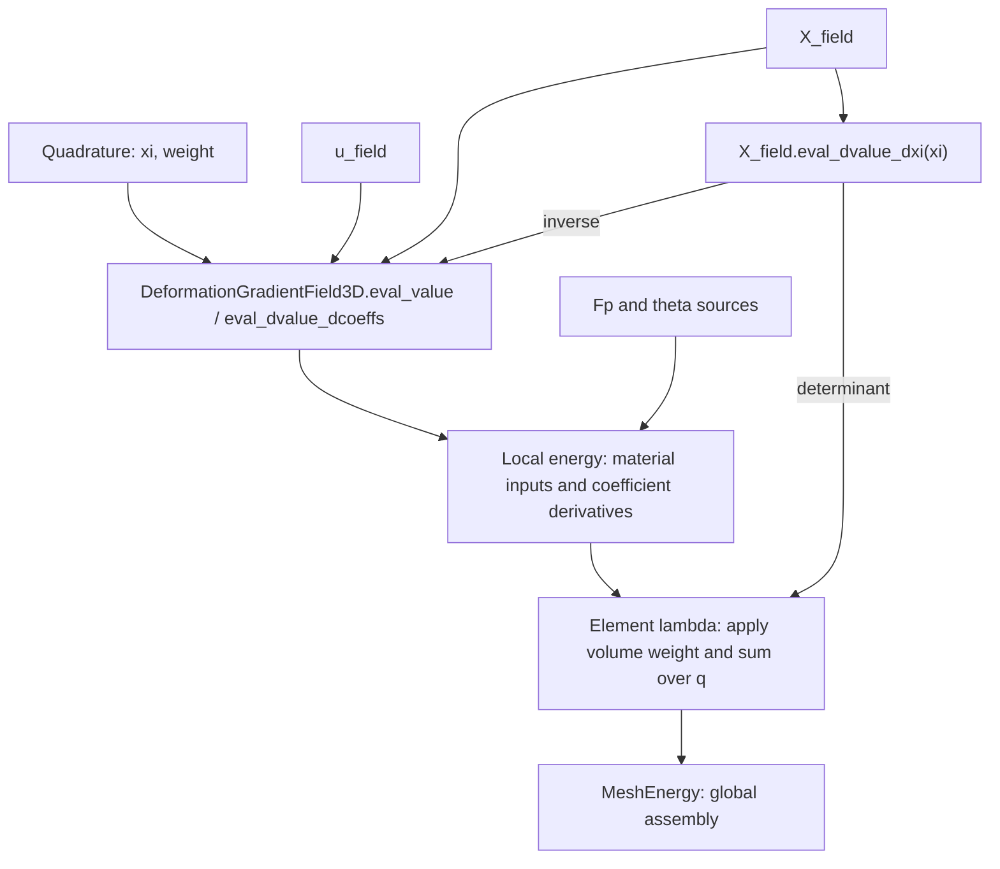

# FEM with MeshEnergy

Quadrature supplies reference coordinates `xi` and weights. A `Field3D` computes values and derivatives at `xi` through virtual functions. `DeformationGradientField3D` composes displacement and coordinate fields at one `xi`, returning column-flattened `F`. Materials consume numerical `F`, `Fp`, and `theta`. Local energies bind one active coefficient block and supply density and coefficient derivatives. The element lambda applies geometric weights and sums quadrature contributions; `MeshEnergy` gathers and assembles the element results.



## Modules and ownership

| Module | Responsibility |
| --- | --- |
| `fem/basis/` | Scalar basis values `N`, reference derivatives `dN_dxi`, and `d2N_dxi2`, grouped into `1d/`, `2d/`, and `3d/` |
| `fem/quadrature/` | Reference points and weights, grouped into `1d/`, `2d/`, and `3d/` |
| `fem/field/` | `Field2D/3D`, `InterpolatedField2D/3D`, `IdentityField2D/3D`, and `DeformationGradientField3D` |
| `fem/kinematics/` | Triangle mid-edge fundamental forms and the Hex Hermite coefficient transform |
| `fem/material/volumetric/` | Volumetric inputs, multiplicative kinematics, Neo-Hookean material, and the `VolumetricMaterialLocalEnergy3D` family |
| `fem/material/shell/` | Shell inputs, Koiter StVK material, `ShellMaterialLocalEnergy2D`, and fixed triangle mid-edge reference data |
| `fem/local/` | Shared `LocalEnergy2D/3D` interfaces and derivative contractions |

The 1D basis building blocks are `LinearLagrangeBasis` and `CubicHermiteBasis`. Tensor-product types use `2D` or `3D` suffixes, mirrored as `_2d` or `_3d` in their filenames.

`FieldT<ParamDim>`, `IdentityFieldT<ParamDim>`, and `LocalEnergyT<ParamDim>` support parameter dimensions 2 and 3. Use `Field2D` / `Field3D`, `IdentityField2D` / `IdentityField3D`, and `LocalEnergy2D` / `LocalEnergy3D` for dimension-specific interfaces. `InterpolatedField2D<B>` / `InterpolatedField3D<B>` select the parameter dimension of `InterpolatedFieldT<B, ParamDim>`. Component counts remain independent of parameter dimension. Dimensionless compatibility names have been removed, and the generic templates require an explicit parameter dimension. Update existing clients to the explicit `2D` / `3D` names and rebuild them.

`IdentityField3D` and `InterpolatedField3D` own coefficient snapshots. `DeformationGradientField3D` borrows two `const Field3D&` inputs: displacement `u` and fixed coordinates `X`. Those input objects must outlive the composed field and any local energy borrowing it; temporary inputs are rejected at compile time. All three inherit `Field3D` and return owning vectors and matrices directly, without a field-sample interface.

The composition uses the same reference coordinate for both inputs. The caller must bind fields belonging to the same element and reference-coordinate convention. Different bases are allowed; the existing extrapolation rules outside their reference elements remain unchanged. No mesh IDs or shared evaluation-cache framework are introduced.

## Names and packing

| Name | Meaning |
| --- | --- |
| `x`, `x_local` | Global optimizer unknowns, and the matrix/vector returned by `map.gather(e, x)` |
| `coeffs` | Generic coefficients stored by a basic field |
| `X_local`, `u_local`, `theta_local` | Coefficients directly consumed by the coordinate, displacement, or parameter field |
| `X_field`, `u_field`, `theta_field` | Field3D objects |
| `X`, `u`, `theta` | Values at one reference coordinate |
| `X_nodes` | Rest nodal positions, either an explicitly declared vertex-by-3 matrix or packed vector |
| `u_physical_local` | Physical Hermite DOFs before conversion to reference interpolation coefficients |
| `x_position` | Deformed position: `x_position(X) = X + u(X)` |

Numerical evaluation functions use `eval_<quantity>`; the combined energy entry point is `eval(...)`. Variables keep the quantity name without a prefix:

```cpp
const auto N = Basis::eval_N(xi);
const auto dvalue_dxi = field.eval_dvalue_dxi(xi);
const auto dW_dF = Material::eval_dW_dF(inputs);
```

This convention also applies to local and global energy values, gradients, and Hessians, including the Python energy API. Queries and operations retain names such as `num_dofs`, `reference_node`, `accumulate`, `assemble`, and `solve`. Previous evaluation names have been removed; update callers and custom overrides together.

`e` indexes elements, `q` quadrature points, `a` basis functions, `v` vertices, `c` components, and `d` coordinate directions. Basis functions and fields return their values and derivatives directly.

For `n` basis functions and `m` components, interpolated coefficients have shape `n`-by-`m` and flatten **by row**:

```
flatten(coeffs)[m*a+c] = coeffs(a,c)
```

Derivative matrices place scalar output components in rows and scalar input coefficients in columns. Matrix outputs flatten **by column**, independently of Eigen storage order:

```
vec(F)[i+3*d] = F(i,d)
```

`IdentityField3D` owns an `Eigen::VectorXd` and returns the same component vector. Flatten matrix coefficients by column before construction, for example `IdentityField3D(Fp.reshaped())`. The material input layer checks that `F` and `Fp` each contain nine components and restores their 3-by-3 shape. `X_nodes(v,c)` and packed `X_nodes[3*v+c]` address the same vertex/component ordering.

## Basic fields

```cpp
#include "litepgo/fem/basis/3d/hex_q1_basis.hpp"
#include "litepgo/fem/basis/3d/hex_hermite_basis.hpp"
#include "litepgo/fem/field/interpolated_field.hpp"
#include "litepgo/fem/field/identity_field.hpp"

const auto X_field = litepgo::InterpolatedField3D<litepgo::HexQ1Basis>(X_local);
const auto u_field = litepgo::InterpolatedField3D<litepgo::HexHermiteBasis>(u_local);
const litepgo::Field3D& field = u_field;
const auto u = field.eval_value(xi);
const auto du_dcoeffs = field.eval_dvalue_dcoeffs(xi);
```

Basis values and derivatives are evaluated independently, where `n` is the number of basis functions and `D` is the parameter dimension:

```cpp
const auto N = B::eval_N(xi);              // n-by-1
const auto dN_dxi = B::eval_dN_dxi(xi);     // n-by-D
const auto d2N_dxi2 = B::eval_d2N_dxi2(xi);  // n-by-D*(D+1)/2
```

`InterpolatedFieldT` calls only the basis function needed for each requested quantity:

$$
y(\xi)=\mathrm{coeffs}^T N(\xi),\qquad
y_{,\xi}(\xi)=\mathrm{coeffs}^T N_{,\xi}(\xi).
$$

| API | Result | Shape for a vector output |
| --- | --- | --- |
| `field.eval_value(xi)` | Value only | `m` |
| `field.eval_dvalue_dxi(xi)` | Reference-coordinate derivative only | `m`-by-`D` |
| `field.eval_dvalue_dcoeffs(xi)` | Derivative of value with respect to flattened coefficients | `m`-by-`n*m` |
| `field.eval_dgrad_xi_dcoeffs(xi)` | Derivative of column-major `vec(dvalue_dxi)` with respect to coefficients | `D*m`-by-`n*m` |
| `field.eval_d2value_dxi2(xi)` | Packed second reference-coordinate derivatives | `m`-by-`D*(D+1)/2` |
| `field.eval_dhess_xi_dcoeffs(xi)` | Coefficient derivative of column-major `vec(d2value_dxi2)` | `m*D*(D+1)/2`-by-`n*m` |

Large coefficient derivative matrices are constructed only when requested. Each method validates its own data dependencies independently. Non-finite coordinates, incompatible or non-finite coefficients, invalid basis data, and unrepresentable results are rejected. `Field3D` requires values and coefficient derivatives; its default spatial-derivative methods throw `std::logic_error` when unsupported.

`IdentityField3D` is spatially constant. It returns zero reference derivatives, an identity coefficient derivative, and a zero mixed reference/coefficient derivative. Being constant in space does not make its coefficients inactive.

Every basis provides static `eval_N`, `eval_dN_dxi`, and `eval_d2N_dxi2` functions returning concrete fixed-size double matrices. The `Basis<B,D>` concept requires all three functions, including for custom bases. There is no combined sample object. Tensor products evaluate only the 1D values and derivative orders needed to form the requested array. Packed Hessian columns are `(11)` in 1D, `(11,12,22)` in 2D, and `(11,12,13,22,23,33)` in 3D. Mixed derivatives are stored once without doubling. Linear 1D and Tet P1 bases have zero second derivatives; bilinear and trilinear bases have zero pure second derivatives but generally nonzero mixed derivatives. Interpolated fields always support second spatial derivatives and their coefficient derivatives; non-interpolated fields retain their optional spatial-derivative protocol.

## Two-dimensional parameter domains

```cpp
#include "litepgo/fem/basis/2d/quad_hermite_basis.hpp"
#include "litepgo/fem/field/interpolated_field.hpp"
#include "litepgo/fem/quadrature/2d/gauss_legendre_2d.hpp"

// coeffs is 16-by-3: four vector slots at each of four corners.
const litepgo::InterpolatedField2D<litepgo::QuadHermiteBasis> u_field(coeffs);
const litepgo::Field2D& field = u_field;
const Eigen::Vector2d xi(0.2, 0.3);
const auto u = field.eval_value(xi);        // 3 components
const auto du = field.eval_dvalue_dxi(xi);   // 3-by-2
const auto d2u = field.eval_d2value_dxi2(xi); // 3-by-3: (11,12,22)
using Q = litepgo::GaussLegendre2D<4>;       // 16 points on [0,1]^2
```

`QuadHermiteBasis` uses corners `(0,0), (1,0), (1,1), (0,1)`. Index `4*vertex+slot` stores `[u, u_xi, u_eta, u_xi_eta]`, with the same row order for basis values and derivatives. `QuadTopology` is `MeshTopology<4>`. `VertexDofMap(topology,12)` gathers a three-component Hermite field as a 4-by-12 matrix, which reshapes by row into 16-by-3 coefficients.

For C1 continuity on aligned rectangular parameter charts, share derivatives with respect to the same chart coordinates. A cell with chart spans `(hs,ht)` converts the four vector slots to reference coefficients using scales `[1,hs,ht,hs*ht]`. A curved reference geometry also needs compatible smooth coordinate interpolation. General chart transitions require their own derivative transformations.

Triangles use a nodal P1 basis on `xi >= 0, eta >= 0, xi+eta <= 1`, with reference vertices `(0,0), (1,0), (0,1)`:

```cpp
#include "litepgo/fem/basis/2d/triangle_p1_basis.hpp"
#include "litepgo/fem/quadrature/2d/triangle_centroid_quadrature.hpp"

// triangle_displacements is 3-by-3: one displacement vector per vertex.
const litepgo::InterpolatedField2D<litepgo::TriangleP1Basis> u_field(triangle_displacements);
using Q = litepgo::TriangleCentroidQuadrature;
```

`TriangleP1Basis` provides `N = (1-xi-eta, xi, eta)`, constant first derivatives, and zero second derivatives in columns `(11,12,22)`. It also supports scalar nodal fields with 3-by-1 coefficients. Reference positions and displacements can use separate fields with the same basis, keeping reference positions fixed while displacement coefficients change. Mid-edge curvature reconstruction requires a neighboring-face stencil and is separate from this basis.

`TriangleCentroidQuadrature` samples `(1/3,1/3)` with weight `1/2`, including the reference triangle's area, and integrates polynomials through degree 1 exactly. Multiply that weight by `norm(X_xi.cross(X_eta))` for the physical reference-area weight; the result is the triangle's area, without another factor of `1/2`. The square rules `GaussLegendre2D` use a different reference domain.

The element callback chooses the geometric measure. For a three-component surface coordinate field, its 3-by-2 derivative supplies reference area `norm(X_xi.cross(X_eta))`; pass this times the quadrature weight to `LocalEnergy2D::accumulate`. `MeshEnergy` and the DOF assembler already accept these elements. The deformation field `DeformationGradientField3D` and the material energies `VolumetricMaterialLocalEnergyF3D`, `VolumetricMaterialLocalEnergyFp3D`, and `VolumetricMaterialLocalEnergyTheta3D` are 3D solid APIs. Triangle mid-edge Koiter shells use `ShellMaterialLocalEnergy2D<KoiterStVK>` as described below.

Material input fields inherit `Field3D`. Only the selected active field needs usable coefficient derivatives and a positive DOF count; inactive fields may report zero DOFs and throw from unsupported derivatives. The active map must be affine in its coefficients. Custom affine parameter fields may have a coefficient count different from their number of output components.

## Deformation and coordinate derivatives

```cpp
#include "litepgo/fem/field/deformation_gradient_field.hpp"

const litepgo::DeformationGradientField3D F_field(u_field, X_field);
const litepgo::Field3D& field = F_field;
const Eigen::Matrix3d F = field.eval_value(xi).reshaped(3, 3);
const auto derivative = field.eval_dvalue_dcoeffs(xi);
```

`X_field` is an ordinary field whose values represent physical coordinates in the reference configuration. Its `eval_dvalue_dxi(xi)` supplies the derivative with respect to element parameter coordinates:

$$
\left[\frac{\partial X}{\partial\xi}\right]_{ij}
=\frac{\partial X_i}{\partial\xi_j},\qquad
\frac{\partial\xi}{\partial X}
=\left(\frac{\partial X}{\partial\xi}\right)^{-1}.
$$

`Field3D` assigns no geometric meaning to its values or derivatives. `DeformationGradientField3D` requests `X_field.eval_dvalue_dxi(xi)`, checks three components, a finite 3-by-3 derivative and a finite positive determinant, then computes and validates the inverse. The element lambda requests the same derivative and validates its shape, finiteness and positive finite determinant for volume weights; the weighting step does not need an inverse. Neither query needs `X_field.eval_value(xi)`. `coordinate_field()` exposes the coordinate field borrowed by the deformation field.

$$
F=I+u_{,\xi}X_{,\xi}^{-1},\qquad
N_{,X}=N_{,\xi}X_{,\xi}^{-1}.
$$

Computing `F` queries `u_field.eval_dvalue_dxi(xi)` and `X_field.eval_dvalue_dxi(xi)` without evaluating either field's value. Displacement component counts, derivative dimensions and finiteness, and the resulting `F` remain validated.

`eval_dvalue_dcoeffs(xi)` is a 9-by-`3*n_u` derivative with respect to the displacement field's reference coefficients, holding `X` fixed. `num_components()` is 9 and `num_dofs()` is the displacement field's count:

$$
\frac{\partial F_{id}}{\partial u_{ab}}=\delta_{ib}\frac{\partial N_a}{\partial X_d}.
$$

The implementation obtains `eval_dgrad_xi_dcoeffs(xi)` from the displacement field and applies the coordinate conversion with `kron(dxi_dX.transpose(), I3)`. This uses the same mixed-derivative interface for interpolated and identity fields.

`dF_dxi` would differentiate spatial position and require second reference derivatives. It is not part of this API. `dF_dX_local` would differentiate coordinate coefficients and is also outside this fixed-geometry scope.

## Materials, local energies, and integration

`F`, `Fp`, and `Fe = F * inverse(Fp)` are 3-by-3 total, plastic, and elastic deformation gradients. `theta` is a pointwise material parameter vector; Neo-Hookean uses `[lambda, mu]`. Its energy density per original rest volume is `W = det_Fp * psi`, with `psi` measured per plastic intermediate volume.

Material APIs keep numerical `VolumetricMaterialInputs{F, Fp, theta}`. They do not sample fields or select quadrature. `eval_W` returns the density. `eval_dW_dF` and `eval_dW_dFp` return 3-by-3 matrices; their Hessians `eval_d2W_dF2` and `eval_d2W_dFp2` are 9-by-9 over column-major vectorization. `eval_dW_dtheta` and `eval_d2W_dtheta2` differentiate the pointwise parameter vector. Elastic derivative helpers use `eval_dpsi_dFe` and `eval_d2psi_dFe2`; inverse/determinant variables use `inv_Fp`, `inv_Fe_T`, `det_Fe`, `det_Fp`, and `log_det_Fe`. Directional changes use `delta_`; optimizer steps retain `dx` and `dx_local`.

The element callback keeps geometry, material binding, and quadrature together. Here `X_fields` owns the coordinate fields for the elements, and `x_local` contains the gathered Q1 displacement coefficients:

```cpp
#include "litepgo/fem/material/volumetric/neo_hookean.hpp"
#include "litepgo/fem/quadrature/3d/gauss_legendre_3d.hpp"
#include "litepgo/fem/material/volumetric/volumetric_material_local_energy.hpp"

#include <Eigen/LU>
#include <cmath>
#include <stdexcept>

const auto eval_element =
    [X_fields, Fp_field, theta_field](int e, const Eigen::MatrixXd& x_local,
                                    Eigen::VectorXd* g, Eigen::MatrixXd* H) {
        const auto& X_field = X_fields[static_cast<std::size_t>(e)];
        const litepgo::InterpolatedField3D<litepgo::HexQ1Basis> u_field(x_local);
        const litepgo::DeformationGradientField3D deformation(u_field, X_field);
        const litepgo::VolumetricMaterialLocalEnergyF3D<litepgo::NeoHookean> local_energy(
            deformation, Fp_field, theta_field);
        if (g)
            g->setZero(local_energy.num_dofs());
        if (H)
            H->setZero(local_energy.num_dofs(), local_energy.num_dofs());
        using Q = litepgo::GaussLegendre3D<2>;
        double E_element = 0;
        for (int q = 0; q < Q::num_points; ++q) {
            const Eigen::Vector3d xi = Q::points().row(q).transpose();
            const auto dX_dxi = X_field.eval_dvalue_dxi(xi);
            if (dX_dxi.rows() != 3 || dX_dxi.cols() != 3 || !dX_dxi.allFinite())
                throw std::invalid_argument("Invalid coordinate derivative");
            const double determinant = Eigen::Matrix3d(dX_dxi).determinant();
            const double weight = Q::weights()[q] * determinant;
            if (!std::isfinite(determinant) || determinant <= 0 || !std::isfinite(weight))
                throw std::invalid_argument("Invalid coordinate determinant or volume weight");
            E_element += local_energy.accumulate(xi, weight, g, H);
        }
        return E_element;
    };
```

`GaussLegendre3D<PointsPerAxis>` uses `PointsPerAxis^3` integration points on `[0,1]^3`; `<2>` therefore uses eight points.

`VolumetricMaterialLocalEnergyF3D<Material>`, `VolumetricMaterialLocalEnergyFp3D<Material>`, and `VolumetricMaterialLocalEnergyTheta3D<Material>` select the active input by their class name. Each constructor accepts `(F_field, Fp_field, theta_field)` as three `const Field3D&` inputs. The abstract `VolumetricMaterialLocalEnergy3D<Material>` base shares input validation, density evaluation and coefficient pullbacks; each concrete class chooses its active field and calls the matching material gradient and Hessian. There is no runtime activity enum. A material only needs to implement `eval_W` and the derivative pair used by the selected class.

All three input fields must outlive the energy, and temporary input fields are rejected. A copied energy borrows the same fields, so subsequent field updates are visible. A composed `F` field activates displacement coefficients; direct `F` or `Fp` coefficients can use a nine-component `IdentityField3D`. Non-positive active DOF counts are rejected at construction.

`LocalEnergy3D::eval_value(xi)`, `eval_gradient(xi)`, and `eval_hessian(xi)` return pointwise density `W` and coefficient derivatives. `accumulate(xi, weight, ...)` receives a complete weight from its caller and adds weighted values and requested derivatives to initialized buffers. It performs no geometry evaluation. The material implementation samples each input once and computes the active coefficient derivative once per accumulation, sharing it between gradient and Hessian. Inactive derivatives and unrequested material derivatives are not evaluated.

The element lambda owns the geometric weighting step: at each quadrature point it validates `X_field.eval_dvalue_dxi(xi)`, computes `weight = w_q * det(dX_dxi)`, and passes that weight to the accumulator exactly once. Computing this weight requires neither coordinate position values nor an inverse. Geometry, material fields, and quadrature must refer to the same element and parameter domain; in particular, use the same coordinates as any composed deformation field. Geometry is fixed when taking coefficient derivatives.

The element lambda initializes each requested output to zero, traverses `q`, and sums the weighted contributions in one pass. Gradient and Hessian pointers are independently nullable; each evaluation overwrites the requested outputs. `accumulate` adds to those buffers without resizing them, so callers must initialize their dimensions and keep them separate from energy data. The examples use fixed quadrature rules with finite points and weights, validate geometry at every evaluated point, and reject non-finite volume weights. Field3D and local-energy evaluation retain coefficient, derivative-shape, and finite-map checks. The Hex Hermite callback integrates in reference coefficients before applying its physical-DOF transform.

For an affine active map `D`, pointwise pullbacks are

$$
g=D^T\operatorname{vec}(W_{,y}),\qquad H=D^TW_{,yy}D.
$$

Names distinguish pointwise `dW_du_local`, `d2W_du_local2` from integrated `dE_du_local`, `d2E_du_local2`. `dW_dtheta` and `dW_dtheta_local` have different denominators. The generic `MeshEnergy` boundary returns `dE_dx_local` and `d2E_dx_local2` for exactly the gathered unknowns.

## Triangle mid-edge stencil DOFs

`StencilDofMap` accepts ordered, variable-length vertex lists and a DOF width per vertex. It owns those lists, rejects repeated or invalid vertex IDs, and gathers a matrix with one row per stencil vertex. Scalar indices follow `width*global_vertex+slot`; flatten the local matrix by row for gradients and Hessians. Empty stencils and unused global vertices are supported.

```cpp
#include "litepgo/dof/stencil_dof_map.hpp"
#include "litepgo/mesh/triangle_mid_edge_stencils.hpp"

const auto stencils = litepgo::make_triangle_mid_edge_stencils(topology);
const litepgo::StencilDofMap map(topology.num_vertices(), stencils.vertices, 3);
const auto X_local = map.gather(f, X_nodes_packed); // fixed reference positions
const auto u_local = map.gather(f, u);             // current displacements
const Eigen::MatrixXd positions = X_local + u_local;
const litepgo::InterpolatedField2D<litepgo::TriangleP1Basis> u_field(u_local.topRows(3));
```

For each triangle `f`, `stencils.vertices[f]` starts with its three vertices in connectivity order. Edge `k` joins local face vertices `(k+1)%3` and `(k+2)%3`. Opposite vertices across edges `0,1,2` are appended in that order, with shared opposite vertices included only once. A face therefore has 3 to 6 stencil vertices. `stencils.opposite[f][k]` is the neighbor's opposite vertex row in the gathered matrix; `-1` denotes a boundary edge and is never a global DOF. The builder rejects duplicate faces, inconsistent shared-edge directions, and edges with more than two incident faces. It does not choose a boundary curvature rule or validate geometry.

Use `MeshEnergy(map, eval_face, step_face)` directly. Its callback receives the full stencil matrix, including neighbors, and returns only the central face's integrated energy. For `n` stencil vertices, requested outputs must overwrite all `3*n` gradient entries and the full `3*n`-by-`3*n` Hessian, including zero entries. `MeshEnergy` includes all stencil couplings in its fixed sparse pattern. Capture reference stencil positions and opposite-row metadata by value or through owned shared data. A shell callback must provide its own geometric feasibility step. Curvature reconstruction and Koiter energy remain separate from this DOF map.

## Triangle mid-edge kinematics

The numerical function `eval_triangle_mid_edge_kinematics` accepts a gathered position stencil and its opposite-row metadata. It returns two 2-by-2 matrices, `a` and `b`, without a field object or quadrature coordinate:

```cpp
#include "litepgo/fem/kinematics/triangle_mid_edge_kinematics.hpp"

const Eigen::MatrixXd x_local = X_local + u_local;
Eigen::MatrixXd dab_dx;
std::array<Eigen::MatrixXd, 6> d2ab_dx2;
const auto current = litepgo::eval_triangle_mid_edge_kinematics(
    x_local, stencils.opposite[f], &dab_dx, &d2ab_dx2);
const auto reference = litepgo::eval_triangle_mid_edge_kinematics(X_local, stencils.opposite[f]);
const Eigen::Matrix2d a_bar = reference.a;
const Eigen::Matrix2d b_bar = reference.b;
```

Both derivative outputs are independently optional and overwritten. They differentiate `(a11,a12,a22,b11,b12,b22)`, with mixed entries stored once without scaling, with respect to row-packed positions. `dab_dx` has shape 6-by-`3*n`; the six Hessians each have shape `3*n`-by-`3*n`. Since reference positions are fixed, these are also the derivatives with respect to `u_local`. Both derivative orders use analytic formulas, computing second derivatives only when requested; finite differences are used only in tests.

The first form is `a = J.transpose()*J`, where `J = [x1-x0, x2-x0]`. The second form uses area-weighted mid-edge normals, following the [mid-edge-average discretization](https://github.com/evouga/libshell/blob/master/src/SecondFundamentalForm/MidedgeAverageFormulation.cpp), with the sign chosen to agree with `b_ab = n.dot(x_,ab)` (the opposite of LibShell's sign). For central unnormalized normal `N`, neighbor normal `N_k`, and opposite row `p_k`,

$$
N=(x_1-x_0)\times(x_2-x_0),\qquad
N_k=(x_{k+2}-x_{p_k})\times(x_{k+1}-x_{p_k}),
$$
$$
c_k=-\frac{[(x_{k+1}-x_k)+(x_{k+2}-x_k)]\cdot N_k}{\|N+N_k\|},\qquad
b=\begin{bmatrix}c_0+c_1&c_0\\c_0&c_0+c_2\end{bmatrix},
$$

where central vertex indices are modulo 3. Boundary edges use `c_k = 0`, equivalent to a one-sided face-normal extrapolation; clamped boundary directors are not implemented. Degenerate central or neighboring triangles, or cancelling averaged normals, throw `InfeasibleState`. Layout errors and non-finite inputs throw `std::invalid_argument`. Geometry singularity checks use a relative tolerance of `1e-12`. This function performs no area integration or material evaluation.

## Koiter shell material and local energy

`KoiterStVK` consumes numerical `ShellMaterialInputs{a, b, a_bar, b_bar, thickness, theta}`. With `theta = [lambda_ps, mu]`, it returns density per reference area,

$$
\epsilon=\frac{a-\bar a}{2},\qquad\kappa=b-\bar b,\qquad
W=t\,\psi(\epsilon)+\frac{t^3}{12}\psi(\kappa),
$$
$$
\psi(S)=\frac{\lambda_{ps}}2[\operatorname{tr}(\bar a^{-1}S)]^2
+\mu\operatorname{tr}(\bar a^{-1}S\bar a^{-1}S).
$$

These are the [Koiter StVK membrane and bending factors](https://github.com/evouga/libshell/blob/master/src/MaterialModel/StVKMaterial.cpp). `lambda_ps` is the plane-stress coefficient, not the 3D Lamé coefficient. For Young's modulus `Y` and Poisson ratio `nu`, use `lambda_ps = Y*nu/(1-nu*nu)` and `mu = Y/(2*(1+nu))`. The material requires positive thickness, `mu > 0`, and `lambda_ps+mu > 0`; stable negative `lambda_ps` is supported. Forms must be finite and symmetric, and both metrics must be positive definite.

`eval_dW_dab` and `eval_d2W_dab2` differentiate the six independent entries `(a11,a12,a22,b11,b12,b22)`. Changing a mixed entry changes both symmetric matrix positions. The material Hessian is 6-by-6; area integration belongs to the caller.

Build fixed reference data once for each face:

```cpp
#include "litepgo/fem/material/shell/shell_material_local_energy.hpp"
#include "litepgo/fem/material/shell/koiter_stvk.hpp"
#include "litepgo/fem/quadrature/2d/triangle_centroid_quadrature.hpp"

std::vector<litepgo::TriangleMidEdgeRestData> rest;
for (int f = 0; f < map.num_elements(); ++f)
    rest.emplace_back(map.gather(f, X_nodes_packed), stencils.opposite[f]);
```

Each record owns `X_local`, `opposite`, `a_bar`, `b_bar`, and `sqrt_det_a_bar`. In the `MeshEnergy` callback, `u_local` is the full stencil matrix gathered by `StencilDofMap`:

```cpp
const litepgo::ShellMaterialLocalEnergy2D<litepgo::KoiterStVK> local_energy(
    rest[f], u_local, thickness, Eigen::Vector2d(lambda_ps, mu));
if (g)
    g->setZero(local_energy.num_dofs());
if (H)
    H->setZero(local_energy.num_dofs(), local_energy.num_dofs());
using Q = litepgo::TriangleCentroidQuadrature;
const Eigen::Vector2d xi = Q::points().row(0).transpose();
const double weight = Q::weights()[0] * rest[f].sqrt_det_a_bar;
return local_energy.accumulate(xi, weight, g, H);
```

The local energy owns snapshots, activates all `3*n` row-packed displacement DOFs, and holds reference data, thickness, and material parameters fixed. Its exact Hessian includes both `J.transpose()*d2W_dab2*J` and the six geometric Hessian contractions weighted by `dW_dab`. Gradient and Hessian outputs remain independently nullable; `accumulate` adds into correctly sized, initialized buffers. Pointwise density and derivatives are constant over this face, so the centroid rule integrates them exactly. Only the central face's contribution is returned; neighboring vertices supply its curvature support.

The current shell path optimizes displacement only and uses per-face constant parameters. It retains the mid-edge boundary normal extrapolation above. A solver still needs a geometric feasible-step callback; the local density implementation does not supply one.

## Hex Hermite physical DOFs

`eval_hex_hermite_dof_transform` accepts an `8`-by-`3` matrix `X_nodes` containing one reference element's physical vertex coordinates, ordered as the corners of `HexHermiteBasis`. The example separately constructs a Q1 coordinate field for deformation evaluation. Displacement uses 64 reference coefficients per component. Each vertex supplies the physical slots `u, u_X, u_Y, u_Z, u_XY, u_XZ, u_YZ, u_XYZ`, each a three-vector. The gathered `u_physical_local` has shape 8-by-24; the field's `u_local` has shape 64-by-3.

```cpp
#include "litepgo/fem/kinematics/hex_hermite_dof_transform.hpp"

const auto S = litepgo::eval_hex_hermite_dof_transform(X_nodes); // Once per fixed rest element.
const Eigen::VectorXd u_local_flat = S * u_physical_local.reshaped<Eigen::RowMajor>();
const Eigen::MatrixXd u_local = u_local_flat.reshaped<Eigen::RowMajor>(64, 3);
const auto u_field = litepgo::InterpolatedField3D<litepgo::HexHermiteBasis>(u_local);
```

`S` is an owning 192-by-192 Eigen diagonal matrix storing only 192 scalars. Its eight slot factors are `1, hx, hy, hz, hx*hy, hx*hz, hy*hz, hx*hy*hz`, repeated over three components at each vertex. For example, `u_xi = hx*u_X`. This coefficient conversion precedes field construction; `dxi_dX` subsequently converts spatial gradients during deformation evaluation.

$$
\operatorname{flatten}(u_{\mathrm{local}})=S\operatorname{flatten}(u_{\mathrm{physical,local}}),\qquad
D_{\mathrm{physical}}=D_uS,\qquad
g_{\mathrm{physical}}=S^Tg_u,\qquad H_{\mathrm{physical}}=S^TH_uS.
$$

The example integrates into coefficient-specific buffers and then returns physical-DOF derivatives, without temporarily giving coefficient derivatives physical-DOF names. Because `S` is diagonal, pullback uses in-place diagonal scaling; no dense 192-by-192 transform is stored.

The nodes must form a positive axis-aligned reference box:

$$
X_v=X_0+\operatorname{diag}(h_x,h_y,h_z)\xi_v,\qquad h_x,h_y,h_z>0.
$$

Here `xi_v` is the reference corner of vertex `v` on `[0,1]^3`. The transform checks matrix dimensions and finite coordinates, obtains `hx`, `hy`, `hz` from edges `0→1`, `0→3`, `0→4`, and verifies all eight vertices against this box in reference-corner order. Non-positive or non-finite lengths and non-positive or non-finite scaling products are rejected. Node consistency uses a dimensionless tolerance of `1e-12` after normalization by each axis length. General rest hexes require a different Hermite DOF mapping and compatible continuity conditions. The deformed configuration may rotate, stretch, shear, or bend subject to material feasibility.

## C++ migration

Use explicit `2D` / `3D` names for dimension-specific types. The dimensionless names and implicit 3D default have been removed; the older header and API migration is listed below.

| Previous API/header | Replacement |
| --- | --- |
| `fem/geometry/interpolation.hpp` or `fem/interpolation/interpolation.hpp` | `fem/field/interpolated_field.hpp` |
| `Interpolation`, `InterpolatedValueField` | `InterpolatedField2D` / `InterpolatedField3D` |
| `fem/geometry/rest.hpp` or `fem/interpolation/rest_point.hpp` | `fem/field/field.hpp` |
| `rest_point(X_field, xi)`, `RestPointData` | `X_field.eval_value(xi)` and `X_field.eval_dvalue_dxi(xi)`; geometric consumers validate and invert the derivative as needed |
| `fem/interpolation/hex_hermite_dof_transform.hpp` or `fem/field/hex_hermite_dof_transform.hpp` | `fem/kinematics/hex_hermite_dof_transform.hpp` |
| `DeformationGradient` and its sample interface | `DeformationGradientField3D(u_field, X_field)` with named, longer-lived inputs |
| `field.value(point)` | `field.eval_value(xi)`; composed deformation fields return nine components |
| `dvalue_dx_local(xi)`, `dgrad_xi_dx_local(xi)` | `eval_dvalue_dcoeffs(xi)`, `eval_dgrad_xi_dcoeffs(xi)` |
| `field.jacobian(point)` / `dF_dx_local` | `field.eval_dvalue_dcoeffs(xi)` |
| `VolumetricMaterialLocalEnergy3D<Material>(F, Fp, theta, active)` or `make_material_local_energy<Material, Active>` | `VolumetricMaterialLocalEnergyF3D`, `VolumetricMaterialLocalEnergyFp3D`, or `VolumetricMaterialLocalEnergyTheta3D`, with named `Field3D` inputs |
| Volume integration helper | Quadrature loop inside the element lambda, passing `w_q * det(dX_dxi)` to `local_energy.accumulate` |
| `B::evaluate(xi)` and `Basis::Sample` | `B::eval_N(xi)`, `B::eval_dN_dxi(xi)`, `B::eval_d2N_dxi2(xi)` |
| `RestPointData::position`, `jacobian`, `inverse_jacobian`, `jacobian_determinant` | Field3D values, coordinate Jacobians, their inverses, and their determinants |
| Material `gradient_F`, `hessian_F` and corresponding `Fp`/`theta` names | `eval_dW_dF`, `eval_d2W_dF2` and corresponding names |

Custom solid-material inputs inherit `Field3D` and implement the value and affine coefficient protocol above. Material local energies borrow their three input fields; composed deformation fields in turn borrow displacement and coordinate fields. All referenced objects must remain alive during evaluation. Scope remains one active affine coefficient block with fixed rest geometry; coordinate optimization, mixed active-block Hessians, and `dF_dxi` are not implemented.

## Examples and validation

Build and run each example from the repository root:

```sh
cmake --preset debug
cmake --build --preset debug --target hex_q1_mesh_energy tet_p1_mesh_energy hex_hermite_mesh_energy litepgo_tests
./build/debug/example/fem/hex_q1_mesh_energy
./build/debug/example/fem/tet_p1_mesh_energy
./build/debug/example/fem/hex_hermite_mesh_energy
ctest --preset debug --output-on-failure
```

Hex Q1 uses two boxes with widths 1 and 2 sharing nodal displacement DOFs and integrates with `GaussLegendre3D<2>`. Tet P1 uses two tetrahedra with volumes 1/6 and 1/3 and `TetCentroidQuadrature`. Hex Hermite uses two boxes of sizes (1,2,3) and (2,2,3), sharing all physical derivative DOFs at their common face, and `GaussLegendre3D<4>`.

Tests cover row/column packing, coefficient and physical finite differences, warped coordinate mappings, different displacement/coordinate bases, direct and derived deformation inputs, all active material inputs, shared/element/global DOF assembly, coefficient ownership, coefficient-transform validation, unsupported capabilities, and pointwise evaluation counts. Basis and interpolated-field tests also verify that unrequested quantities are not evaluated. Examples evaluate energy and derivatives only; feasible solver step bounds remain unimplemented.
