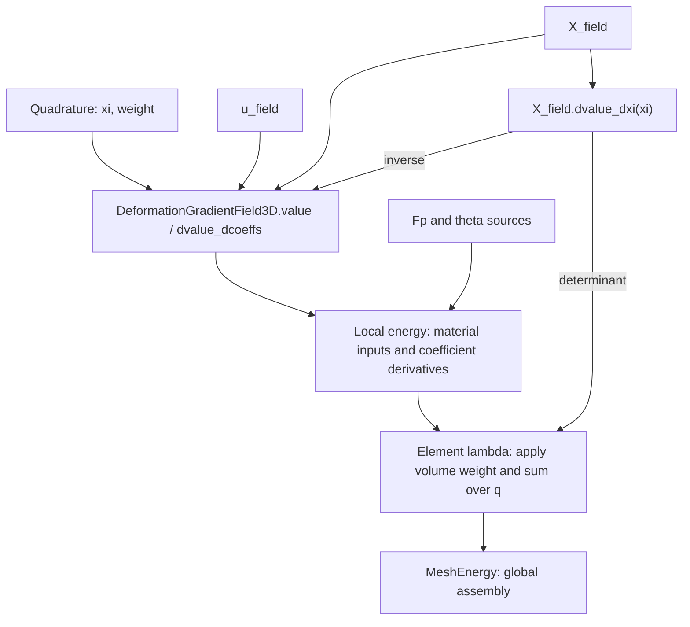

# FEM with MeshEnergy

Quadrature supplies reference coordinates `xi` and weights. A `Field3D` computes values and derivatives at `xi` through virtual functions. `DeformationGradientField3D` composes displacement and coordinate fields at one `xi`, returning column-flattened `F`. Materials consume numerical `F`, `Fp`, and `theta`. Local energies bind one active coefficient block and supply density and coefficient derivatives. The element lambda applies geometric weights and sums quadrature contributions; `MeshEnergy` gathers and assembles the element results.



## Modules and ownership

| Module | Responsibility |
| --- | --- |
| `fem/basis/` | Scalar basis values `N`, reference derivatives `dN_dxi`, and optional `d2N_dxi2`, grouped into `1d/`, `2d/`, and `3d/` |
| `fem/quadrature/` | Reference points and weights, grouped into `1d/`, `2d/`, and `3d/` |
| `fem/field/` | `Field2D/3D`, `InterpolatedField2D/3D`, `IdentityField2D/3D`, `DeformationGradientField3D`, and the Hex Hermite coefficient transform |
| `fem/material/` | Numerical constitutive inputs, density, and material derivatives |
| `fem/local/` | Pointwise local energies, active-input binding, and derivative contractions |

The 1D basis building blocks are `LinearLagrangeBasis` and `CubicHermiteBasis`. Tensor-product types use `2D` or `3D` suffixes, mirrored as `_2d` or `_3d` in their filenames.

`FieldT<ParamDim>`, `IdentityFieldT<ParamDim>`, and `LocalEnergyT<ParamDim>` support parameter dimensions 2 and 3. Use `Field2D` / `Field3D`, `IdentityField2D` / `IdentityField3D`, and `LocalEnergy2D` / `LocalEnergy3D` for dimension-specific interfaces. `InterpolatedField2D<B>` / `InterpolatedField3D<B>` select the parameter dimension of `InterpolatedFieldT<B, ParamDim>`. Component counts remain independent of parameter dimension. Dimensionless compatibility names have been removed, and the generic templates require an explicit parameter dimension. Update existing clients to the explicit `2D` / `3D` names and rebuild them.

`IdentityField3D` and `InterpolatedField3D` own coefficient snapshots. `DeformationGradientField3D` borrows two `const Field3D&` inputs: displacement `u` and fixed coordinates `X`. Those input objects must outlive the composed field and any local energy borrowing it; temporary inputs are rejected at compile time. All three inherit `Field3D` and return owning vectors and matrices directly, without a field-sample interface.

The composition uses the same reference coordinate for both inputs. The caller must bind fields belonging to the same element and reference-coordinate convention. Different bases are allowed; the existing extrapolation rules outside their reference elements remain unchanged. No mesh IDs or shared evaluation-cache framework are introduced.

## Names and packing

| Name | Meaning |
| --- | --- |
| `x`, `x_local` | Global optimizer unknowns, and the matrix/vector returned by `map.gather(e, x)` |
| `coeffs` | Generic coefficients stored by a basic field |
| `X_local`, `u_local`, `theta_local` | Coefficients directly consumed by the coordinate, displacement, or parameter field |
| `X_field`, `u_field`, `theta_field` | Field3D objects |
| `X`, `u`, `theta` | Values at one reference coordinate |
| `X_nodes` | Rest nodal positions, either an explicitly declared vertex-by-3 matrix or packed vector |
| `u_physical_local` | Physical Hermite DOFs before conversion to reference interpolation coefficients |
| `x_position` | Deformed position: `x_position(X) = X + u(X)` |

`e` indexes elements, `q` quadrature points, `a` basis functions, `v` vertices, `c` components, and `d` coordinate directions. Use `basis_sample` for basis evaluation results. Fields return their values and derivatives directly.

For `n` basis functions and `m` components, interpolated coefficients have shape `n`-by-`m` and flatten **by row**:

```
flatten(coeffs)[m*a+c] = coeffs(a,c)
```

Derivative matrices place scalar output components in rows and scalar input coefficients in columns. Matrix outputs flatten **by column**, independently of Eigen storage order:

```
vec(F)[i+3*d] = F(i,d)
```

`IdentityField3D` owns an `Eigen::VectorXd` and returns the same component vector. Flatten matrix coefficients by column before construction, for example `IdentityField3D(Fp.reshaped())`. The material input layer checks that `F` and `Fp` each contain nine components and restores their 3-by-3 shape. `X_nodes(v,c)` and packed `X_nodes[3*v+c]` address the same vertex/component ordering.

## Basic fields

```cpp
#include "litepgo/fem/basis/3d/hex_q1_basis.hpp"
#include "litepgo/fem/basis/3d/hex_hermite_basis.hpp"
#include "litepgo/fem/field/interpolated_field.hpp"
#include "litepgo/fem/field/identity_field.hpp"

const auto X_field = litepgo::InterpolatedField3D<litepgo::HexQ1Basis>(X_local);
const auto u_field = litepgo::InterpolatedField3D<litepgo::HexHermiteBasis>(u_local);
const litepgo::Field3D& field = u_field;
const auto u = field.value(xi);
const auto du_dcoeffs = field.dvalue_dcoeffs(xi);
```

`B::evaluate(xi)` returns a `basis_sample` containing `N` (`n`-by-1) and `dN_dxi` (`n`-by-`D`), where `D` is the parameter dimension. `InterpolatedFieldT` uses these arrays to compute each requested quantity:

$$
y(\xi)=\mathrm{coeffs}^T N(\xi),\qquad
y_{,\xi}(\xi)=\mathrm{coeffs}^T N_{,\xi}(\xi).
$$

| API | Result | Shape for a vector output |
| --- | --- | --- |
| `field.value(xi)` | Value only | `m` |
| `field.dvalue_dxi(xi)` | Reference-coordinate derivative only | `m`-by-`D` |
| `field.dvalue_dcoeffs(xi)` | Derivative of value with respect to flattened coefficients | `m`-by-`n*m` |
| `field.dgrad_xi_dcoeffs(xi)` | Derivative of column-major `vec(dvalue_dxi)` with respect to coefficients | `D*m`-by-`n*m` |
| `field.d2value_dxi2(xi)` | Packed second reference-coordinate derivatives | `m`-by-`D*(D+1)/2` |
| `field.dhess_xi_dcoeffs(xi)` | Coefficient derivative of column-major `vec(d2value_dxi2)` | `m*D*(D+1)/2`-by-`n*m` |

Large coefficient derivative matrices are constructed only when requested. Each method validates its own data dependencies independently. Non-finite coordinates, incompatible or non-finite coefficients, invalid basis data, and unrepresentable results are rejected. `Field3D` requires values and coefficient derivatives; its default spatial-derivative methods throw `std::logic_error` when unsupported.

`IdentityField3D` is spatially constant. It returns zero reference derivatives, an identity coefficient derivative, and a zero mixed reference/coefficient derivative. Being constant in space does not make its coefficients inactive.

Second spatial derivatives are optional. `SecondOrderBasis<B,D>` checks for `Sample::d2N_dxi2` with upper-triangle columns `(11,12,22)` in 2D or `(11,12,13,22,23,33)` in 3D. Mixed derivatives are stored once without doubling. `InterpolatedFieldT` provides the second-derivative methods only when the basis has this capability; otherwise the methods throw `std::logic_error`. Constant fields return zeros. Existing 3D bases retain their first-order interfaces.

## Two-dimensional parameter domains

```cpp
#include "litepgo/fem/basis/2d/quad_hermite_basis.hpp"
#include "litepgo/fem/field/interpolated_field.hpp"
#include "litepgo/fem/quadrature/2d/gauss_legendre_2d.hpp"

// coeffs is 16-by-3: four vector slots at each of four corners.
const litepgo::InterpolatedField2D<litepgo::QuadHermiteBasis> u_field(coeffs);
const litepgo::Field2D& field = u_field;
const Eigen::Vector2d xi(0.2, 0.3);
const auto u = field.value(xi);             // 3 components
const auto du = field.dvalue_dxi(xi);       // 3-by-2
const auto d2u = field.d2value_dxi2(xi);     // 3-by-3: (11,12,22)
using Q = litepgo::GaussLegendre2D<4>;       // 16 points on [0,1]^2
```

`QuadHermiteBasis` uses corners `(0,0), (1,0), (1,1), (0,1)`. Index `4*vertex+slot` stores `[u, u_xi, u_eta, u_xi_eta]`, with the same row order for basis values and derivatives. `QuadTopology` is `MeshTopology<4>`. `VertexDofMap(topology,12)` gathers a three-component Hermite field as a 4-by-12 matrix, which reshapes by row into 16-by-3 coefficients.

For C1 continuity on aligned rectangular parameter charts, share derivatives with respect to the same chart coordinates. A cell with chart spans `(hs,ht)` converts the four vector slots to reference coefficients using scales `[1,hs,ht,hs*ht]`. A curved reference geometry also needs compatible smooth coordinate interpolation. General chart transitions require their own derivative transformations.

The element callback chooses the geometric measure. For a three-component surface coordinate field, its 3-by-2 derivative supplies reference area `norm(X_xi.cross(X_eta))`; pass this times the quadrature weight to `LocalEnergy2D::accumulate`. `MeshEnergy` and the DOF assembler already accept these elements. The deformation field `DeformationGradientField3D` and the material energies `MaterialLocalEnergyF3D`, `MaterialLocalEnergyFp3D`, and `MaterialLocalEnergyTheta3D` are 3D solid APIs. Koiter kinematics and energy are not part of this 2D foundation.

Material input fields inherit `Field3D`. Only the selected active field needs usable coefficient derivatives and a positive DOF count; inactive fields may report zero DOFs and throw from unsupported derivatives. The active map must be affine in its coefficients. Custom affine parameter fields may have a coefficient count different from their number of output components.

## Deformation and coordinate derivatives

```cpp
#include "litepgo/fem/field/deformation_gradient_field.hpp"

const litepgo::DeformationGradientField3D F_field(u_field, X_field);
const litepgo::Field3D& field = F_field;
const Eigen::Matrix3d F = field.value(xi).reshaped(3, 3);
const auto derivative = field.dvalue_dcoeffs(xi);
```

`X_field` is an ordinary field whose values represent physical coordinates in the reference configuration. Its `dvalue_dxi(xi)` supplies the derivative with respect to element parameter coordinates:

$$
\left[\frac{\partial X}{\partial\xi}\right]_{ij}
=\frac{\partial X_i}{\partial\xi_j},\qquad
\frac{\partial\xi}{\partial X}
=\left(\frac{\partial X}{\partial\xi}\right)^{-1}.
$$

`Field3D` assigns no geometric meaning to its values or derivatives. `DeformationGradientField3D` requests `X_field.dvalue_dxi(xi)`, checks three components, a finite 3-by-3 derivative and a finite positive determinant, then computes and validates the inverse. The element lambda requests the same derivative and validates its shape, finiteness and positive finite determinant for volume weights; the weighting step does not need an inverse. Neither query needs `X_field.value(xi)`. `coordinate_field()` exposes the coordinate field borrowed by the deformation field.

$$
F=I+u_{,\xi}X_{,\xi}^{-1},\qquad
N_{,X}=N_{,\xi}X_{,\xi}^{-1}.
$$

Computing `F` queries `u_field.dvalue_dxi(xi)` and `X_field.dvalue_dxi(xi)` without evaluating either field's value. Displacement component counts, derivative dimensions and finiteness, and the resulting `F` remain validated.

`dvalue_dcoeffs(xi)` is a 9-by-`3*n_u` derivative with respect to the displacement field's reference coefficients, holding `X` fixed. `num_components()` is 9 and `num_dofs()` is the displacement field's count:

$$
\frac{\partial F_{id}}{\partial u_{ab}}=\delta_{ib}\frac{\partial N_a}{\partial X_d}.
$$

The implementation obtains `dgrad_xi_dcoeffs(xi)` from the displacement field and applies the coordinate conversion with `kron(dxi_dX.transpose(), I3)`. This uses the same mixed-derivative interface for interpolated and identity fields.

`dF_dxi` would differentiate spatial position and require second reference derivatives. It is not part of this API. `dF_dX_local` would differentiate coordinate coefficients and is also outside this fixed-geometry scope.

## Materials, local energies, and integration

`F`, `Fp`, and `Fe = F * inverse(Fp)` are 3-by-3 total, plastic, and elastic deformation gradients. `theta` is a pointwise material parameter vector; Neo-Hookean uses `[lambda, mu]`. Its energy density per original rest volume is `W = det_Fp * psi`, with `psi` measured per plastic intermediate volume.

Material APIs keep numerical `MaterialInputs{F, Fp, theta}`. They do not sample fields or select quadrature. `dW_dF` and `dW_dFp` return 3-by-3 matrices; their Hessians `d2W_dF2` and `d2W_dFp2` are 9-by-9 over column-major vectorization. `dW_dtheta` and `d2W_dtheta2` differentiate the pointwise parameter vector. Elastic derivatives use `dpsi_dFe` and `d2psi_dFe2`; inverse/determinant variables use `inv_Fp`, `inv_Fe_T`, `det_Fe`, `det_Fp`, and `log_det_Fe`. Directional changes use `delta_`; optimizer steps retain `dx` and `dx_local`.

The element callback keeps geometry, material binding, and quadrature together. Here `X_fields` owns the coordinate fields for the elements, and `x_local` contains the gathered Q1 displacement coefficients:

```cpp
#include "litepgo/fem/material/neo_hookean.hpp"
#include "litepgo/fem/quadrature/3d/gauss_legendre_3d.hpp"
#include "litepgo/fem/local/material_local_energy.hpp"

#include <Eigen/LU>
#include <cmath>
#include <stdexcept>

const auto evaluate_element =
    [X_fields, Fp_field, theta_field](int e, const Eigen::MatrixXd& x_local,
                                    Eigen::VectorXd* g, Eigen::MatrixXd* H) {
        const auto& X_field = X_fields[static_cast<std::size_t>(e)];
        const litepgo::InterpolatedField3D<litepgo::HexQ1Basis> u_field(x_local);
        const litepgo::DeformationGradientField3D deformation(u_field, X_field);
        const litepgo::MaterialLocalEnergyF3D<litepgo::NeoHookean> local_energy(
            deformation, Fp_field, theta_field);
        if (g)
            g->setZero(local_energy.num_dofs());
        if (H)
            H->setZero(local_energy.num_dofs(), local_energy.num_dofs());
        using Q = litepgo::GaussLegendre3D<2>;
        double E_element = 0;
        for (int q = 0; q < Q::num_points; ++q) {
            const Eigen::Vector3d xi = Q::points().row(q).transpose();
            const auto dX_dxi = X_field.dvalue_dxi(xi);
            if (dX_dxi.rows() != 3 || dX_dxi.cols() != 3 || !dX_dxi.allFinite())
                throw std::invalid_argument("Invalid coordinate derivative");
            const double determinant = Eigen::Matrix3d(dX_dxi).determinant();
            const double weight = Q::weights()[q] * determinant;
            if (!std::isfinite(determinant) || determinant <= 0 || !std::isfinite(weight))
                throw std::invalid_argument("Invalid coordinate determinant or volume weight");
            E_element += local_energy.accumulate(xi, weight, g, H);
        }
        return E_element;
    };
```

`GaussLegendre3D<PointsPerAxis>` uses `PointsPerAxis^3` integration points on `[0,1]^3`; `<2>` therefore uses eight points.

`MaterialLocalEnergyF3D<Material>`, `MaterialLocalEnergyFp3D<Material>`, and `MaterialLocalEnergyTheta3D<Material>` select the active input by their class name. Each constructor accepts `(F_field, Fp_field, theta_field)` as three `const Field3D&` inputs. The abstract `MaterialLocalEnergy3D<Material>` base shares input validation, density evaluation and coefficient pullbacks; each concrete class chooses its active field and calls the matching material gradient and Hessian. There is no runtime activity enum. A material only needs to implement `value` and the derivative pair used by the selected class.

All three input fields must outlive the energy, and temporary input fields are rejected. A copied energy borrows the same fields, so subsequent field updates are visible. A composed `F` field activates displacement coefficients; direct `F` or `Fp` coefficients can use a nine-component `IdentityField3D`. Non-positive active DOF counts are rejected at construction.

`LocalEnergy3D::value(xi)`, `gradient(xi)`, and `hessian(xi)` return pointwise density `W` and coefficient derivatives. `accumulate(xi, weight, ...)` receives a complete weight from its caller and adds weighted values and requested derivatives to initialized buffers. It performs no geometry evaluation. The material implementation samples each input once and computes the active coefficient derivative once per accumulation, sharing it between gradient and Hessian. Inactive derivatives and unrequested material derivatives are not evaluated.

The element lambda owns the geometric weighting step: at each quadrature point it validates `X_field.dvalue_dxi(xi)`, computes `weight = w_q * det(dX_dxi)`, and passes that weight to the accumulator exactly once. Computing this weight requires neither coordinate position values nor an inverse. Geometry, material fields, and quadrature must refer to the same element and parameter domain; in particular, use the same coordinates as any composed deformation field. Geometry is fixed when taking coefficient derivatives.

The element lambda initializes each requested output to zero, traverses `q`, and sums the weighted contributions in one pass. Gradient and Hessian pointers are independently nullable; each evaluation overwrites the requested outputs. `accumulate` adds to those buffers without resizing them, so callers must initialize their dimensions and keep them separate from energy data. The examples use fixed quadrature rules with finite points and weights, validate geometry at every evaluated point, and reject non-finite volume weights. Field3D and local-energy evaluation retain coefficient, derivative-shape, and finite-map checks. The Hex Hermite callback integrates in reference coefficients before applying its physical-DOF transform.

For an affine active map `D`, pointwise pullbacks are

$$
g=D^T\operatorname{vec}(W_{,y}),\qquad H=D^TW_{,yy}D.
$$

Names distinguish pointwise `dW_du_local`, `d2W_du_local2` from integrated `dE_du_local`, `d2E_du_local2`. `dW_dtheta` and `dW_dtheta_local` have different denominators. The generic `MeshEnergy` boundary returns `dE_dx_local` and `d2E_dx_local2` for exactly the gathered unknowns.

## Hex Hermite physical DOFs

`hex_hermite_dof_transform` accepts an `8`-by-`3` matrix `X_nodes` containing one reference element's physical vertex coordinates, ordered as the corners of `HexHermiteBasis`. The example separately constructs a Q1 coordinate field for deformation evaluation. Displacement uses 64 reference coefficients per component. Each vertex supplies the physical slots `u, u_X, u_Y, u_Z, u_XY, u_XZ, u_YZ, u_XYZ`, each a three-vector. The gathered `u_physical_local` has shape 8-by-24; the field's `u_local` has shape 64-by-3.

```cpp
#include "litepgo/fem/field/hex_hermite_dof_transform.hpp"

const auto S = litepgo::hex_hermite_dof_transform(X_nodes); // Once per fixed rest element.
const Eigen::VectorXd u_local_flat = S * u_physical_local.reshaped<Eigen::RowMajor>();
const Eigen::MatrixXd u_local = u_local_flat.reshaped<Eigen::RowMajor>(64, 3);
const auto u_field = litepgo::InterpolatedField3D<litepgo::HexHermiteBasis>(u_local);
```

`S` is an owning 192-by-192 Eigen diagonal matrix storing only 192 scalars. Its eight slot factors are `1, hx, hy, hz, hx*hy, hx*hz, hy*hz, hx*hy*hz`, repeated over three components at each vertex. For example, `u_xi = hx*u_X`. This coefficient conversion precedes field construction; `dxi_dX` subsequently converts spatial gradients during deformation evaluation.

$$
\operatorname{flatten}(u_{\mathrm{local}})=S\operatorname{flatten}(u_{\mathrm{physical,local}}),\qquad
D_{\mathrm{physical}}=D_uS,\qquad
g_{\mathrm{physical}}=S^Tg_u,\qquad H_{\mathrm{physical}}=S^TH_uS.
$$

The example integrates into coefficient-specific buffers and then returns physical-DOF derivatives, without temporarily giving coefficient derivatives physical-DOF names. Because `S` is diagonal, pullback uses in-place diagonal scaling; no dense 192-by-192 transform is stored.

The nodes must form a positive axis-aligned reference box:

$$
X_v=X_0+\operatorname{diag}(h_x,h_y,h_z)\xi_v,\qquad h_x,h_y,h_z>0.
$$

Here `xi_v` is the reference corner of vertex `v` on `[0,1]^3`. The transform checks matrix dimensions and finite coordinates, obtains `hx`, `hy`, `hz` from edges `0→1`, `0→3`, `0→4`, and verifies all eight vertices against this box in reference-corner order. Non-positive or non-finite lengths and non-positive or non-finite scaling products are rejected. Node consistency uses a dimensionless tolerance of `1e-12` after normalization by each axis length. General rest hexes require a different Hermite DOF mapping and compatible continuity conditions. The deformed configuration may rotate, stretch, shear, or bend subject to material feasibility.

## C++ migration

Use explicit `2D` / `3D` names for dimension-specific types. The dimensionless names and implicit 3D default have been removed; the older header and API migration is listed below.

| Previous API/header | Replacement |
| --- | --- |
| `fem/geometry/interpolation.hpp` or `fem/interpolation/interpolation.hpp` | `fem/field/interpolated_field.hpp` |
| `Interpolation`, `InterpolatedValueField` | `InterpolatedField2D` / `InterpolatedField3D` |
| `fem/geometry/rest.hpp` or `fem/interpolation/rest_point.hpp` | `fem/field/field.hpp` |
| `rest_point(X_field, xi)`, `RestPointData` | `X_field.value(xi)` and `X_field.dvalue_dxi(xi)`; geometric consumers validate and invert the derivative as needed |
| `fem/interpolation/hex_hermite_dof_transform.hpp` | `fem/field/hex_hermite_dof_transform.hpp` |
| `DeformationGradient` and its sample interface | `DeformationGradientField3D(u_field, X_field)` with named, longer-lived inputs |
| `field.value(point)` | `field.value(xi)`; composed deformation fields return nine components |
| `dvalue_dx_local(xi)`, `dgrad_xi_dx_local(xi)` | `dvalue_dcoeffs(xi)`, `dgrad_xi_dcoeffs(xi)` |
| `field.jacobian(point)` / `dF_dx_local` | `field.dvalue_dcoeffs(xi)` |
| `MaterialLocalEnergy3D<Material>(F, Fp, theta, active)` or `make_material_local_energy<Material, Active>` | `MaterialLocalEnergyF3D`, `MaterialLocalEnergyFp3D`, or `MaterialLocalEnergyTheta3D`, with named `Field3D` inputs |
| Volume integration helper | Quadrature loop inside the element lambda, passing `w_q * det(dX_dxi)` to `local_energy.accumulate` |
| `Basis::Sample::values`, `gradients` | `N`, `dN_dxi` |
| `RestPointData::position`, `jacobian`, `inverse_jacobian`, `jacobian_determinant` | Field3D values, coordinate Jacobians, their inverses, and their determinants |
| Material `gradient_F`, `hessian_F` and corresponding `Fp`/`theta` names | `dW_dF`, `d2W_dF2` and corresponding names |

Custom solid-material inputs inherit `Field3D` and implement the value and affine coefficient protocol above. Material local energies borrow their three input fields; composed deformation fields in turn borrow displacement and coordinate fields. All referenced objects must remain alive during evaluation. Scope remains one active affine coefficient block with fixed rest geometry; coordinate optimization, mixed active-block Hessians, and `dF_dxi` are not implemented.

## Examples and validation

Build and run each example from the repository root:

```sh
cmake --preset debug
cmake --build --preset debug --target hex_q1_mesh_energy tet_p1_mesh_energy hex_hermite_mesh_energy litepgo_tests
./build/debug/example/fem/hex_q1_mesh_energy
./build/debug/example/fem/tet_p1_mesh_energy
./build/debug/example/fem/hex_hermite_mesh_energy
ctest --preset debug --output-on-failure
```

Hex Q1 uses two boxes with widths 1 and 2 sharing nodal displacement DOFs and integrates with `GaussLegendre3D<2>`. Tet P1 uses two tetrahedra with volumes 1/6 and 1/3 and `TetCentroidQuadrature`. Hex Hermite uses two boxes of sizes (1,2,3) and (2,2,3), sharing all physical derivative DOFs at their common face, and `GaussLegendre3D<4>`.

Tests cover row/column packing, coefficient and physical finite differences, warped coordinate mappings, different displacement/coordinate bases, direct and derived deformation inputs, all active material inputs, shared/element/global DOF assembly, sample ownership, coefficient-transform validation, unsupported capabilities, and pointwise evaluation counts. Samples cannot be default-constructed or manually combined. Examples evaluate energy and derivatives only; feasible solver step bounds remain unimplemented.
